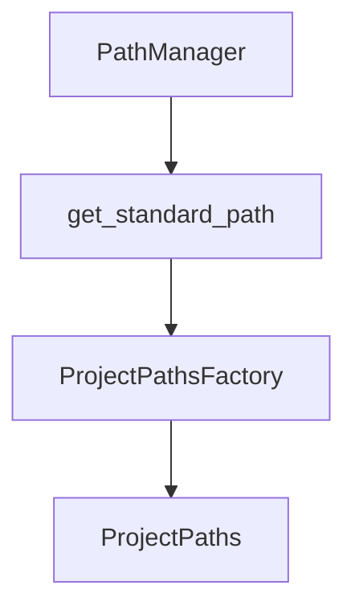

# Config Manifest

**[> Architecture Deep Dive (ARCHITECTURE.md)](ARCHITECTURE.md)** — config loading pipeline, two-stage validation, defaults cascade, path resolution, DI system, and 20 caveats.

## Overview

What: Configuration and initialization surfaces for Agent Actions—schema models, environment
settings, DI container wiring, project initialization, and path management.

Why: Provides a single, consistent source of truth for how workflows are defined, validated,
and wired at runtime.

How: Models (schema + env) define inputs, path resolution anchors IO, and DI wiring connects
orchestration, prompts, and processing to concrete implementations.

## Sub-Modules

| Sub-Module | Description |
|------------|-------------|

## Modules

| Name | Type | Description | Signals |
|------|------|-------------|---------|
| `__init__.py` | Module | Direct import of `WorkflowConfig` from `schema` (backward-compat alias `WorkflowConfigV2`). | `configuration` |
| `schema.py` | Module | Workflow configuration schema (Pydantic models) with `extra="forbid"` on `WorkflowConfig`, `ActionConfig`, `DefaultsConfig`, `StorageConfig` (the workflow's own `storage:` block, strict-typed because its consumer reads the raw dict) and `ChunkConfig` (the `chunk_config:` block, strict-typed because an undeclared key there is silently replaced by the hardcoded default at split time) and `VersionConfig` (the `versions:` block, validated by the render step because expansion strips it before `WorkflowConfig` runs), `ActionConfig.schema_options` (the schema names a `schema: dispatch_task(...)` can choose from), cross-validation (tool `impl` required, duplicate/dangling dep checks, circular dependency detection; a cycle message names the branch of each included action in it). `dump_defaults` gives the keys a `defaults:` block sets, as the expander reads them. `ActionConfig.include_context` (alias `_include`) holds the origin of an included action, set by the render step; it enters no config hash or stamp. `branch_origins` writes one sentence per branch naming the actions it defines (`'a', 'b' come from branch 'x' (branches/x.yml).`), for the cycle message and the preflight `Origin:`. `ExpectConfig` binds an expectation suite to an action via `ActionConfig.expect`, including `judge_budget: int \| None` (caps real `llm_judge` calls per action per run; `None` is uncapped, and unlike `max_iterations`/`on_exhausted` it is allowed under `repair: none`). `ActionConfig` and `DefaultsConfig` take `record_concurrency` (int 1-32, strict). `RetryConfig` takes `base_delay` (> 0, ≤ 300 s, default 1.0) and `max_delay` (> 0, ≤ 3600 s, default 60.0) and refuses a `max_delay` below `base_delay`. `vendor_params` (a mapping) is declared on `ActionConfig` and `DefaultsConfig`. `ExpectConfig.judge_mode` (`batch` or `online`, omitted as the action runs) chooses how a batch action's `llm_judge` calls are sent. Internal `_sends_elsewhere` and `_gathers` (`sends_elsewhere`, `gathers`) mark an action whose guard filter sends a record to another branch and one where such records come back (`record/elsewhere.py`). | `configuration`, `validation` |
| `includes.py` | Module | Include of a shared branch file. `expand_includes` reads `branches/<name>.yml` for each `- include: <name>` entry, and `expand_workflow_includes` (pure: parsed data in, parsed data out) validates the branch file (`parse_branch`: keys, `branch:` equal to the file stem, each action an `ActionConfig`, action names that can take a `__` prefix and are not reserved (`RESERVED_AGENT_NAMES`, refused with the text a workflow without an include gives), prompt store prompts only, no Jinja, no include), the entry keys (`include`, `as`, `inputs`, `defaults`, `override`, `remove`), the input bindings and the names, then puts the branch actions in place of the entry with an `_include` origin. `as: <instance>` names the instance (`_prefix`: the action-name rule; instance names are unique, an include without `as:` taking its branch name): each branch action becomes `<instance>__<name>`, an input may be bound to any action (without `as:` only to one of its own name), and `_bound` renames every short name (branch actions, their version names, inputs and the version names of a versioned target) in the action's `dependencies`, `context_scope` lists, guard clause (`renamed_clause`: only the root of a dotted field path, outside quoted strings and numbers; the text is otherwise kept), `version_consumption.source` and inline `llm_judge` `context` (`rename_judge_contexts`), and in the include's `defaults:`; a trailing `?` on a bare name is kept. The map rides as `_include.names`. A short name that is also a workflow action is refused (`_refuse_short_name_clashes`), except an input bound to the action of its own name. `Inclusion.label`, `final` and `local` name an entry and translate names. `instance_names` reads an action's map; the render step calls `alias_prompts` (the alias header of `prompt.aliases` before each prompt of an `as:` include) and `rename_schema_judge_contexts` (the `llm_judge` contexts of the action's own copy of its compiled schema, on its fields and in its `expectations:` block). `override:` maps a branch action to whole keys that replace the branch value (`null` removes the key; `name` and a key that is not an action field are refused, `schema` and `schema_name` count as one key, and the merged action must validate as `ActionConfig`); `remove:` leaves branch actions out; an override or removal that names no branch action is refused with the nearest name, and one action cannot be under both. `defaults:` is validated as `DefaultsConfig` (`data_source` is refused: it is a setting of the workflow) and is carried, not copied, as `_include.defaults` on each included action; the expander lays it over the workflow defaults with `layered_defaults`. `check_include_reads` runs on the finished render: a host action reads only declared `outputs`, a branch action reads only its branch, the actions its `inputs` bind and their versions; inside an `as:` include a read (or, before the workflow validates, a dependency) of a name that is no action, binding or framework namespace is refused naming the branch, the instance and its short names, and single-brace prompt text is left to the static checks, which report it as in a workflow without an include. A branch action that reads a bound workflow action by its workflow name, not through its input, is refused when `_bound` renames it (`_LookedUp` keeps the names a rename looked up and missed); a removal refusal names the include by `Inclusion.label` and the reader by its short name. A read includes the `llm_judge` context of the `expect` block the action gets from the expander: `merge_expect` over the defaults (the workflow's keys over the project's), then `adapt_inherited_expect` with the kind and granularity from `inherited_routing_kind` and `resolved_granularity`, so a block with no rule of its own on a tool or FILE action reads nothing; for an included action the defaults are its instance defaults over those (`action_defaults`, by `layered_defaults`). The `context_scope` an action inherits counts too. `_Levels` computes it with the functions the load calls, in the load's order: `project_action_defaults` and `merge_workflow_defaults` (the workflow's defaults over the project's), `ActionExpander.defaults_for` (the include's defaults), `inherited_context_scope` (the action's raw directives over the defaults'), `project_agent_config` with `merge_over_agent_defaults` (the project scope for an action left with none), then `normalize_context_scope`; only then are the `observe`, `passthrough` and `drop` lists taken as reads. So an own directive that is null or not a list replaces the inherited one and reads nothing, and a workflow `context_scope:` that is null or empty leaves the project scope in force: a branch action that reads a host action through the workflow, project or include defaults is refused unless the action is a declared input, a host action that reads a branch internal through the workflow defaults is refused, and the refusal names the level in `(from 'context_scope' under ...)`. A `seed` reads nothing; an unknown directive, a defaults level that the load refuses, and a project `context_scope` that is not a mapping are left to the load, so the user gets the message a workflow with no include gets. A read of a removed action is refused first, when the defaults validate, on each action that validates as `ActionConfig`: a branch reader names every reader in the branch, with the defaults level of each reader that only inherits the read (the advice then adds an edit of those defaults, and says that in an override `null` takes away an inherited directive while a list is added to it), and a host reader is told the output is left out under `remove:`; a binding to a removed output is refused at expansion. The other checks run only on a workflow that validates as `WorkflowConfig`; so no check reads a malformed shape, and a malformed workflow is left to the validation after the render, which refuses it with the message it gives a workflow with no include. A hand-written `_include` is refused in a workflow and in a branch file; `schema_name:` in a branch action is validated as `schema:`, as the render step reads it. Every refusal is a `ConfigurationError` with the workflow file under `file_path` (shown on the CLI `File:` line) and the action under `action_name`. Every refusal names the workflow file in its text; a refusal about a branch file or a branch action also names the branch file and the action (a branch-file refusal begins `Branch '<name>' (branches/<name>.yml), included in <workflow file>`, then `, action '<action>'` when it is about one action). A dependency cycle is the exception: `WorkflowConfig` refuses it and names only the branch file of each branch action in it. `has_include` tells whether parsed data has an include entry. | `configuration`, `validation` |
| `environment.py` | Module | Environment settings with validation (validators raise `ValueError` for Pydantic compatibility). | `configuration`, `validation` |
| `paths.py` | Module | `PathManager` with project-boundary-guarded `clean_path()`, scoped root cache, and fallback heuristic warning. | `paths`, `configuration` |
| `path_config.py` | Module | Path configuration: `load_project_config`, `resolve_project_root` (cwd fallback), `get_tool_dirs` (tool dir resolution), `get_schema_path`. | `paths`, `configuration` |
| `init.py` | Module | `ProjectInitializer` for scaffolding new projects (atomic `create_file`, `yaml.safe_dump`). | `configuration`, `filesystem` |
| `interfaces.py` | Module | Loader/processor/generator interfaces and async mixins. | `configuration`, `interfaces` |
| `defaults.py` | Module | Centralized default constants grouped by domain (`StorageDefaults`, `LockDefaults`, `OllamaDefaults`, `LLMDefaults` (the 600 s request timeout an action gets when it sets none, except on a declared endpoint, which keeps its `timeout_seconds`; and the 5 s connect limit for the SDKs that take an `httpx.Timeout`), `ApiDefaults`, `SeedDataDefaults`, `PromptDefaults`, `DocsDefaults`). Zero imports—safe to import anywhere. | `config`, `defaults` |
| `types.py` | Module | Typed dictionaries (`ActionConfigDict`, `ActionEntryDict`, `ActionConfigMap`, `ContextScopeDict`, `GuardConfigDict`, `HitlConfigDict`) and enums (`Granularity`, `RunMode`) for config structures. `ActionConfigDict.vendor_params` is the merged block. | `config`, `workflow`, `processing` |
| `project_paths.py` | Module | `ProjectPathsFactory` and `ProjectPaths` for project directory resolution. Moved from `cli/`. | `paths`, `validation`, `output` |
| `manager.py` | Module | `ConfigManager` for workflow config assembly: YAML loading, template rendering, schema validation, config merging, dependency inference, and execution order determination. The defaults steps are module functions that the include read check calls too: `project_action_defaults`, `merge_workflow_defaults`, `project_agent_config`, `merge_over_agent_defaults`. `vendor_params` merges key by key from the project's `default_agent_config` to `defaults:` (`merged_defaults`) and again in `merge_agent_configs`. Given `rendered_workflow`, `load_configs` parses that text and does not render the workflow file again; after `load_configs`, `rendered_workflow` holds the workflow text it parsed, so a caller can hand it on. An LLM action with no `model_vendor` is refused with the action as `action_name` and `missing_fields`. | `configuration`, `workflow` |

## Flows

### Configuration Bootstrap

| Module | Symbol | Type | Description |
|--------|--------|------|-------------|
| `environment.py` | `EnvironmentConfig` | Class | Environment settings with validation helpers. |

### Project Path Resolution

Key Functions

| Module | Symbol | Type | Description |
|--------|--------|------|-------------|
| `paths.py` | `PathManager.get_standard_path` | Method | Resolve standard project/agent paths. |
| `paths.py` | `PathManager.get_project_root` | Method | Locate the project root (caches only for CWD lookups). |
| `paths.py` | `PathManager.clean_path` | Method | Remove files/dirs with project-boundary guard. |
| `path_config.py` | `load_project_config` | Function | Load project-level config from YAML. |
| `path_config.py` | `resolve_project_root` | Function | Resolve project root, defaulting to `Path.cwd()`. |
| `path_config.py` | `get_project_name` | Function | Return `project_name` from project config, or `None` with warning if absent. |
| `path_config.py` | `get_tool_dirs` | Function | Resolve tool directory names from project config, defaulting to `["tools"]`. |
| `path_config.py` | `warn_unread_project_keys` | Function | Report each top-level `agent_actions.yml` key that no reader takes. |

## Cross-Module Touchpoints

| Package | Why it matters |
|---------|----------------|
| `agent_actions/workflow` | Consumes `WorkflowConfig` (schema) and DI-provisioned runners. Uses `WorkflowRuntimeConfig` for execution context. |
| `agent_actions/validation` | Uses config models and environment settings for startup checks. |
| `agent_actions/prompt` | Relies on resolved paths and DI wiring for prompt preparation. |
| `agent_actions/output` | Uses path resolution to locate IO and schema artifacts. |
| `agent_actions/cli` | Reads config and project paths to render/run workflows. |

## Project Surface

| Symbol | File | Interaction | Config Key |
|--------|------|-------------|------------|
| `VersionConfig` | `agent_config/{workflow}.yml` | Validates | `actions[].versions` (applied by the render step) |
| `WorkflowConfig` | `agent_config/{workflow}.yml` | Reads | `name`, `description`, `version`, `defaults`, `actions`, `tool_path`, `storage` (extras refused) |
| `ActionConfig` | `agent_config/{workflow}.yml` | Validates | `name`, `intent`, `kind`, `impl`, `model_vendor`, `model_name`, `schema`, `guard`, `dependencies` |
| `DefaultsConfig` | `agent_config/{workflow}.yml` | Validates | `model_vendor`, `model_name`, `granularity`, `run_mode`, `on_empty`, `data_source`, `request_timeout` (positive seconds, also on `ActionConfig`; unset or null, 600, except on a declared endpoint, which keeps its `timeout_seconds`) |
| `ActionConfig.vendor_params`, `DefaultsConfig.vendor_params` | `agent_config/{workflow}.yml`, `agent_actions.yml` | Validates | `actions[].vendor_params`, `defaults.vendor_params`, `default_agent_config.vendor_params` (a mapping; merged key by key, action over defaults over project; its keys are checked against the vendor's request at preflight) |
| `EnvironmentConfig` | `.env` | Reads | `OPENAI_API_KEY`, `ANTHROPIC_API_KEY`, `GEMINI_API_KEY`, `AGENT_ACTIONS_ENV` |
| `PathManager.get_project_root` | `agent_actions.yml` | Reads | — |
| `PathManager.get_standard_path` | `agent_io/target/{action}/` | Reads | — |
| `PathManager.clean_path` | `agent_io/target/{action}/` | Writes | — |
| `load_project_config` | `agent_actions.yml` | Reads | `project_name`, `schema_path`, `tool_path`, `seed_data_path`, `seed_data_paths`, `logging` |
| `ConfigManager.get_user_agents` | `agent_actions.yml` | Validates | `endpoints` (each entry's `url`, `auth`, `headers`, `timeout_seconds`; refused with the endpoint name and key by `llm.config.endpoints.load_project_endpoints`, which also fills the per-project endpoint registry) |
| `get_tool_dirs` | `agent_actions.yml` | Reads | `tool_path` |
| `get_schema_path` | `agent_actions.yml` | Reads | `schema_path` |
| `get_seed_data_path` | `agent_actions.yml` | Reads | `seed_data_path` |
| `get_seed_data_paths` | `agent_actions.yml` | Reads, refuses a missing or outside folder | `seed_data_paths` |
| `seed_search_folders`, `resolve_seed_file` | `seed_data/`, `<seed_data_paths>/` | Reads; the one search the loader, preflight, the editor and `inspect` share | `seed_data_path`, `seed_data_paths` |
| `get_project_name` | `agent_actions.yml` | Reads | `project_name` |
| `warn_unread_project_keys` | `agent_actions.yml` | Validates | `output_storage` |
| `ProjectInitializer.init_project` | `agent_actions.yml` | Writes | `project_name`, `default_agent_config`, `schema_path`, `tool_path`, `seed_data_path` |
| `ProjectPathsFactory.create_project_paths` | `prompt_store/{workflow}.md` | Reads | — |
| `ConfigManager.load_configs` | `agent_config/{workflow}.yml` | Reads | `tool_path` |
| `expand_includes` | `branches/{name}.yml` | Reads, validates | `branch`, `description`, `inputs`, `outputs`, `actions` |
| `expand_workflow_includes` | `agent_config/{workflow}.yml` | Validates | `actions[].include`, `actions[].inputs`, `actions[].defaults`, `actions[].override`, `actions[].remove` |
| `ConfigManager._resolve_dotenv` | `.env` | Reads | — |

**Internal only**: `ActionKind`, `MergePattern`, `VersionConsumptionConfig`, `RetryConfig`, `ExpectConfig`, `HitlConfig`, `PathType`, `PathConfig`, `PathManagerError`, `ProjectRootNotFoundError`, `PathManagerValidationError`, `ILoader`, `IProcessor`, `IGenerator`, `IDataLoader`, `ISourceDataLoader`, `Granularity`, `RunMode`, `ContextScopeDict`, `GuardConfigDict`, `HitlConfigDict`, `ActionConfigDict`, `ActionEntryDict`, `ActionConfigMap`, `ProjectPaths`, `StorageDefaults`, `LockDefaults`, `OllamaDefaults`, `ApiDefaults`, `SeedDataDefaults`, `PromptDefaults`, `DocsDefaults` -- no direct project surface.

## Dependencies

| Package | Direction | Why |
|---------|-----------|-----|
| `agent_actions/validation` | inbound | Validators consume config models and environment settings for startup checks. |
| `agent_actions/workflow` | inbound | Consumes `WorkflowConfig`, DI-provisioned runners, and `ConfigManager` output. |
| `agent_actions/prompt` | inbound | Relies on resolved paths and DI wiring for prompt preparation. |
| `agent_actions/output` | inbound | Uses path resolution to locate IO and schema artifacts. |
| `agent_actions/cli` | inbound | Reads config and project paths to render/run workflows. |
| `agent_actions/errors` | outbound | Raises `ConfigurationError`, `ConfigValidationError`, `FileSystemError`, `FileLoadError`, `TemplateRenderingError`. |
| `agent_actions/llm/config` | outbound | `ConfigManager.get_user_agents` validates the project's `endpoints:` block with `load_project_endpoints`. |
| `agent_actions/guards` | outbound | `GuardParser`/`parse_guard_config` used by `ActionConfig.validate_guard`. |
| `agent_actions/logging` | outbound | Fires config load and validation events via `fire_event`. |
| `agent_actions/utils` | outbound | Uses `FileHandler`, `resolve_absolute_path`, constants. |
| `agent_actions/validation` | outbound | `check_include_reads` reads the references of each action with `ReferenceExtractor`, imported only when a workflow has an include. |
| `agent_actions/output` | outbound | `check_include_reads` reads `llm_judge` context references with `collect_judge_context_refs`. |
| `agent_actions/prompt` | outbound | `alias_prompts` builds the alias header with `prompt.aliases.with_alias_header`. |
| `pydantic` | outbound | Schema models and field validation. |
| `pydantic_settings` | outbound | `EnvironmentConfig` settings loader. |
| `yaml` | outbound | YAML parsing for config files. |
