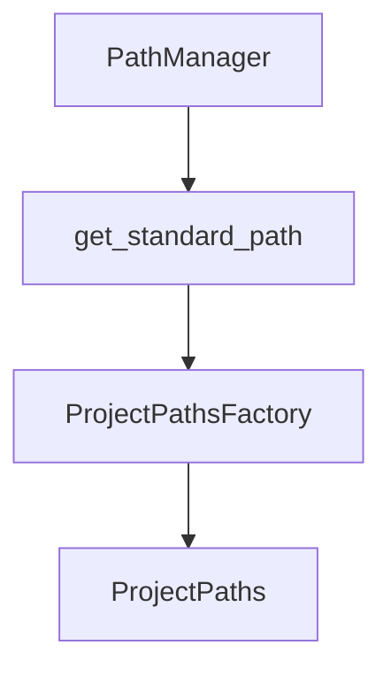

# Config Manifest

**[> Architecture Deep Dive (ARCHITECTURE.md)](ARCHITECTURE.md)** — config loading pipeline, two-stage validation, defaults cascade, path resolution, DI system, and 20 caveats.

## Overview

What: Configuration and initialization surfaces for Agent Actions—schema models, environment
settings, DI container wiring, project initialization, and path management.

Why: Provides a single, consistent source of truth for how workflows are defined, validated,
and wired at runtime.

How: Models (schema + env) define inputs, path resolution anchors IO, and DI wiring connects
orchestration, prompts, and processing to concrete implementations.

## Sub-Modules

| Sub-Module | Description |
|------------|-------------|

## Modules

| Name | Type | Description | Signals |
|------|------|-------------|---------|
| `__init__.py` | Module | Direct import of `WorkflowConfig` from `schema` (backward-compat alias `WorkflowConfigV2`). | `configuration` |
| `schema.py` | Module | Workflow configuration schema (Pydantic models) with `extra="forbid"` on `WorkflowConfig`, `ActionConfig`, `DefaultsConfig`, `StorageConfig` (the workflow's own `storage:` block, strict-typed because its consumer reads the raw dict), `WorkflowConfig.batch_preparation_concurrency` (`BatchPreparationConcurrency`, an int 1-50, strict for the same reason: the most batch actions of a step that prepare at once) and `ChunkConfig` (the `chunk_config:` block, strict-typed because an undeclared key there is silently replaced by the hardcoded default at split time; its `field` names one top-level field of a staged record to split, as `source.<name>` or `<name>`, read by `split_field_name`) and `VersionConfig` (the `versions:` block, validated by the render step because expansion strips it before `WorkflowConfig` runs), `ActionConfig.schema_options` (the schema names a `schema: dispatch_task(...)` can choose from), cross-validation (tool `impl` required, duplicate/dangling dep checks, a dangling name that is a short name of an `as:` include naming the final names that end in it, circular dependency detection; a cycle message names the branch of each included action in it). `dump_defaults` gives the keys a `defaults:` block sets, as the expander reads them. `refuse_agents_format` refuses a workflow file in the `agents:` format (a top-level `agents:` key, or a top-level key that holds an `agents:` list or a list of `agent_type` entries, in a file with no `actions:`) with a `ConfigurationError` that names the file under `file_path` and the key, and tells the author to write a `name:` and an `actions:` list; the render step calls it right after the parse. `refuse_undeclared_keys` names each undeclared key, the declared key it resembles and the keys the block takes; `DefaultsConfig`, `VersionConfig`, `ChunkConfig`, `StorageConfig`, `WorkflowConfig` and `DefaultAgentConfig` use it. `ActionConfig.include_context` (alias `_include`) holds the origin of an included action, set by the render step; it enters no config hash or stamp. `branch_origins` writes one sentence per branch naming the actions it defines (`'a', 'b' come from branch 'x' (branches/x.yml).`), for the cycle message and the preflight `Origin:`. `ExpectConfig` binds an expectation suite to an action via `ActionConfig.expect`, including `judge_budget: int \| None` (caps real `llm_judge` calls per action per run; `None` is uncapped, and unlike `max_iterations`/`on_exhausted` it is allowed under `repair: none`). `ActionConfig` and `DefaultsConfig` take `record_concurrency` (int 1-32, strict). `DefaultsConfig.guard_timeout` (seconds, > 0, strict) is the time each condition guard has on one record when the guard sets no `timeout`. `RetryConfig` takes `base_delay` (> 0, ≤ 300 s, default 1.0) and `max_delay` (> 0, ≤ 3600 s, default 60.0) and refuses a `max_delay` below `base_delay`. `vendor_params` (a mapping) is declared on `ActionConfig` and `DefaultsConfig`. `ExpectConfig.judge_mode` (`batch` or `online`, omitted as the action runs) chooses how a batch action's `llm_judge` calls are sent. Internal `_sends_elsewhere` and `_gathers` (`sends_elsewhere`, `gathers`) mark an action whose guard filter sends a record to another branch and one where such records come back (`record/elsewhere.py`). Internal `_builtin` (`builtin`) holds the settings of a tool agac runs itself (`route`, `pick`). `ActionConfig` and `DefaultsConfig` read both optional `observe` forms into plain references plus `context_scope.optional` (`split_optional_observe`), and refuse an optional wildcard, an optional `passthrough`/`drop` entry, an optional entry that a `drop` of the same reference removes, or a hand-written `context_scope.optional` block as a field error. `ActionConfig` and `DefaultsConfig` take `context_block` (`auto`, `all`, `none`). `OutputConfig` models one entry of the workflow's `outputs:` block (written to a database table by `connections.export`). | `configuration`, `validation` |
| `includes.py` | Module | Include of a shared branch file. `expand_includes` reads `branches/<name>.yml` for each `- include: <name>` entry, and `expand_workflow_includes` (pure: parsed data in, parsed data out) validates the branch file (`parse_branch`: keys, `branch:` equal to the file stem, each action an `ActionConfig`, action names that can take a `__` prefix, prompt store prompts only, no Jinja, no include), the entry keys (`include`, `as`, `inputs`, `defaults`, `override`, `remove`) and, in `_inclusion`, that no branch action has a reserved name (`RESERVED_AGENT_NAMES`, refused with the text a workflow without an include gives, naming the branch, the include and its `as:` instance), the input bindings and the names, then puts the branch actions in place of the entry with an `_include` origin. `as: <instance>` names the instance (`_prefix`: the action-name rule; instance names are unique, an include without `as:` taking its branch name): each branch action becomes `<instance>__<name>`, an input may be bound to any action (without `as:` only to one of its own name), and `_bound` renames every short name (branch actions, their version names, inputs and the version names of a versioned target) in the action's `dependencies`, `context_scope` lists (an optional observe entry written as a mapping by its `field`), guard clause (`renamed_clause`: only the root of a dotted field path, outside quoted strings and numbers; the text is otherwise kept), `version_consumption.source` and inline `llm_judge` `context` (`rename_judge_contexts`), and in the include's `defaults:`; a trailing `?` on a bare name is kept. The map rides as `_include.names`. A short name that is also a workflow action is refused (`_refuse_short_name_clashes`), except an input bound to the action of its own name. `Inclusion.label`, `final` and `local` name an entry and translate names. `instance_names` reads an action's map; the render step calls `alias_prompts` (the alias header of `prompt.aliases` before each prompt of an `as:` include) and `rename_schema_judge_contexts` (the `llm_judge` contexts of the action's own copy of its compiled schema, on its fields and in its `expectations:` block). `override:` maps a branch action to whole keys that replace the branch value (`null` removes the key; `name` and a key that is not an action field are refused, `schema` and `schema_name` count as one key, and the merged action must validate as `ActionConfig`); `remove:` leaves branch actions out; an override or removal that names no branch action is refused with the nearest name, and one action cannot be under both. `defaults:` is validated as `DefaultsConfig` (`data_source` is refused: it is a setting of the workflow) and is carried, not copied, as `_include.defaults` on each included action; the expander lays it over the workflow defaults with `layered_defaults`. `check_include_reads` runs on the finished render: a host action reads only declared `outputs`, a branch action reads only its branch, the actions its `inputs` bind and their versions; inside an `as:` include a read (or, before the workflow validates, a dependency) of a name that is no action, binding or framework namespace is refused naming the branch, the instance and its short names, and single-brace prompt text is left to the static checks, which report it as in a workflow without an include. A branch action that reads a bound workflow action by its workflow name, not through its input, is refused when `_bound` renames it (`_LookedUp` keeps the names a rename looked up and missed); a removal refusal names the include by `Inclusion.label` and the reader by its short name. A read includes the `llm_judge` context of the `expect` block the action gets from the expander (a named suite's rules read from `_Levels.root`, and preferred over an inline list as the run prefers them; a suite that does not load reads nothing; inside an `as:` include, where a suite's rules are not renamed, a short name that only a suite reads is refused by `_refuse_short_name_in_suite`, which gives the final name to write or says to move the rule to the action's schema or an inline list): `merge_expect` over the defaults (the workflow's keys over the project's), then `adapt_inherited_expect` with the kind and granularity from `inherited_routing_kind` and `resolved_granularity`, so a block with no rule of its own on a tool or FILE action reads nothing; for an included action the defaults are its instance defaults over those (`action_defaults`, by `layered_defaults`). The `context_scope` an action inherits counts too. `_Levels` computes it with the functions the load calls, in the load's order: `project_action_defaults` and `merge_workflow_defaults` (the workflow's defaults over the project's), `ActionExpander.defaults_for` (the include's defaults), `inherited_context_scope` (the action's raw directives over the defaults'), `project_agent_config` with `merge_over_agent_defaults` (the project scope for an action left with none), then `normalize_context_scope`; only then are the `observe`, `passthrough` and `drop` lists taken as reads. So an own directive that is null or not a list replaces the inherited one and reads nothing, and a workflow `context_scope:` that is null or empty leaves the project scope in force: a branch action that reads a host action through the workflow, project or include defaults is refused unless the action is a declared input, a host action that reads a branch internal through the workflow defaults is refused, and the refusal names the level in `(from 'context_scope' under ...)`. A `seed` reads nothing; an unknown directive, a defaults level that the load refuses, and a project `context_scope` that is not a mapping are left to the load, so the user gets the message a workflow with no include gets. A read of a removed action is refused first, when the defaults validate, on each action that validates as `ActionConfig`: a branch reader names every reader in the branch, with the defaults level of each reader that only inherits the read, through `context_scope` or an inherited `expect` (`_scope_origin`; the advice then adds an edit of those defaults, and says that in an override `null` takes away an inherited directive while a list is added to it), and a host reader is told the output is left out under `remove:`; a binding to a removed output is refused at expansion. The other checks run only on a workflow that validates as `WorkflowConfig`; so no check reads a malformed shape, and a malformed workflow is left to the validation after the render, which refuses it with the message it gives a workflow with no include. A hand-written `_include` is refused in a workflow and in a branch file; `schema_name:` in a branch action is validated as `schema:`, as the render step reads it. Every refusal is a `ConfigurationError` with the workflow file under `file_path` (shown on the CLI `File:` line) and the action under `action_name`. Every refusal names the workflow file in its text; a refusal about a branch file or a branch action also names the branch file and the action (a branch-file refusal begins `Branch '<name>' (branches/<name>.yml), included in <workflow file>`, then `, action '<action>'` when it is about one action). A dependency cycle is the exception: `WorkflowConfig` refuses it and names only the branch file of each branch action in it. `has_include` tells whether parsed data has an include entry. A router (a built-in route action, `is_router`) may be read from any instance: the first action of each of its branches reads its case. Two iterations of one loop read each other (`Inclusion.loop`, from the include entry's internal `_loop` key, rides as `_include.loop`). `inherited_granularities` gives the granularity each action runs at once it inherits the defaults, with `_Levels`. `workflow_label()` names the workflow file as a refusal names it. | `configuration`, `validation` |
| `routes.py` | Module | `- route:` and `- join:` entries. `expand_routes` (after the includes) turns `- route: <name>` (`on: <action>.<field>`, `cases:` value → include instance or list of entry actions, required `default:` branch or `filter`; YAML's bare `on` key arrives as `True` and is read as `on`) into a built-in `agac.route` tool action that observes the field, depends on its action and writes `case` (inline schema with the case enum; under `default: filter` an ordinary guard `<field> IN [...]`, `passthrough_on_error: false`), and gives each entry action the guard `<router>.case == "<case>"` (`default` for the default branch), `_sends_elsewhere`, the router as a dependency and `<router>.case` in its observe list. The entries of an instance are its actions that read no other action of it. `- join: <name>` (`of:` actions, or an instance with one output) becomes a built-in `agac.pick` action that depends on and observes `<action>.*` of each, with `_gathers`. Refuses: no default, a case or default naming no branch or an unknown name, a non-string, empty, quoted or `default` case value, an entry in two cases, an entry with its own guard or that is the field's action, an action reading two cases' branches (dependency or context_scope) short of a gatherer, unknown keys, and a router or join name that is taken, breaks the name rule or ends in `_<digits>` (`entry_name`, which `loops.py` uses too). `finish_routes` (after schema compile) refuses a case value outside the field's `enum` and, under `default: filter`, an enum value with no case; and gives a join without a schema the union of its sources' compiled fields, none required, `additionalProperties: true`. A router or join the expansion makes is an action a later entry can name (`on:`, `cases:`, `default:`, `of:`); a join refuses a versioned source; `finish_routes` refuses a router on a field whose schema type is not `string` or whose `enum` holds a non-string (`null` is accepted in a type list and an enum, and the message names the type when the type is the cause); `_warn_partial_joins` warns of a join that covers some but not all branches of one router, except a join that closes a router inside one branch of it. Under `default: filter` the router guard also lets through a value that is set and is no string, so `route_case` fails it. | `config`, `llm.providers`, `record` |
| `loops.py` | Module | `- loop:` entries. `unroll_loops` (called by `expand_workflow_includes` before it reads the include entries) checks a `- loop: <name>` entry (`include` a branch file, `max_iterations` 1-10, `inputs`, `feedback` input → branch action listed under `outputs`, `until` a guard clause on branch fields up to `result` (parsed with `WhereClauseParser`, `clause_paths`), `result` a branch output with no versions; no own guard on an entry action, no guard or version source reading a feedback input) and replaces it with `max_iterations` include entries `as: <name>_iter<k>` (`instance_name`; `_iter` keeps an instance name from ending in `_<digits>`), each carrying the internal key `_loop` (refused when written), plus a built-in `agac.pick` action named after the loop that depends on and observes `<name>_iter<k>__<result>.*` of every iteration, last first, with `_gathers` and the loop settings under `_builtin.loop`. A feedback input is bound to the previous iteration's action, and in iteration 1 to the pick as a placeholder. `expand_loops` (after the includes) then, in iteration 1, binds each feedback input to `none` in `_include.names` (so the alias header writes ``) and drops the placeholder from `dependencies` and the `context_scope` lists; from iteration 2, each entry action (one that depends on no action of its instance) depends on the previous iteration's result only and gets the guard `NOT (<until renamed to the previous iteration>)` (`renamed_clause`), `on_false: filter`, `passthrough_on_error: false`, and `_sends_elsewhere`. `finish_loops` (after schema compile) refuses an `until` field its action's schema does not declare, a branch action that inherits File granularity (`includes.inherited_granularities`), and an action outside the loop that reads an iteration's action (dependency, `context_scope`, guard or prompt); and gives the pick the result's compiled schema. `loop_of` reads the loop settings of an iteration action (`_include.loop`) or a pick (`_builtin.loop`); `is_loop_pick` tells a loop's pick. | `config`, `llm.providers`, `record` |
| `environment.py` | Module | Environment settings with validation (validators raise `ValueError` for Pydantic compatibility). | `configuration`, `validation` |
| `paths.py` | Module | `PathManager` with project-boundary-guarded `clean_path()`, scoped root cache, and fallback heuristic warning. | `paths`, `configuration` |
| `path_config.py` | Module | Path configuration: `load_project_config`, `project_config_file`, `resolve_project_root` (cwd fallback), `get_tool_dirs` (tool dir resolution), `get_schema_path`. | `paths`, `configuration` |
| `init.py` | Module | `ProjectInitializer` for scaffolding new projects (atomic `create_file`, `yaml.safe_dump`). | `configuration`, `filesystem` |
| `interfaces.py` | Module | Loader interfaces and async mixins. | `configuration`, `interfaces` |
| `defaults.py` | Module | Centralized default constants grouped by domain (`StorageDefaults`, `LockDefaults`, `OllamaDefaults`, `LLMDefaults` (the 600 s request timeout an action gets when it sets none, except on a declared endpoint, which keeps its `timeout_seconds`; and the 5 s connect limit for the SDKs that take an `httpx.Timeout`), `ApiDefaults`, `SeedDataDefaults`, `PromptDefaults`, `DocsDefaults`). Zero imports—safe to import anywhere. | `config`, `defaults` |
| `types.py` | Module | Typed dictionaries (`ActionConfigDict`, `ActionEntryDict`, `ActionConfigMap`, `ContextScopeDict`, `GuardConfigDict`, `HitlConfigDict`) and enums (`Granularity`, `RunMode`) for config structures. `ActionConfigDict.vendor_params` is the merged block. | `config`, `workflow`, `processing` |
| `project_paths.py` | Module | `ProjectPathsFactory` and `ProjectPaths` for project directory resolution. Moved from `cli/`. | `paths`, `validation`, `output` |
| `sandbox.py` | Module | Sandbox mode, one flag for the process: `sandbox_mode(enabled)` sets it for a block (the CLI's `--sandbox` holds it on the Click context), `is_active()` reads it. `run_dir(io_dir)` is the folder holding a run's `target/`, `logs/` and status file (`agent_io/sandbox/` in the mode, else `agent_io/`), `status_file` is `.agent_status.json` in it, and `store_file(io_dir, workflow)` is `store/<workflow>.sandbox.db` in the mode, else `store/<workflow>.db`, and `is_sandbox_store(path)` tells a store of the first kind by that suffix; every path a run writes or a read command reads is derived from these. `point_at_mock(action_configs)`, called by `workflow.config_pipeline.load_workflow_configs` after expansion while the mode is on, sets `model_vendor: agac-provider` on each `kind: llm` action (its `model_name` stays) and `_sandbox_auto_approve` (`AUTO_APPROVE_KEY`) on each `kind: hitl` action; tool and other actions are unchanged. It returns each LLM action with the base name of its version group (`version_base_name` of a versioned action), or None. `scenario_choice(source)` (entered on the Click context by the CLI's `--scenario` option, on `run` and `retry` only) has each load in it follow a scenario and holds one `Tally` for the command; `load_scenario(project_root, llm_actions, tools, workflow)`, called by `load_workflow_configs` right after `point_at_mock` with what it returned and the workflow's name, reads and checks it (no `--scenario`: `sandbox.<workflow>.yml`, else `sandbox.yml`, else `happy`) with `llm.providers.agac.scenario.load` before any call, and `scenario()` hands it to the mock (None outside sandbox mode, or for a command that took no `--scenario` option). `check_scenario_outputs(schemas, action_configs)`, called after pre-flight by `AgentWorkflow` and by `WorkflowInspector.validate` (so `agac inspect --sandbox` refuses what a run refuses), refuses a `pin` or `break_rules` an LLM action's output schema cannot take (`Scenario.check_outputs`). `attach_store(store)`, called by `AgentWorkflow` once the store is open, has the scenario count attempts there; `forget_attempts(store, action, records)` clears the counts of one action (`ActionExecutor._forget_what_it_did`, on `--rerun` and every other reset), of some records at one action (`ActionExecutor._forget_records_no_longer_staged`, for the records gone from the staged input) or of all (`--fresh`), in sandbox mode only. `scenario_summary(only_after_calls)` is the command's one `SANDBOX scenario` line, after which the tally starts again; with `only_after_calls`, as a command that an error stopped asks, it is None when the mock answered no call. `wait_between_passes()` is the time `agac run --sandbox --wait` waits between two passes when `--poll` is not given: 0, or the scenario's `batch.complete_after_seconds` up to 1 second. `run_flags()` is `flag()` plus the `--scenario` given, for a printed `agac run` or `agac retry`. `tool_actions(action_configs)` returns each `kind: tool` action as a `scenario.Tool`: its version group and `cannot_stub`, why the mock cannot build its output (a built-in tool, `granularity: File`, or no `json_output_schema`), or None; `load_workflow_configs` passes it to `load_scenario` as *tools*, so a scenario names tool actions and can stub one (`actions.<tool>.stub: true`). No config is changed for a stubbed tool: `stubs(action)` and `stubbed_tools()` read the loaded scenario (False and empty outside sandbox mode), for `ToolClient`, the progress line and `agac inspect`. `stub_notice()` is the text of the `SANDBOX` line naming the stubbed tools, with `(the stubs come from <file>, the rest from preset <name>)` when a preset kept the project's stubs; None when nothing is stubbed, and None after its first line in one `scenario_choice` block (one command), which starts its own count as it starts its own `Tally`. `AgentWorkflow` prints it after `check_scenario_outputs`. `scenario_choice` is entered by `--scenario` on `run`, `retry` and `inspect`. `check_scenario_outputs` also checks the `pin` fields of each stubbed tool action, whatever its `json_mode`. | `config`, `paths` |
| `manager.py` | Module | `ConfigManager` for workflow config assembly: YAML loading, template rendering, schema validation, config merging, dependency inference, and execution order determination. `get_user_agents` validates every workflow with `WorkflowConfig`; `find_agent_name` reads its `name:` key. The defaults steps are module functions that the include read check calls too: `project_action_defaults`, `merge_workflow_defaults`, `project_agent_config`, `merge_over_agent_defaults`. `vendor_params` merges key by key from the project's `default_agent_config` to `defaults:` (`merged_defaults`) and again in `merge_agent_configs`. Given `rendered_workflow`, `load_configs` parses that text and does not render the workflow file again; after `load_configs`, `rendered_workflow` holds the workflow text it parsed, so a caller can hand it on. An LLM action with no `model_vendor` is refused with the action as `action_name` and `missing_fields`. A key in the project's `default_agent_config:` that a `defaults:` block does not take is refused on both defaults paths (`project_action_defaults` first, then `project_agent_config`, which calls `_refuse_undeclared_or_raise` before `DefaultAgentConfig` and raises a formatted `ConfigurationError`). A `chunk_config.field` in the project's `default_agent_config:` is refused (`_refuse_project_split_field`), on both defaults paths: it names a field of one workflow's records. `get_user_agents` adds the `llm_judge` `context:` refs of each action's named `suite:` to its `context_scope.observe` after expansion (`observe_suite_judge_context_refs`), with the project root it read the project defaults from, so `determine_execution_order` infers the source action as it does for an inline rule. | `configuration`, `workflow` |

## Flows

### Configuration Bootstrap

| Module | Symbol | Type | Description |
|--------|--------|------|-------------|
| `environment.py` | `EnvironmentConfig` | Class | Environment settings with validation helpers. |

### Project Path Resolution

Key Functions

| Module | Symbol | Type | Description |
|--------|--------|------|-------------|
| `paths.py` | `PathManager.get_standard_path` | Method | Resolve standard project/agent paths. |
| `paths.py` | `PathManager.get_project_root` | Method | Locate the project root (caches only for CWD lookups). |
| `paths.py` | `PathManager.clean_path` | Method | Remove files/dirs with project-boundary guard. |
| `path_config.py` | `load_project_config` | Function | Load project-level config from YAML. |
| `path_config.py` | `project_config_file` | Function | The project file `load_project_config` reads (four accepted spellings), or None. |
| `path_config.py` | `resolve_project_root` | Function | Resolve project root, defaulting to `Path.cwd()`. |
| `path_config.py` | `get_project_name` | Function | Return `project_name` from project config, or `None` with warning if absent. |
| `path_config.py` | `get_tool_dirs` | Function | Resolve tool directory names from project config, defaulting to `["tools"]`. |
| `path_config.py` | `record_seed_search_folders` | Function | `seed_search_folders` for a run's records: keeps the project root and named folders per workflow file until a stat of the project file changes; folder presence is checked on every call. |

## Cross-Module Touchpoints

| Package | Why it matters |
|---------|----------------|
| `agent_actions/workflow` | Consumes `WorkflowConfig` (schema) and DI-provisioned runners. Uses `WorkflowRuntimeConfig` for execution context. |
| `agent_actions/validation` | Uses config models and environment settings for startup checks. |
| `agent_actions/prompt` | Relies on resolved paths and DI wiring for prompt preparation. |
| `agent_actions/output` | Uses path resolution to locate IO and schema artifacts. |
| `agent_actions/cli` | Reads config and project paths to render/run workflows. |

## Project Surface

| Symbol | File | Interaction | Config Key |
|--------|------|-------------|------------|
| `VersionConfig` | `agent_config/{workflow}.yml` | Validates | `actions[].versions` (applied by the render step) |
| `WorkflowConfig` | `agent_config/{workflow}.yml` | Reads | `name`, `description`, `version`, `defaults`, `actions`, `tool_path`, `storage`, `batch_preparation_concurrency`, `outputs` (extras refused) |
| `refuse_agents_format` | `agent_config/{workflow}.yml` | Validates | top-level `agents:`, or a top-level key that holds an `agents:` list or a list of `agent_type` entries (refused: agac reads only `name:` and `actions:`) |
| `OutputConfig` | `agent_config/{workflow}.yml` | Validates | `outputs` (`action`, `connection`, `table`, `mode`, `key`, `carry`; a `carry` naming a column twice or naming `source_guid` refused) |
| `ActionConfig` | `agent_config/{workflow}.yml` | Validates | `name`, `intent`, `kind`, `impl`, `model_vendor`, `model_name`, `schema`, `guard`, `dependencies` |
| `ActionConfig._plain_observe`, `DefaultsConfig._plain_observe` | `agent_config/{workflow}.yml` | Validates | `actions[].context_scope.observe`, `defaults.context_scope.observe` (an entry may be optional: `action.field?` or `{field, optional, default}`) |
| `DefaultsConfig` | `agent_config/{workflow}.yml` | Validates | `model_vendor`, `model_name`, `granularity`, `run_mode`, `on_empty`, `data_source`, `request_timeout` (positive seconds, also on `ActionConfig`; unset or null, 600, except on a declared endpoint, which keeps its `timeout_seconds`), `context_window` (positive whole tokens, also on `ActionConfig`; the prompt-size guard's window, over the model table), `guard_timeout` (positive seconds; a guard's own `timeout` wins; unset, 5) |
| `ActionConfig.vendor_params`, `DefaultsConfig.vendor_params` | `agent_config/{workflow}.yml`, `agent_actions.yml` | Validates | `actions[].vendor_params`, `defaults.vendor_params`, `default_agent_config.vendor_params` (a mapping; merged key by key, action over defaults over project; its keys are checked against the vendor's request at preflight) |
| `EnvironmentConfig` | `.env` | Reads | `OPENAI_API_KEY`, `ANTHROPIC_API_KEY`, `GEMINI_API_KEY`, `AGENT_ACTIONS_ENV` |
| `PathManager.get_project_root` | `agent_actions.yml` | Reads | — |
| `ConfigManager.get_user_agents`, `check_include_reads` | `schema/{workflow}/{action}.yml` | Reads | `expect.suite` (the `context:` refs of its `llm_judge` rules) |
| `PathManager.get_standard_path` | `agent_io/target/{action}/` | Reads | — |
| `PathManager.clean_path` | `agent_io/target/{action}/` | Writes | — |
| `load_project_config` | `agent_actions.yml` | Reads | `project_name`, `schema_path`, `tool_path`, `seed_data_path`, `seed_data_paths`, `logging` |
| `ConfigManager.get_user_agents` | `agent_actions.yml` | Validates | `endpoints` (each entry's `url`, `auth`, `headers`, `timeout_seconds`; refused with the endpoint name and key by `llm.config.endpoints.load_project_endpoints`, which also fills the per-project endpoint registry) |
| `get_tool_dirs` | `agent_actions.yml` | Reads | `tool_path` |
| `get_schema_path` | `agent_actions.yml` | Reads | `schema_path` |
| `get_seed_data_path` | `agent_actions.yml` | Reads | `seed_data_path` |
| `get_seed_data_paths` | `agent_actions.yml` | Reads, refuses a missing or outside folder | `seed_data_paths` |
| `seed_search_folders`, `resolve_seed_file` | `seed_data/`, `<seed_data_paths>/` | Reads; the one search the loader, preflight, the editor and `inspect` share | `seed_data_path`, `seed_data_paths` |
| `record_seed_search_folders` | `agent_actions.yml`, `seed_data/`, `<seed_data_paths>/` | Stats the project file per record; re-reads it only when the stat changes | `seed_data_path`, `seed_data_paths` |
| `get_project_name` | `agent_actions.yml` | Reads | `project_name` |
| `project_action_defaults`, `project_agent_config` | `agent_actions.yml` | Validates | `default_agent_config` (only the keys `DefaultsConfig` declares; another key is refused as unknown, with the list of valid keys) |
| `ProjectInitializer.init_project` | `agent_actions.yml` | Writes | `project_name`, `default_agent_config`, `schema_path`, `tool_path`, `seed_data_path` |
| `ProjectPathsFactory.create_project_paths` | `prompt_store/{workflow}.md` | Reads | — |
| `ConfigManager.load_configs` | `agent_config/{workflow}.yml` | Reads | `tool_path` |
| `expand_includes` | `branches/{name}.yml` | Reads, validates | `branch`, `description`, `inputs`, `outputs`, `actions` |
| `expand_workflow_includes` | `agent_config/{workflow}.yml` | Validates | `actions[].include`, `actions[].inputs`, `actions[].defaults`, `actions[].override`, `actions[].remove` |
| `unroll_loops`, `finish_loops` | `agent_config/{workflow}.yml`, `branches/{name}.yml` | Validates, expands | `actions[].loop`, `actions[].include`, `actions[].max_iterations`, `actions[].inputs`, `actions[].feedback`, `actions[].until`, `actions[].result` |
| `ConfigManager._resolve_dotenv` | `.env` | Reads | — |
| `sandbox.store_file`, `sandbox.run_dir`, `sandbox.status_file` | `agent_io/store/{workflow}.sandbox.db`, `agent_io/sandbox/` | Names (in sandbox mode, in place of `agent_io/store/{workflow}.db`, `agent_io/target/`, `agent_io/logs/`, `agent_io/.agent_status.json`) | `--sandbox` |
| `sandbox.point_at_mock` | `agent_config/{workflow}.yml` | Overrides at load, in sandbox mode | `actions[].model_vendor` |
| `sandbox.load_scenario` | `sandbox.<workflow>.yml` or `sandbox.yml`, or the file `--scenario` names | Reads (once per workflow load, in sandbox mode, on `run`, `retry` and `inspect`) | — |
| `sandbox.tool_actions` | `agent_config/{workflow}.yml` | Reads (each tool action's kind, granularity, version group and compiled output schema, at load in sandbox mode) | `actions[].kind`, `actions[].granularity`, `actions[].schema` |
| `sandbox.forget_attempts` | `agent_io/store/` (`<workflow>.sandbox.db` `sandbox_attempts:` metadata) | Deletes (`--fresh`, each reset of an action, and each record gone from the staged input) | — |

**Internal only**: `ActionKind`, `MergePattern`, `VersionConsumptionConfig`, `RetryConfig`, `ExpectConfig`, `HitlConfig`, `PathType`, `PathConfig`, `PathManagerError`, `ProjectRootNotFoundError`, `PathManagerValidationError`, `ILoader`, `IDataLoader`, `ISourceDataLoader`, `Granularity`, `RunMode`, `ContextScopeDict`, `GuardConfigDict`, `HitlConfigDict`, `ActionConfigDict`, `ActionEntryDict`, `ActionConfigMap`, `ProjectPaths`, `StorageDefaults`, `LockDefaults`, `OllamaDefaults`, `ApiDefaults`, `SeedDataDefaults`, `PromptDefaults`, `DocsDefaults` -- no direct project surface.

## Dependencies

| Package | Direction | Why |
|---------|-----------|-----|
| `agent_actions/validation` | inbound | Validators consume config models and environment settings for startup checks. |
| `agent_actions/workflow` | inbound | Consumes `WorkflowConfig`, DI-provisioned runners, and `ConfigManager` output. |
| `agent_actions/prompt` | inbound | Relies on resolved paths and DI wiring for prompt preparation. |
| `agent_actions/output` | inbound | Uses path resolution to locate IO and schema artifacts. |
| `agent_actions/cli` | inbound | Reads config and project paths to render/run workflows. |
| `agent_actions/errors` | outbound | Raises `ConfigurationError`, `ConfigValidationError`, `FileSystemError`, `FileLoadError`, `TemplateRenderingError`. |
| `agent_actions/llm/providers/agac` | outbound | `sandbox.load_scenario` reads the scenario with `scenario.load`, imported there, not at module level. |
| `agent_actions/llm/providers/tools` | outbound | `sandbox.tool_actions` tells a built-in tool with `builtin.builtin_tool`, imported there, not at module level. |
| `agent_actions/llm/config` | outbound | `ConfigManager.get_user_agents` validates the project's `endpoints:` block with `load_project_endpoints`. |
| `agent_actions/guards` | outbound | `GuardParser`/`parse_guard_config` used by `ActionConfig.validate_guard`. |
| `agent_actions/logging` | outbound | Fires config load and validation events via `fire_event`. |
| `agent_actions/utils` | outbound | Uses `FileHandler`, `resolve_absolute_path`, constants. |
| `agent_actions/validation` | outbound | `check_include_reads` reads the references of each action with `ReferenceExtractor`, imported only when a workflow has an include. |
| `agent_actions/output` | outbound | `check_include_reads` reads `llm_judge` context references with `collect_judge_context_refs`, a named suite's from the project root. `ConfigManager.get_user_agents` calls `observe_suite_judge_context_refs` after expansion. |
| `agent_actions/prompt` | outbound | `alias_prompts` builds the alias header with `prompt.aliases.with_alias_header`. |
| `agent_actions/input` | outbound | `loops.py` parses `until` with `WhereClauseParser`. |
| `agent_actions/expectations` | outbound | `loops.clause_paths` reads a clause's field paths with `referenced_field_paths`. |
| `agent_actions/connections` | outbound | `OutputConfig.mode` is a `connections.base.WriteMode`. |
| `pydantic` | outbound | Schema models and field validation. |
| `pydantic_settings` | outbound | `EnvironmentConfig` settings loader. |
| `yaml` | outbound | YAML parsing for config files. |
