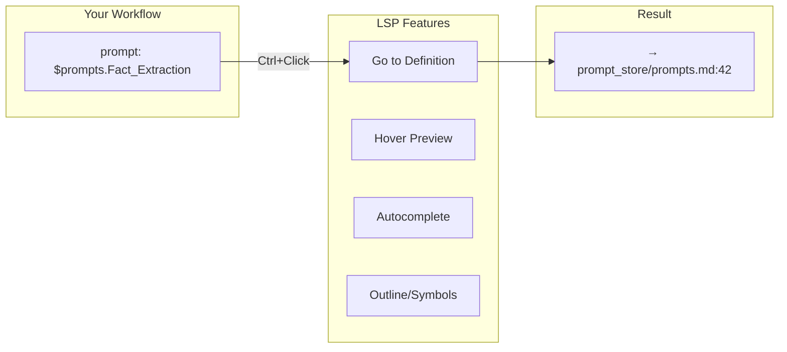
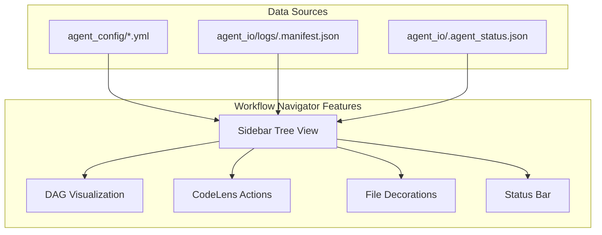
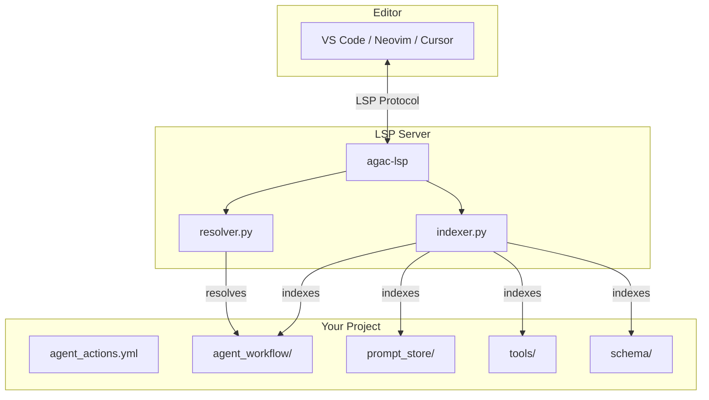

# Editor Integration

With the Agent Actions LSP, a Ctrl+Click on `$prompts.Extract_Facts` in your workflow YAML opens the definition of the prompt. This is the same as navigation in code. Without editor integration, a Ctrl+Click does nothing. You then search for the prompt file manually and scroll to find the correct `{prompt}` block. This search stops your work.

The Language Server Protocol (LSP) gives IDE-quality navigation in your workflows. The LSP is part of the agent-actions package. When you run `uv pip install agent-actions`, you also get the LSP.

## LSP Features {/* #what-you-get */}

The diagram shows a Ctrl+Click on a prompt reference. The Go to Definition feature opens the line in the prompt file.



| Feature | What It Does | Example |
|---------|--------------|---------|
| **Go to Definition** | A Ctrl+Click opens the source. | `$prompts.Extract` → the prompt file, line 42 |
| **Hover** | Shows a preview of the content. You stay in the current file. | Hover on `impl: flatten_questions` → the signature of the tool function |
| **Autocomplete** | Gives suggestions while you type. | Type `$prompts.` → a list of the available prompts |
| **Outline** | Shows the document symbols in the sidebar. | All actions in a workflow, all prompts in a file |
| **Syntax Highlighting** | Gives colors to `{prompt}` tags and Jinja2. | The template syntax looks different from the other text. |

## Navigation Reference

The LSP reads agent-actions references and resolves each reference to a file location:

| Pattern | Example | Jumps To |
|---------|---------|----------|
| **Prompt** | `prompt: $quiz_gen.Extract_Raw_QA` | `prompt_store/quiz_gen.md` → `{prompt Extract_Raw_QA}` |
| **Tool** | `impl: flatten_questions` | `tools/**/flatten_questions.py` → `@udf_tool def` |
| **Schema** | `schema: question_schema` | `schema/question_schema.yml` (or `.yaml`/`.json`) |
| **Action** | `dependencies: [extract_qa]` | Same file → `- name: extract_qa` |
| **Workflow** | `workflow: other_workflow` | `agent_workflow/other_workflow/agent_config/*.yml` |
| **Seed File** | `$file:exam_syllabus.json` | The file that the run reads. The LSP looks in the `seed_data/` folder of the workflow, then in the `seed_data/` folder of the project, then in each folder of `seed_data_paths`. |

## Installation

The LSP is part of the agent-actions package. When you install the package, you also get `agac-lsp`:

```bash
uv pip install agent-actions

# Verify it's available
agac-lsp --help
```

## VS Code Setup

### Option A: Install from VSIX (Recommended)

To build and install the VS Code extension, run these commands:

```bash
# From the agent-actions repository
cd vscode-extension

# Install dependencies and build
npm install
npm run compile

# Package the extension
npx vsce package

# Install to VS Code
code --install-extension agent-actions-0.2.0.vsix
```

The extension is also on the VS Code Marketplace as `runagac.agent-actions`.

After the installation, reload VS Code (`Cmd+Shift+P` → "Developer: Reload Window").

### Option B: Development Mode

Use this mode to develop or test the extension:

1. Open the extension folder:
   ```bash
   code vscode-extension
   ```

2. Install dependencies:
   ```bash
   npm install && npm run compile
   ```

3. Press **F5** to start the Extension Development Host.

4. Open your agent-actions project.

5. Test Ctrl+Click.

### Requirements

The extension needs `agac-lsp` in your PATH. If you installed agent-actions in a virtual environment, use one of these options:

```bash
# Option 1: Activate the environment before opening VS Code
source .venv/bin/activate
code .

# Option 2: Add the venv bin to PATH in your shell config
export PATH="$HOME/projects/my-project/.venv/bin:$PATH"
```

## VS Code Workflow Navigator

The VS Code extension also includes a **Workflow Navigator**. The Workflow Navigator shows the status of your workflow in real time while the workflow runs.

The diagram shows the three data sources of the Workflow Navigator and the features that use them:



### Sidebar Tree View

The Explorer sidebar shows all workflows and actions in the order of execution:

| Icon | Status | Meaning |
|------|--------|---------|
| ✓ (green) | Completed | The action finished successfully. |
| ↻ (yellow, spinning) | Running | The action runs now. |
| ✗ (red) | Failed | The action had an error. |
| ○ (gray) | Pending | The action waits to run. |
| ⊘ (blue) | Skipped | The action was skipped. |

**Features:**
- Click an action to open its definition in the YAML config.
- Expand an action to see its output folders.
- A project with more than one workflow shows all of its workflows.
- A status summary shows the count of completed actions and the total count.

### DAG Visualization

This command shows your workflow as an interactive directed acyclic graph (DAG):

```
Command Palette: "Agent Actions: Show Workflow DAG"
```

The extension has no default keyboard shortcut for this command. If you want a shortcut, assign one to the command `agentActions.showDAG` in the Keyboard Shortcuts editor of VS Code.

**Features:**
- The edges of the graph show the dependencies between actions.
- The color of each node shows the status: green is completed, yellow is running, red is failed, gray is pending.
- Click a node to open the definition of the action in the config.
- Set the layout direction (vertical or horizontal) with `agentActions.dagLayout`.
- The graph updates automatically while the workflow runs.

### CodeLens Actions

In workflow YAML files (`agent_config/*.yml`), each action definition shows links on the same line:

```yaml
actions:
  - name: extract_facts    # 🔎 Preview Output | ✅ completed
    prompt: $prompts.Extract_Facts
    dependencies: [load_data]
```

| Link | Action |
|------|--------|
| 🔎 **Preview Output** | Shows a preview of the action output from the storage backend. |
| Status indicator | Shows the current status. Click it to open the DAG. |

### Query Results Panel

The Query Results Panel is an interactive view of the output data of your action. It shows the results from the storage backend as a table or as JSON.

**Features:**
- **Table View**: An HTML table with sticky column headers, a row count and a column count.
- **JSON View**: Formatted JSON with metadata.
- **View Toggle**: Toolbar buttons change between the table mode and the JSON mode.
- **Pagination**: Next and previous page controls move through large datasets (50 rows on each page).
- **Theme Integration**: The panel changes automatically to the light or dark theme of VS Code.

**How to Open the Panel:**
1. **From Tree View**: Right-click an action in the Workflow Navigator → "Preview Data".
2. **From CodeLens**: Click 🔎 **Preview Output** above an action definition in a YAML file.
3. **From Command Palette**: `Cmd+Shift+P` → "Agent Actions: Preview Data".

The panel opens in a new editor tab next to your current file. Thus you can compare the data with your workflow configuration side by side.

**Pagination Controls:**
- Click the **Next Page** or **Previous Page** button in the panel header.
- The page size is 50 rows.
- The panel shows the current offset and the total row count.

**Requirements:**
For the data preview, the extension must find the `agent_actions` Python module. In most cases, the extension finds it automatically. For monorepos or complex setups, you may need to set `agentActions.modulePath`:

```json
{
  "agentActions.modulePath": "/path/to/agent-actions"
}
```

**Caching:**
By default, the extension caches preview data for 5 seconds to improve performance. To change the duration, use this setting:

```json
{
  "agentActions.previewCacheTTL": 5000  // milliseconds, 0 to disable
}
```

### File Decorations

The action folders in `agent_io/target/` show these badges:

- **Execution order number**: A badge with the number (1, 2, 3...).
- **Status-colored text**: The color of the text agrees with the current state of the action.

The badges help you quickly find the action that each output belongs to.

### Status Bar

The status bar at the bottom shows the progress of the workflow:

```
$(graph) MyWorkflow: 5/10 | [6] process_results
```

- The **completed/total** count.
- The name of the action that is **currently running** (if one runs).
- Click the status bar to focus the Workflow Navigator panel.

### Command Palette

The extension registers no default keyboard shortcuts. Run each command from the Command Palette (`Cmd+Shift+P` / `Ctrl+Shift+P`), or assign your own key:

| Command | Description |
|---------|-------------|
| Agent Actions: Show Workflow DAG | Opens the visual DAG panel. |
| Agent Actions: Go to Action... | Opens a quick-pick list to go to an action. |
| Agent Actions: Refresh Workflow | Refreshes the workflow state manually. |
| Agent Actions: Preview Data | Opens the data preview for the selected action. |
| Agent Actions: Open Action Config | Opens the YAML definition of the action. |
| Agent Actions: Show Workflow Navigator | Focuses the sidebar tree view. |
| Agent Actions: Open Documentation | Opens the Agent Actions docs site. |
| Agent Actions: Open Settings | Opens the Agent Actions settings. |

### Settings

Configure the Workflow Navigator in the VS Code settings:

```json
{
  "agentActions.pythonPath": "",
  "agentActions.modulePath": "",
  "agentActions.showStatusBar": true,
  "agentActions.autoRevealSidebar": false,
  "agentActions.showCodeLens": true,
  "agentActions.showFileDecorations": true,
  "agentActions.dagLayout": "vertical",
  "agentActions.refreshInterval": 0,
  "agentActions.logLevel": "info",
  "agentActions.previewCacheTTL": 5000,
  "agentActions.previewPageSize": 50
}
```

| Setting | Default | Description |
|---------|---------|-------------|
| `pythonPath` | `""` | The path of the Python interpreter. If empty, the extension detects it automatically from the Python extension. |
| `modulePath` | `""` | The path of the agent-actions module directory. It is necessary for the data preview in monorepos. |
| `showStatusBar` | `true` | Shows the workflow progress in the status bar. |
| `autoRevealSidebar` | `false` | Shows the Agent Actions sidebar automatically when you open a project with workflows. |
| `showCodeLens` | `true` | Shows the action links (Preview Output, Status) in YAML files. |
| `showFileDecorations` | `true` | Shows the execution order badges on action folders. |
| `dagLayout` | `"vertical"` | The DAG direction: `"vertical"` (top to bottom) or `"horizontal"` (left to right). |
| `refreshInterval` | `0` | The polling interval in ms. `0` = use only the file watchers. Set it to `2000` for polling every 2 seconds. |
| `logLevel` | `"info"` | The log verbosity in the Output panel: `debug`, `info`, `warn`, `error`. |
| `previewCacheTTL` | `5000` | The cache duration in ms for the data preview. `0` = no caching. |
| `previewPageSize` | `50` | The number of rows on each page of the data preview. |

### Data Sources

The Workflow Navigator reads from three sources:

| File | Purpose | When Updated |
|------|---------|--------------|
| `agent_config/*.yml` | The workflow structure, the action definitions and the dependencies | When you edit the workflow |
| `agent_io/logs/.manifest.json` | The execution plan, the action levels and the output directories | When the workflow starts |
| `agent_io/.agent_status.json` | The live runtime status of each action | While the workflow runs |

When these files change, file watchers refresh the UI automatically. For faster updates while the workflow runs, enable polling with `agentActions.refreshInterval`.

## Neovim Setup

Use this configuration with nvim-lspconfig:

```lua
local lspconfig = require('lspconfig')
local configs = require('lspconfig.configs')

-- Register the agent-actions language server
configs.agent_actions = {
  default_config = {
    cmd = { 'agac-lsp', '--stdio' },
    filetypes = { 'yaml', 'markdown' },
    root_dir = lspconfig.util.root_pattern('agent_actions.yml'),
    settings = {},
  },
}

-- Configure with your preferences
lspconfig.agent_actions.setup({
  on_attach = function(client, bufnr)
    -- Go to definition
    vim.keymap.set('n', 'gd', vim.lsp.buf.definition, { buffer = bufnr })
    -- Hover
    vim.keymap.set('n', 'K', vim.lsp.buf.hover, { buffer = bufnr })
    -- Autocomplete (if using nvim-cmp, it picks this up automatically)
  end,
})
```

## Cursor Setup

Cursor uses VS Code extensions. Do the VS Code VSIX installation first. Then do these steps:

1. Open Cursor.
2. Go to Extensions → Install from VSIX.
3. Select the `agent-actions-0.2.0.vsix` file that you built.
4. Reload the window.

## Syntax Highlighting

The extension gives syntax highlighting for prompt files (Markdown with agent-actions syntax):

| Element | Highlighting | Example |
|---------|--------------|---------|
| `{prompt Name}` | Keyword (purple) | Block delimiter |
| `{end_prompt}` | Keyword (purple) | Block delimiter |
| `{{ variable }}` | Variable (orange) | Jinja2 expression |
| `` | Control (blue) | Jinja2 control flow |
| `{# comment #}` | Comment (dimmed) | Jinja2 comment |
| `CRITICAL` / `WARNING` | Warning markers | Red or yellow emphasis |

### Outline Navigation

To see the document symbols, open the Outline view in the VS Code Explorer sidebar.

**In YAML workflow files:**
- The view shows all action names as symbols.
- You can go quickly to an action.

**In Markdown prompt files:**
- The view shows all `{prompt}` blocks.
- You can go quickly from one prompt to a different prompt.

## How It Works

The editor connects to `agac-lsp` with the LSP protocol. The indexer reads the folders of your project. The resolver resolves references in the workflow files:



### Project Detection

The LSP starts at the opened file and goes up through the parent directories until it finds `agent_actions.yml`. It then indexes these directories:

| Directory | What Is Indexed |
|-----------|----------------|
| `agent_workflow/*/agent_config/*.yml` | Actions (`- name: X`) |
| `prompt_store/*.md` | Prompts (`{prompt X}`) |
| `tools/**/*.py` | Tools (`@udf_tool def`) |
| `schema/*.{yml,yaml,json}` | Schema files |
| `seed_data/`, `<seed_data_paths>/` | Seed files (`$file:X`) |

### Re-indexing

When you save a file, the LSP indexes the project again automatically. If you add new files while the LSP runs, do one of these steps:

- Save a file. This starts a new index.
- Reload the editor window.

## Troubleshooting

### "agac-lsp: command not found"

The LSP command is not in your PATH. Use these commands to find the problem:

```bash
# Check if agent-actions is installed
uv pip show agent-actions

# Find where agac-lsp is
uv pip show agent-actions | grep Location
# Then check: <location>/agent_actions/tooling/lsp/

# Reinstall if needed
uv pip install --force-reinstall agent-actions
```

### Extension Not Activating

1. Look for errors in the Output panel → "Agent Actions LSP".
2. Make sure that your workspace contains `agent_actions.yml`.
3. Make sure that `agac-lsp --help` works in a terminal.

### References Not Resolving

If Ctrl+Click does not work on a reference, the cause can be one of these:

1. **File not indexed yet**: Save a file to start a new index.
2. **Reference typo**: The referenced item does not exist.
3. **Outside project**: The file is not under the `agent_actions.yml` directory.

### Hover Shows Nothing

The LSP may not have finished the index. After you open a project, wait a moment. Alternatively, reload the window.

### Workflow Navigator Not Showing

Make sure that your project has these items:
- An `agent_config/` directory with `.yml` files.
- Actions that have `- name:` fields.

### Status Not Updating

If the workflow status does not refresh, do these steps:

1. Make sure that `agent_io/logs/.manifest.json` exists.
2. To refresh manually, run "Agent Actions: Refresh Workflow" from the Command Palette.
3. Enable polling: `"agentActions.refreshInterval": 2000`.

### DAG Not Rendering

If the DAG panel shows nothing, do these steps:

1. Make sure that you have a minimum of one workflow with actions.
2. Make sure that the action `dependencies` are correct.
3. Reload the window.
4. Try again.

### Data Preview Not Working

This section applies if "Preview Data" shows errors or does not show data.

**"Module import failed" or "Failed to load data from storage backend":**

The extension cannot find the `agent_actions` Python module. Set the module path explicitly:

```json
{
  "agentActions.modulePath": "/path/to/agent-actions"
}
```

To find the correct path, run this command:
```bash
uv pip show agent-actions | grep Location
# Use the path shown (e.g., /Users/you/.venv/lib/python3.11/site-packages)
```

**No data appears in table:**

1. Make sure that the action has completed and has written output data.
2. Make sure that the storage backend has the correct configuration in your workflow.
3. Make sure that the output directory of the action exists in `agent_io/target/`.
4. Look for errors in the Output panel → "Agent Actions".

**Reinstalling the Extension:**

If the preview features do not work after an update, reinstall the extension completely:

```bash
cd vscode-extension

# Remove any globally installed version
rm -rf ~/.vscode/extensions/runagac.agent-actions-*

# Clean and rebuild
rm -rf out/
npm run compile
npx @vscode/vsce package

# Install fresh
code --install-extension agent-actions-0.2.0.vsix --force
```

Then reload VS Code: `Cmd+Shift+P` → "Developer: Reload Window".

## See Also

- [Skills Command](../reference/cli/skills): Install skills for AI coding assistants
- [Troubleshooting](./troubleshooting): Common problems and their solutions
