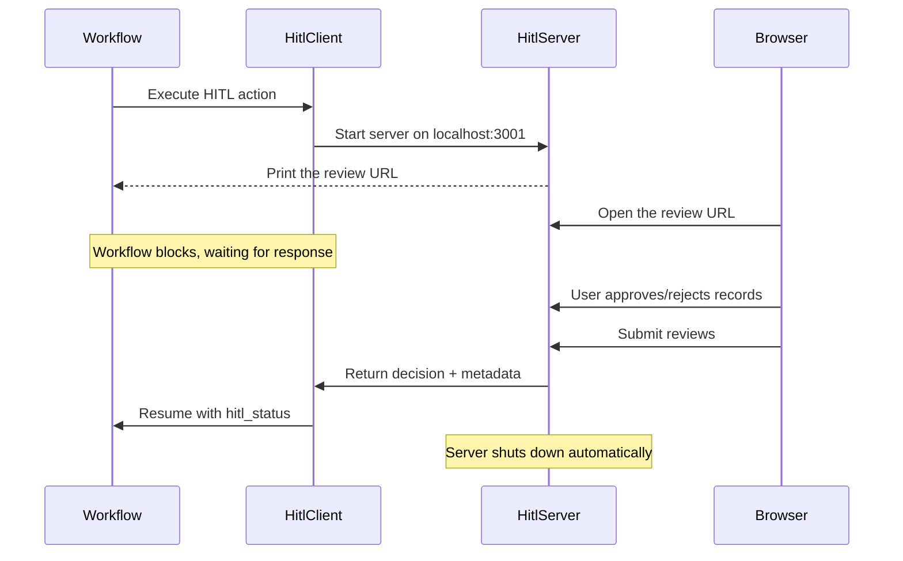

# Human-in-the-Loop (HITL) Review

A Human-in-the-Loop (HITL) action pauses the workflow for manual review and approval. Use a HITL action when a person must decide before the workflow continues. For example, a person can review AI-generated content, approve data transformations, or check the quality of critical outputs.

## Quick Start

To add a HITL action, put this configuration in your workflow:

```yaml
actions:
  - name: review_data
    kind: hitl  # Required: marks this as a human review action
    dependencies: [extract_data]
    intent: "Human reviews extracted data before processing"
    hitl:
      port: 3001  # Optional: port for review UI (default: 3001)
      instructions: "Review the extracted data for accuracy"
      timeout: 300  # Optional: seconds before timeout (default: 300)
      require_comment_on_reject: true  # Optional: require comment when rejecting
    context_scope:
      observe:
        - extract_data.*  # Data to review
```

When the workflow gets to this action, this sequence occurs:

1. The terminal prints `HITL approval UI ready at: http://localhost:3001`. Open that URL in your browser.
2. The workflow pauses and waits for your decision.
3. You review each record, and you approve or reject it.
4. After you submit, the workflow continues automatically.

## How It Works

### Architecture

HITL actions use a **client-server architecture**:

- **HitlClient**: Validates the config, starts the server and blocks the workflow.
- **HitlServer**: A Flask server that serves the review UI at localhost.
- **Browser UI**: An interactive approval interface that shows one record at a time.

The diagram shows the sequence from the start of the HITL action to the return of the decision:



### Review UI Features

The browser UI has these features:

- **Per-record navigation**: You review each record separately. After each decision, the UI goes to the next record automatically.
- **Keyboard shortcuts**:
  - `A`: Approve the current record.
  - `R`: Reject the current record.
  - `J` / `↓`: Go to the next record.
  - `K` / `↑`: Go to the previous record.
  - `S`: Go to the next pending record.
  - `N`: Focus the reviewer note.
  - `?`: Show the shortcut list.
- **Inspector tabs**:
  - **Review**: A structured view of the record and your decision.
  - **JSON**: The raw JSON, for debugging.
- **Progress tracking**: A progress bar and counts (pending, approved, rejected).
- **State persistence**: You can refresh the page, and your reviews stay.
- **Auto-shutdown**: The server stops automatically after you submit.
- **One tab for every file**: The action reviews its input one file at a time.
  Each file has a new server at the same address. After you submit a file (or
  its timeout ends), the tab loads the next file when it is ready.

## Configuration

### HITL Config Block

```yaml
hitl:
  port: 3001                        # Port for review server (1024-65535)
  instructions: "Review carefully"  # Instructions shown in UI (required)
  timeout: 300                      # Seconds before auto-timeout (5-3600)
  require_comment_on_reject: true   # Require comment when rejecting
```

**Configuration options:**

| Field | Type | Default | Description |
|-------|------|---------|-------------|
| `port` | int | 3001 | The server port (1024-65535). If the port is busy, HITL tries a maximum of 5 consecutive ports. |
| `instructions` | str | *(required)* | The instructions that the review UI shows. Write clear and specific instructions. |
| `timeout` | int | 300 | The number of seconds that each file waits for its review. On a timeout, the server stops and saves the partial reviews. The records of that file are marked failed, so that `agac retry` can continue the review. |
| `require_comment_on_reject` | bool | true | If true, the reviewer must write a comment that explains why the record is rejected. |

### Workflow-Level Default Timeout

To set a default timeout for all HITL actions in the workflow, use `defaults.hitl_timeout`. Each action can still override this value.

```yaml
defaults:
  hitl_timeout: 600  # 10 minutes for all HITL actions

actions:
  - name: review_data
    kind: hitl
    dependencies: [extract_data]
    hitl:
      instructions: "Review extracted data"
      # Uses workflow default: 600s

  - name: review_summary
    kind: hitl
    dependencies: [generate_summary]
    hitl:
      instructions: "Review generated summary"
      timeout: 120  # Overrides workflow default
```

**Resolution order:** action `hitl.timeout` > `defaults.hitl_timeout` > 300s hardcoded default.

For real reviews, use a timeout of at least 60 seconds. Reviewers need time to read the instructions and examine the records.

:::note[Minimum timeout]
The minimum value is 5 seconds. This value is useful for tests.
:::

### Granularity

HITL actions always use **FILE granularity**. The UI shows all records in a single review session. In that session, the reviewer can go from record to record, approve or reject each record separately, and submit one time. (Here, file granularity means one UI session for the full batch, not one session for each record.)

:::warning[CAUTION]
**Record granularity is not supported.** If you set `granularity: record` on a HITL action, the action raises a `ConfigurationError`. Record granularity would start a separate approval UI for each record, which is broken UX. If you must filter each record before HITL, use a guard to filter the records first.
:::

```yaml
- name: review_data
  kind: hitl
  dependencies: [extract_data]
  hitl:
    instructions: "Review the full dataset and approve or reject"
  context_scope:
    observe:
      - extract_data.*
```

**Output**: Each record gets its own `hitl_status`, `user_comment` and `timestamp` under the namespace of the HITL action. These values come from the decision for that record in the UI.

```json
[
  {
    "content": {
      "extract_data": { "id": 1, "name": "Alice" },
      "review_data": {
        "hitl_status": "approved",
        "user_comment": "",
        "timestamp": "2026-02-12T10:00:00Z"
      }
    }
  },
  {
    "content": {
      "extract_data": { "id": 2, "name": "Bob" },
      "review_data": {
        "hitl_status": "rejected",
        "user_comment": "Invalid email",
        "timestamp": "2026-02-12T10:00:00Z"
      }
    }
  }
]
```

Downstream actions read HITL fields through the namespace: `review_data.hitl_status`, `review_data.user_comment`.

## Output Schema

HITL actions return decisions in a standard format:

### Response Fields

| Field | Type | Description |
|-------|------|-------------|
| `hitl_status` | str | `"approved"` or `"rejected"`. These are the only values that reach downstream actions. |
| `user_comment` | str | An optional comment from the reviewer |
| `timestamp` | str | The ISO-8601 timestamp (UTC) of the submission of the review |
| `record_reviews` | list | (FILE mode only) The decision for each record |

### Accessing HITL Decisions Downstream

The framework stores the HITL decision fields (`hitl_status`, `user_comment`, `timestamp`) under the namespace of the HITL action in the record content. To read these fields, a downstream action uses the action name as a namespace prefix (for example, `review_data.hitl_status`).

#### Guards

Guards examine namespaced fields. Use the HITL action name as the namespace prefix:

```yaml
- name: process_approved_data
  dependencies: [review_data]
  guard:
    condition: "review_data.hitl_status == 'approved'"
    on_false: skip  # Skip processing if HITL rejected
  prompt: |
    Process the approved data:
    {{ review_data | tojson }}

    Reviewer comment: {{ review_data.user_comment }}
```

**Common guard patterns:**

```yaml
# Only process approved items (filter out rejected/timeout)
guard:
  condition: "review_action.hitl_status == 'approved'"
  on_false: filter

# Skip downstream if rejected (passthrough original content)
guard:
  condition: "review_action.hitl_status == 'approved'"
  on_false: skip
```

:::note[No guard is needed for timeouts or server failures]
A review that does not complete never produces a reviewed record. When a file
times out, its records are marked failed. When a server cannot start, the
action fails. Thus `hitl_status` downstream is always `approved` or
`rejected`. A guard such as `hitl_status != 'timeout'` can never fire.
:::

## Usage Patterns

### Pattern 1: Quality Gate

Approve AI-generated content before the workflow uses it:

```yaml
actions:
  - name: generate_summary
    intent: "LLM generates article summary"
    prompt: "Summarize this article..."

  - name: review_summary
    kind: hitl
    dependencies: [generate_summary]
    intent: "Human reviews AI summary"
    hitl:
      instructions: "Review the generated summary for accuracy and tone"
    context_scope:
      observe:
        - generate_summary.summary

  - name: publish_summary
    dependencies: [review_summary]
    intent: "Publish approved summary"
    guard:
      condition: "review_summary.hitl_status == 'approved'"
      on_false: skip
    prompt: "Publish the summary..."
```

### Pattern 2: Batch Approval

Review and filter a dataset before the workflow processes it:

```yaml
actions:
  - name: extract_candidates
    intent: "Extract potential matches from data"

  - name: review_candidates
    kind: hitl
    dependencies: [extract_candidates]
    hitl:
      instructions: "Approve valid candidates, reject false positives"
      require_comment_on_reject: true
    context_scope:
      observe:
        - extract_candidates.*

  - name: process_approved_only
    dependencies: [review_candidates]
    intent: "Process only approved candidates"
    guard:
      condition: "review_candidates.hitl_status == 'approved'"
      on_false: filter
```

### Pattern 3: Checkpoint Review

Pause between two stages of the workflow for a manual inspection:

```yaml
actions:
  - name: stage_1_transformation
    intent: "Initial data transformation"

  - name: checkpoint_review
    kind: hitl
    granularity: file  # One decision for entire stage
    dependencies: [stage_1_transformation]
    hitl:
      instructions: "Verify stage 1 output before continuing to stage 2"
    context_scope:
      observe:
        - stage_1_transformation.*

  - name: stage_2_enrichment
    dependencies: [checkpoint_review]
    guard:
      condition: "checkpoint_review.hitl_status == 'approved'"
      on_false: filter  # Exclude items if stage 1 was rejected
```

### Pattern 4: Pre-filtered HITL Review

Put a guard on the HITL action to show only flagged records to the reviewer:

```yaml
actions:
  - name: auto_review_quality
    intent: "LLM scores each record for quality"
    prompt: "Score this Q&A for quality (1-10)..."

  - name: review_flagged_items
    kind: hitl
    dependencies: [auto_review_quality]
    guard:
      condition: 'auto_review_quality.decision == "review"'
      on_false: skip  # Auto-approved records skip HITL, preserve original content
    hitl:
      instructions: "Review items flagged by auto-review"
    context_scope:
      observe:
        - auto_review_quality.*
```

The guard runs on each record before the HITL UI starts. Only the records where `decision == "review"` appear in the approval UI. For the behavior of each `on_false` mode, see [Guards with File Granularity](../reference/execution/guards.md#guards-with-file-granularity).

## Debugging & Troubleshooting

### Guard Filters or Skips All Records {/* #guard-filters-or-skips-all-items */}

Your downstream guard can filter or skip **every** record (also the approved records). These are the most common causes:

**1. Missing action name prefix in the guard condition**

```yaml
# Wrong - hitl_status must be namespaced under the HITL action
condition: "hitl_status == 'approved'"

# Correct - use the HITL action name as namespace prefix
condition: "review_data.hitl_status == 'approved'"
```

Guard conditions use dotted namespace paths. A guard reads a field such as `hitl_status` under the HITL action name, the same as any other upstream field.

**2. Wrong field name**

Field names are case-sensitive. Make sure that you use the exact field name in your data:
- The HITL server produces `hitl_status` (snake_case).
- Your storage layer may show it as `hitlStatus` (camelCase).
- Use the field name that the workflow uses **during processing**, which is `hitl_status`.

**3. Default passthrough behavior**

`passthrough_on_error: true` (the default) does **not** help when the clause cannot find a field:

- The guard classifies a missing field as *not matched*. Thus `on_false` applies.
- A bare field name that exists inside a namespace is a semantic error. A semantic error does not go through `passthrough_on_error` at all.

In the two cases, the guard filters or skips the record. The guard does not pass the record through. The result is the same when the field resolves to `None` and the comparison only evaluates to `False`.

### Find the Review URL

The server prints the review URL to the terminal when it starts:

```
  HITL approval UI ready at: http://localhost:3001
```

The framework does not open the browser for you.

### State Refresh Issue

The server saves each decision to a state file under the output directory of the action, in `hitl/.hitl_reviews_<hash>.json`. The page loads its decisions again from `/api/review-state`. If all records show as "pending" after you refresh the page, do these steps:

1. **Check the browser console** for the warning `Could not restore review state`.
2. **Check the state file.** Make sure that it exists and holds your decisions.
3. **Check the run log** for `HITL state file record count mismatch ... starting fresh`. The server discards a state file if its record count is different from the count of the current records.

### Port Conflicts

If the configured port is busy, HITL shows this message:

```
WARNING: Port 3001 in use, using 3002 instead
```

HITL tries a maximum of 5 consecutive ports. If all of these ports are busy, HITL shows this error:

```
NetworkError: Could not find available port near 3001
Attempted ports: [3001, 3002, 3003, 3004, 3005]
```

**Fix**: Stop the servers that you do not use, or configure a different port range.

### Timeout Handling

This section applies if the review does not complete before the timeout:

```yaml
hitl:
  timeout: 300  # 5 minutes
```

The timeout applies to each input file separately. After a file times out:
- The server of the file stops, and the review continues with the next file.
- The framework saves to disk the decisions that you already made on the file.
- **The records of the file are marked failed**, with a warning that names the
  file. The run never sends them downstream as reviewed records. The action
  ends as completed with failures (`partial` in the run summary). If no file
  was reviewed, the action ends as failed.
- `agac retry -a <workflow>` opens the UI again for those files only. Your
  earlier decisions are restored, so you continue from the point where you
  stopped.

The approval UI can fail to start (for example, if each port in its range is
in use). Then no decision was made. Thus the framework writes nothing to the
records, and the action fails with the reason. If the approval UI does not
start, correct the cause. Then run the workflow again.

## Advanced Topics

### Custom Ports

To prevent conflicts, configure the port at the workflow level:

```yaml
actions:
  - name: review_stage_1
    dependencies: [extract_data]
    kind: hitl
    hitl:
      instructions: "Review the extracted data"
      port: 3001  # First review

  - name: review_stage_2
    dependencies: [generate_summary]
    kind: hitl
    hitl:
      instructions: "Review the generated summary"
      port: 3002  # Second review (different port)
```

### Workflow Continuation

After you click "Submit Reviews", this sequence occurs:

1. ✅ **The workflow continues immediately**, and the server of the file stops.
2. ✅ **The tab waits for the next file.** When the server of the next file
   is ready, the tab loads it at the same address.
3. The tab shows this message: "Submitted. This tab loads the next file when one is ready; close it once the run has finished."

Each page carries the review session that the server served it for. The page
can send a request after the review of its file has ended. Then the server of
the next file refuses the request, and the request changes nothing on that
server. Thus a tab that stays open on an earlier file cannot submit, time out
or stop the file under review.

### Security Notes

- ✅ The server binds to `127.0.0.1` (localhost only, no network exposure).
- ✅ HTML escaping prevents XSS.
- ✅ CSP headers with a nonce for each request. `Cache-Control: no-store` on every response.
- ⚠️ Not suitable for remote or multi-user reviews (use webhooks instead).

> **The trust boundary is loopback.** Any process that runs as your user on the
> same machine can reach `http://localhost:{port}/`. The HITL UI is a
> single-user local tool. If you run it on a shared multi-user host, it is not
> private. On that host, any other user with shell access can read the record
> under review. That user can also
> approve or reject the record. In that case, use a different review mechanism
> (webhooks, ticketing).

### Testing HITL Actions

#### Bypassing review in a smoke run

If you set `AGAC_HITL_AUTO_APPROVE=true`, every HITL action approves every
record and does not open the UI. This variable exists so that end-to-end smoke
runs do not wait for a person.

```bash
AGAC_HITL_AUTO_APPROVE=true agac run -a my_workflow --fresh
```

:::danger[WARNING]
**This variable makes an approval that no person gave.** While the variable is
set, **every approval gate in every workflow approves all records with no
review**. The records get `hitl_status: approved` and the comment
`auto-approved (smoke test)`. This comment is the only trace in the data that
no person reviewed them.

Each affected action logs a warning that names the variable and the record
count. Export the variable for one command, as the example shows. Do not
export it in your shell profile. Never set it in an environment that produces
data that you want to keep.
:::

For unit tests, mock the HITL decision:

```python
from agent_actions.llm.providers.hitl.client import HitlClient

def test_workflow_with_hitl(monkeypatch):
    # Mock HITL to auto-approve
    def mock_invoke(agent_config, context_data, tool_args=None, source_content=None):
        return {
            "hitl_status": "approved",
            "user_comment": "Auto-approved for testing",
            "timestamp": "2026-02-12T10:00:00Z"
        }

    monkeypatch.setattr(HitlClient, "invoke", staticmethod(mock_invoke))

    # Run the workflow here; every HITL action receives this decision.
```

## See Also

- [Design Patterns](./design-patterns.md): Patterns to orchestrate a workflow
- [Context Scope](../reference/context/context-scope.md): Control the data flow with observe, drop and passthrough
- [Key Concepts](../tutorials/concepts.md): Actions, dependencies and conditional execution
