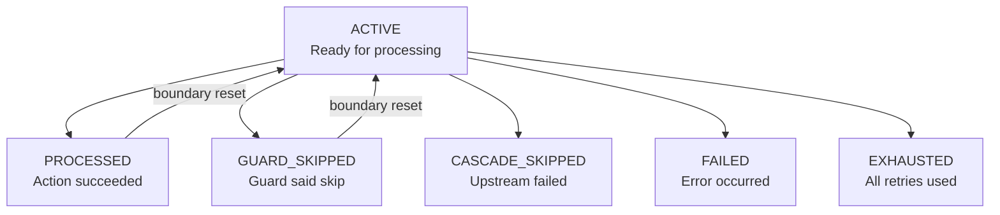

# Record Lifecycle

A record enters your workflow as raw input. When the record exits, it carries the output of each action that processed it and a full state history. It also carries metadata about each retry, skip and failure on its path.

This guide explains the state machine that controls each record. It also explains the audit trail, which lets you trace each decision.

## The Record Envelope

When Agent Actions reads your input data, it gives each record a `source_guid`. It then puts the record in a **record envelope**. After the first action runs, the stored record has this shape:

```json
{
  "source_guid": "a3f7c291-8d1c-5f83-be54-2b9ef2a548bb",
  "content": {
    "source": { "id": "row-a", "title": "First input document" },
    "classify_ticket": { "category": "billing" }
  },
  "_state": "processed",
  "_state_schema_version": 1,
  "_state_history": [ ... ]
}
```

At the start, the `content` dict holds your input under `source`. Each action adds its output under a namespace key, so the dict becomes larger. A source record has no `_state` until the first action sets it. The `_state_history` collects each transition of the record.

## The State Machine

Each record has a `_state` field. A finite state machine controls this field. The field has 6 possible states:



The states are in three categories:

| Category | States | Behavior |
|----------|--------|----------|
| **Processable** | `active` | The record is ready for the next action. |
| **Resettable** | `processed`, `guard_skipped` | The state changes to `active` at the next action boundary. |
| **Terminal** | `cascade_skipped`, `failed`, `exhausted` | The record stops. No more actions process it. |

## How Records Flow Through Actions

This example shows a record that goes through three actions:

```yaml
actions:
  - name: classify_ticket
  - name: extract_entities
  - name: draft_response
```

### Step 1: First action processes the record

The executor sends the record to `classify_ticket`. The LLM returns structured output. The framework puts the output under the namespace of the action and changes the state:

```json
{
  "content": {
    "classify_ticket": { "category": "billing", "urgency": "high" }
  },
  "_state": "processed",
  "_state_history": [
    { "action": "classify_ticket", "from": null, "to": "processed", "reason": "success" }
  ]
}
```

### Step 2: Boundary reset

Before the next action runs, the executor changes the state from `processed` to `active` again:

```json
{
  "_state": "active",
  "_state_history": [
    { "action": "classify_ticket", "from": null, "to": "processed", "reason": "success" },
    { "action": "classify_ticket", "from": "processed", "to": "active", "reason": "downstream_reset" }
  ]
}
```

### Step 3: Next action adds its output

`extract_entities` runs. Its output goes under its own namespace. The `content` dict becomes larger:

```json
{
  "content": {
    "classify_ticket": { "category": "billing", "urgency": "high" },
    "extract_entities": { "amount": 299.00, "subscription": "premium" }
  },
  "_state": "processed",
  "_state_history": [
    { "action": "classify_ticket", "from": null, "to": "processed", "reason": "success" },
    { "action": "classify_ticket", "from": "processed", "to": "active", "reason": "downstream_reset" },
    { "action": "extract_entities", "from": null, "to": "processed", "reason": "success" }
  ]
}
```

Each action adds data to the record. No action overwrites data. The history becomes longer, and the content collects the output of each action.

## Guard Skips

When a guard condition is false, the action does not run. The state of the record changes to `guard_skipped`:

```yaml
- name: rewrite_response
  dependencies: [review_response]
  guard:
    condition: "review_response.pass == false"
    on_false: skip
```

If the review passed, the guard skips `rewrite_response`:

```json
{
  "_state": "guard_skipped",
  "_state_history": [
    ...previous entries...,
    { "action": "rewrite_response", "from": null, "to": "guard_skipped", "reason": "guard_skip" }
  ]
}
```

Many users do not expect this behavior: **a skipped record is still a live record**. The state of the record changes to `active` at the next boundary. The record then continues downstream, and all of its data stays. The skip means "this action had nothing to do". It does not mean "this record is done".

## Terminal States: When a Record Stops

Three states are terminal. When a record is in a terminal state, the record stops:

### `failed`

An action had an error that it cannot recover from. Downstream actions do not process the record.

### `cascade_skipped`

An upstream action failed or was exhausted. The framework does not try to process incomplete data. It cascade-skips all downstream actions for this record. Thus no LLM calls are wasted.

### `exhausted`

The action tried again many times and did not succeed. If `on_exhausted: return_last` is set, the record carries the result of the last attempt as a best-effort result. If not, the record carries empty content.

When the executor finds a terminal record at an action boundary, it does not change the state to `active`. It sends `cascade_skipped` downstream:

```json
{
  "_state": "cascade_skipped",
  "_state_history": [
    { "action": "classify_ticket", "from": null, "to": "processed", "reason": "success" },
    { "action": "draft_response", "from": null, "to": "failed", "reason": "parse_error" },
    { "action": "review_response", "from": null, "to": "cascade_skipped", "reason": "upstream_unprocessed" },
    { "action": "send_response", "from": null, "to": "cascade_skipped", "reason": "upstream_unprocessed" }
  ]
}
```

This history shows the action where the record failed. It also shows the actions that the framework skipped because of the failure.

## The Single Transition Function

All state changes go through one function:

```python
RecordEnvelope.transition(record, new_state, action_name, reason)
```

This function does these operations:

1. It makes sure that the transition is legal. For example, a record cannot go from `failed` to `processed`.
2. It sets `_state` to the new value.
3. It adds an entry to `_state_history` with the timestamp, the action name, the from and to states, and the reason.
4. It sets `_state_schema_version`, so that readers can find stale records.

Framework code changes `_state` and `_state_history` only through this function. Thus the framework sets the state in the same way on each path.

## The Audit Trail: `_state_history`

Each record carries its full transition history in `_state_history`. Each entry contains these fields:

| Field | Description |
|-------|-------------|
| `timestamp` | The ISO 8601 timestamp of the transition |
| `action` | The action that caused the transition |
| `from` | The previous state (or `null` for the first transition) |
| `to` | The new state |
| `reason` | The reason for the transition (`success`, `guard_skip`, `downstream_reset` and other values) |
| `detail` | Optional additional context |

The history has a maximum of 64 entries (`STATE_HISTORY_CAP` in `agent_actions/record/envelope.py`). This limit puts a maximum on memory usage. Each action adds 2–4 transitions to each record: a downstream reset to `active`, a final state, and one entry for each retry. Thus a workflow with approximately 16 or more actions can start to lose older entries.

The framework writes a log message the first time that truncation occurs for each action in a process. The message is about a framework constant, not about a setting that you configure. Thus the framework writes it to `events.json` at WARNING, but does not show it on the terminal. To see it on the terminal, run with `-v`:

```
_state_history capped at 64 entries; dropped N oldest transition(s) for action='<name>'.
```

When this line appears in `events.json`, the oldest transitions of the record for that action are already lost. Later truncations for the same action are silent by design. The framework writes one log message for each action in each process, so that the diagnostic does not repeat for each record.

:::note
You can filter records by their history to answer questions such as "which records were guard-skipped at action X?" or "which records required retries?". You do not need separate log aggregation for this.
:::

### Failure Forensics: `input_snapshot`

A record can reach a terminal failure state (`failed` or `exhausted`) through the result collection path. Then the disposition store captures the input record at the time of the failure. It writes the input record to the `input_snapshot` column of `record_disposition`. This applies to the online, batch and file-tool processing paths.

The snapshot keeps the data that the action processed when the failure occurred. The snapshot stays after the framework removes the batch context maps and the temporary recovery files.

The framework serializes the snapshot as JSON, and the storage backend stores it compressed. If a snapshot is longer than 10,240 characters, a JSON object replaces it. This object has `"__truncated__": true` and a `partial` field that holds the first 8,192 characters. To print the snapshot, use [`agac records --snapshots`](../reference/cli/records):

```bash
agac records -w <workflow> --snapshots
```

## Field Categories

The record envelope controls three categories of framework fields:

| Category | Fields | Behavior |
|----------|--------|----------|
| **Tracking** | `source_guid`, `parent_source_guid`, `version_correlation_id`, `aggregated_by`, `folded_sources` | The framework sets these fields one time, when it creates the record. They are a stable identity that never changes. |
| **Lifecycle** | `_state_history`, `_state_schema_version` | Cumulative. The framework carries these fields forward and adds to them in each action. |
| **Stage** | `_state`, `target_id`, `metadata`, `content`, `lineage`, `node_id` and other fields | The framework makes these fields again for each action. It does not carry them forward. Enrichers set new values at each stage. |

All three categories are **framework fields**. The framework does not show them in user-visible content. The outputs of your actions are under `content.{action_name}`. Framework fields never go into that namespace.

## A Complete Record

This is a record at the end of a workflow with 7 actions:

```json
{
  "source_guid": "a3f7c291-8d1c-5f83-be54-2b9ef2a548bb",
  "version_correlation_id": "corr_efe50c6190398e05",
  "target_id": "56901d5d-c411-436a-be5a-4ca6d7a3487d",
  "content": {
    "classify_ticket": { "category": "billing", "urgency": "high" },
    "extract_entities": { "amount": 299.00, "subscription": "premium" },
    "search_kb": { "articles": ["KB-201"], "confidence": 0.92 },
    "draft_response": { "text": "Dear Sarah, ...", "tone": "empathetic" },
    "review_response": { "pass": true, "compliance_ok": true },
    "route_decision": { "action": "auto_send" },
    "send_response": { "sent": true, "channel": "email" }
  },
  "_state": "processed",
  "_state_schema_version": 1,
  "_state_history": [
    { "timestamp": "2024-01-18T09:14:02Z", "action": "classify_ticket", "from": null, "to": "processed", "reason": "success", "detail": null },
    { "timestamp": "2024-01-18T09:14:02Z", "action": "classify_ticket", "from": "processed", "to": "active", "reason": "downstream_reset", "detail": null },
    { "timestamp": "2024-01-18T09:14:04Z", "action": "extract_entities", "from": null, "to": "processed", "reason": "success", "detail": null },
    { "timestamp": "2024-01-18T09:14:04Z", "action": "extract_entities", "from": "processed", "to": "active", "reason": "downstream_reset", "detail": null },
    { "timestamp": "2024-01-18T09:14:05Z", "action": "search_kb", "from": null, "to": "processed", "reason": "success", "detail": null },
    { "timestamp": "2024-01-18T09:14:05Z", "action": "search_kb", "from": "processed", "to": "active", "reason": "downstream_reset", "detail": null },
    { "timestamp": "2024-01-18T09:16:30Z", "action": "draft_response", "from": null, "to": "processed", "reason": "success", "detail": null },
    { "timestamp": "2024-01-18T09:16:30Z", "action": "draft_response", "from": "processed", "to": "active", "reason": "downstream_reset", "detail": null },
    { "timestamp": "2024-01-18T09:18:15Z", "action": "review_response", "from": null, "to": "processed", "reason": "success", "detail": null },
    { "timestamp": "2024-01-18T09:18:15Z", "action": "review_response", "from": "processed", "to": "active", "reason": "downstream_reset", "detail": null },
    { "timestamp": "2024-01-18T09:18:15Z", "action": "route_decision", "from": null, "to": "processed", "reason": "success", "detail": null },
    { "timestamp": "2024-01-18T09:18:15Z", "action": "route_decision", "from": "processed", "to": "active", "reason": "downstream_reset", "detail": null },
    { "timestamp": "2024-01-18T09:18:16Z", "action": "send_response", "from": null, "to": "processed", "reason": "success", "detail": null }
  ],
  "metadata": { "model": "gpt-4o-mini", "provider": "openai" },
  "node_id": "send_response_d38daf8b-...",
  "lineage": ["send_response_d38daf8b-..."]
}
```

The record is one dict, with seven namespaces in `content` and thirteen entries in `_state_history`. You can answer any question about this record from this single object: what occurred, in what order, and what each action produced.

## Batch Mode: Across Process Boundaries

In online mode, the record stays in memory for the full run. In batch mode, the record goes across process boundaries. The framework writes the record to SQLite after each action. A new process polls for results and continues from the point where the previous process stopped.

The record stays complete because `_state_history` includes the transitions from the two processes. The `source_guid` connects all of the data. For the record, the number of processes and the time between actions have no effect.

## See Also

- [Data Lineage](../reference/data-io/data-lineage.md): How `target_id`, `parent_target_id` and `root_target_id` record the ancestry of a record
- [Guards](../reference/execution/guards.md): Conditional execution and the behavior of a guard skip
- [Batch Recovery](../reference/execution/batch-recovery.md): How retry and repair operate
- [Prompt Traces](../reference/data-io/prompt-traces.md): The LLM request and response of each record
