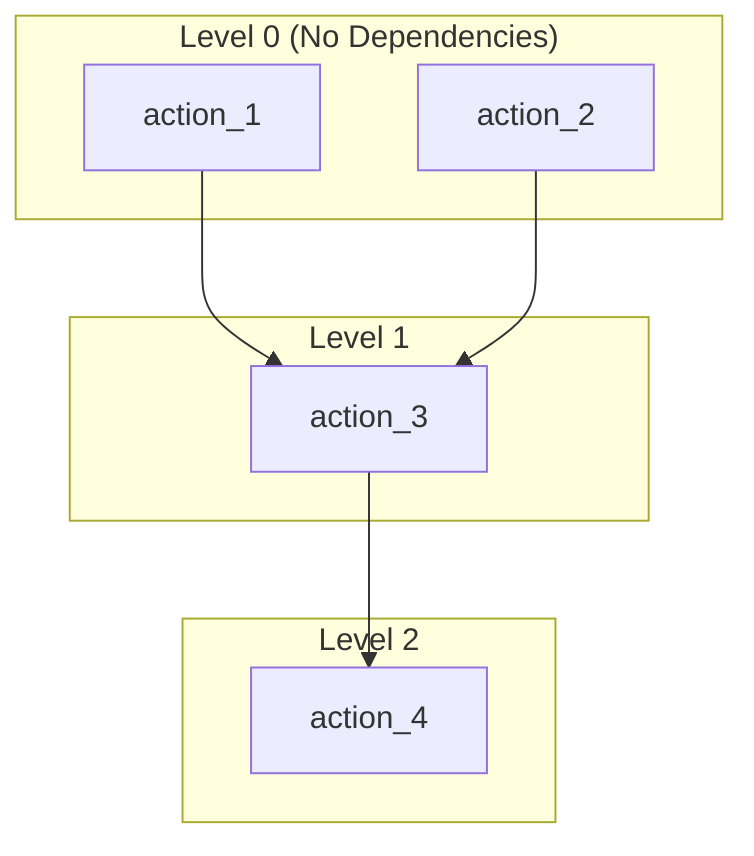
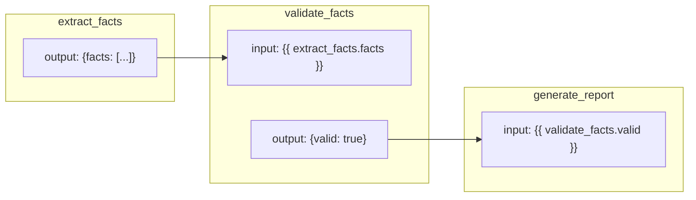
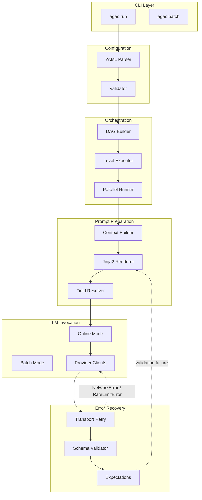

# Architecture

This page describes how Agent Actions sets the order in which actions run, and how data moves from one action to the next action. If you know the architecture, you can design better workflows. You can also debug problems more easily when they occur.

Agent Actions runs a workflow as a **Directed Acyclic Graph (DAG)**. Some actions can run in parallel. Other actions must wait until their dependencies complete. This model gives parallel execution, a deterministic order and a clear data flow.

## DAG Execution Model

Agent Actions puts actions into levels before it runs them. The diagram below shows four actions in three levels:

`action_1` and `action_2` have no dependencies. Thus they can run in parallel. `action_3` waits until the two actions complete. `action_4` waits for `action_3`.

The dependencies of an action set its **level**:

| Level | Description | Execution |
|-------|-------------|-----------|
| Level 0 | Actions that have no dependencies | Run in parallel |
| Level 1 | Actions that depend only on Level 0 | Run after Level 0 completes |
| Level N | Actions that depend on Levels 0..N-1 | Run after all dependencies complete |

Actions in the same level run **concurrently**, up to the concurrency limit (default: 5, max: 50). The limit is a practical limit. It helps to prevent more requests than the API rate limits allow.

## Data Flow

Data moves through the DAG through **field references**. A field reference such as `{{ extract_facts.facts }}` points to a field of an upstream action. The field gets its value when that upstream action completes. A field reference works like a formula in a spreadsheet that points to a cell.

The diagram shows the data flow between three actions:

The arrows show data dependencies. `validate_facts` cannot run until `extract_facts` produces its output.

When an action refers to `{{ upstream_action.field }}`, Agent Actions does these steps:

1. **Locate** - Find the stored records of the upstream action.
2. **Extract** - Read the specified field from the record.
3. **Inject** - Make the value available in the prompt template.

## Component Architecture

The diagram shows the components and how they connect. Each layer has one specific function:

The diagram shows two recovery loops:
- **Transport retry** (Retry → Providers): If a network error or a rate limit occurs, Agent Actions sends the same request again, with exponential backoff.
- **Repair** (Expectations → Template): If validation fails, Agent Actions builds the prompt again with the list of failures.

In batch mode, the two loops run as two sequential phases after the batch completes. For more information, see [Batch Recovery](../execution/batch-recovery.md).

## Execution Lifecycle

When you run `agac run -a my_workflow`, Agent Actions does the steps in the subsections that follow.

### 1. Configuration Loading

1. Parse `agent_actions.yml` (the project configuration).
2. Parse the YAML file of the workflow.
3. Merge the configuration hierarchy (project defaults -> workflow defaults -> action).
4. Validate the configuration.

### 2. Pre-flight Validation

1. Make sure that all field references resolve.
2. Make sure that the schema files exist.
3. Make sure that the vendors are compatible.
4. Find circular dependencies.

### 3. DAG Construction

1. Build the dependency graph from the `dependencies` of each action.
2. Calculate the execution levels.
3. Make sure that the DAG is acyclic (has no cycles).

### 4. Execution

For each level, Agent Actions does these steps:
1. Evaluate the guards (skip or filter actions).
2. Prepare the prompts (resolve the field references, apply the context scope).
3. Run the actions in parallel (up to the concurrency limit).
4. Validate the outputs against the schemas.
5. If an expectation fails, generate the output again (if an `expect:` block is set).
6. Write the outputs to the SQLite store of the workflow.

### 5. Output

- The records of each action, in the SQLite store of the workflow, `agent_io/store/<workflow>.db` (read them with `agac records`)
- Lineage tracking through `source_guid` and `node_id`
- Passthrough fields, merged from the context scope

Lineage tracking is important. It lets you trace each output back through the actions that produced it. This is very useful for debugging and audits.

## See Also

- [Run Modes](../execution/run-modes.md) — Batch execution and online execution
- [Batch Recovery](../execution/batch-recovery.md) — Two-phase recovery for batch processing
- [Granularity](../execution/granularity.md) — Record vs file processing
- [Data I/O](../data-io/) — Directory structure and file formats
- [Validation](../validation/) — Pre-flight and schema validation
