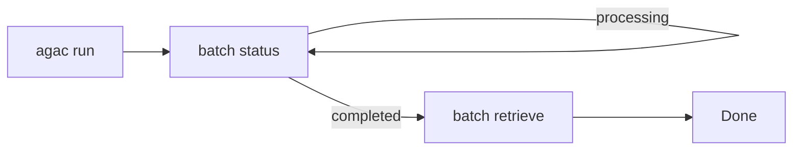

# batch Commands

Batch mode submits all records at one time for asynchronous processing. Use batch mode when you have hundreds or thousands of records to process. To run these records one at a time is inefficient and expensive.

## Submit a Batch {/* #submitting-a-batch */}

To submit a batch, use the standard `run` command with a workflow that has the batch mode configuration:

```yaml
# In your workflow config
defaults:
  run_mode: batch
```

```bash
agac run -a my_workflow
```

When `run_mode: batch` is set, Agent Actions submits the records asynchronously. Then it pauses the workflow with `Workflow paused - batch job(s) submitted for: <actions>`. The batch ID is in the `Batch <id> submitted: <n> requests to <provider>` line. Use the commands below to manage the batch from submission to retrieval.

```bash
agac batch <subcommand> [options]
```

:::note[Run from Anywhere]
You can run batch commands from any subdirectory in your project.
:::

## Subcommands

| Subcommand | Description |
|------------|-------------|
| `status` | Show the status of a batch job |
| `retrieve` | Retrieve the results of a completed batch |

## batch status

This subcommand shows when a batch job is finished.

After you submit a batch, you can poll its status. The status shows if the batch is still processing, completed successfully or failed:

```bash
agac batch status --batch-id <id>
```

**Options:**
| Option | Description |
|--------|-------------|
| `--batch-id` | **Required.** The ID of the batch job. If you omit this option, the command raises `UsageError: --batch-id is required.` Get the batch ID from the `Batch <id> submitted` line of the run. |
| `-a, --agent` | The workflow name. Required in a project with more than one workflow. |
| `--action` | The action name. Required when the workflow has more than one batch action and the batch ID does not identify one action. |

**Example:**
```bash
$ agac batch status --batch-id batch_abc123
Batch job status: completed
```

`--batch-id` is required. The command does not use the last job as a fallback. You must give the batch ID from the submission output.

## batch retrieve

When a batch is complete, retrieve the results:

```bash
agac batch retrieve --batch-id <id>
```

**Options:**
| Option | Description |
|--------|-------------|
| `--batch-id` | **Required.** The ID of the batch job to retrieve. If you omit this option, the command raises `UsageError: --batch-id is required.` |
| `-a, --agent` | The workflow name. Required in a project with more than one workflow. |
| `--action` | The action name. Required when the workflow has more than one batch action and the batch ID does not identify one action. |

**Example:**
```bash
agac batch retrieve --batch-id batch_abc123
```

The command writes the results to `agent_workflow/<workflow>/agent_io/target/<action>/<batch-id>_results.jsonl`. Then it prints that path.

## Batch Workflow {/* #batch-agentic-workflow */}

The typical batch process has three parts: run (the run submits the batch), poll the status, and retrieve the results.



:::note[Batch Limitations]
Batch mode works best for independent records that do not have to share state.
:::

If your workflow requires coordination between records, process the batch results in a separate step after retrieval. An example of coordination between records is to aggregate the results from many records.

## See Also

- [run Command](./run): Run workflows synchronously
- [Troubleshooting](./troubleshooting): Debug batch problems
