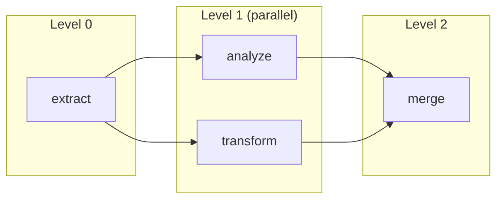

# run Command

The `run` command is the primary way to run a workflow. It resolves dependencies, runs independent actions in parallel and finds tools automatically.

```bash
agac run -w <workflow-name> [options]
```

:::note[Run from Anywhere]
You can run this command from any subdirectory in your project. The CLI will find your project root automatically.
:::

## Basic Usage

These are the basic commands:

```bash
# Run an agentic workflow
agac run -w my_workflow

# Run with custom tools
agac run -w my_workflow -u ./user_code --use-tools

# Force parallel execution
agac run -w my_workflow --execution-mode parallel
```

The last line of the output counts actions, not records. A final action is an action that no other action reads.
A final action can complete, or be skipped, with no record. This occurs when each record was filtered, skipped or
failed before it got to the final action. In that case, the run prints a warning under the last line and names the final action:

```
✓ 0.3s — 1 completed, 1 skipped
⚠ No records reached the final output: write_out
```

The log line before the warning names the `agac dispositions` command that shows the cause.

## Options

| Option | Description |
|--------|-------------|
| `-w, --workflow NAME` | The workflow name (required). `-a` names the same option. |
| `-u, --user-code DIRECTORY` | The path to the folder of your code that contains the tools |
| `--use-tools` | Let actions use tools |
| `-e, --execution-mode` | The execution mode: `auto` (default), `parallel` or `sequential` |
| `--concurrency-limit` | The maximum number of concurrent actions (default: 5, range: 1-50) |
| `--record-limit N` | Limit each action to N records **per input file**, whatever the workflow configuration sets. This is the same unit that `record_limit` uses. The flag applies to actions that set no limit of their own. It takes precedence over `AGAC_RECORD_LIMIT`. An action that actually drops records says so, and names this flag and the counts. The reason is that a truncated run otherwise looks complete |
| `--file-limit N` | Stop each action after N input files, whatever the workflow configuration sets. This is the same unit that `file_limit` uses. The flag counts the files that the action processed successfully. Thus a file that fails does not use the budget, and the action attempts each file in a directory of unreadable files. The flag applies to actions that set no limit of their own. It takes precedence over `AGAC_FILE_LIMIT`. An action whose walk through its input files actually stops says so, and names this flag. The reason is that a shortened run otherwise looks complete. This flag never limits `agac retry` |
| `--fresh` | Before execution, clear the stored results, the dispositions, the prompt traces, the status, the stored token usage and the event logs (`events.json`, `errors.json` and their rotations from earlier runs). Also discard the data that the provider recorded locally about each batch that this workflow submitted, collected or not. This flag gives a clean start for debugging. |
| `--refresh-input` | Read the query of each `database` data source again. Rows that did not change keep their answers. New and changed rows are answered. Rows that the query no longer returns are forgotten. If a batch is still open, the run stops before it starts, because the batch answers the rows that it was sent. With `--fresh`, an open batch does not stop it, because `--fresh` discards the batches. `--fresh` alone does not read the query again: it keeps the snapshot. See [Databases](../data-io/databases.md#the-snapshot) |
| `--rerun ACTION` | Answer each record of `ACTION` again, under the configuration as it is now. Do the same for each action that reads the output of `ACTION`. You can give the name of a versioned action as the configuration writes it. The flag then runs each version of the action again. Give the flag more than one time to run more than one action again in the same run (`--rerun classify --rerun summarize`). Each other action keeps its answers. Use this flag after a configuration edit. An edit alone runs nothing again (see [When you edit the workflow](#when-you-edit-the-workflow)). If the workflow does not have a name, the run stops before it starts, and names each name that it does not have |
| `--where EXPRESSION` | With one `--rerun ACTION`: answer again only the records of `ACTION` that the expression matches, at `ACTION` and at each action that reads it. Each other record keeps its answers. The expression is a [guard](../execution/guards.md) condition. See [Rerun selected records](#rerun-selected-records) |
| `--records FILE` | With one `--rerun ACTION`: answer again only the records that `FILE` lists. `FILE` has one `source_guid` on each line. With `--where` also, a record must be in the list and match the expression. See [Rerun selected records](#rerun-selected-records) |
| `--dry-run` | With `--where` or `--records`: print the count and the ids of the records that match. The command changes nothing and calls no model |
| `--verify-keys` | Verify the API keys before execution. The command probes each vendor one time for each endpoint. For an `openai` action with `base_url`, the probe uses `models.list()` at that URL. For an action without `base_url`, the probe uses the OpenAI endpoint. If a server does not answer, the command logs a warning and the run continues. A local server may serve `/v1/models` without a check of the key (llamafile 0.10.6 does this). Thus a passing probe there shows that the server is reachable, not that the key is correct. Each [declared endpoint](../configuration/endpoints.md#verify-an-endpoint) that the workflow uses also gets one structured-output request. For that request, three conditions are errors. They are a refused credential, a server that cannot be reached, and a reply that does not match the schema of the probe |
| `--wait` | While the run is paused for a batch, wait and run the workflow again until no batch is open. Then exit with the code of the final status. See [Wait for batch jobs](#wait-for-batch-jobs) |
| `--poll SECONDS` | With `--wait`: the time between two checks of the batch jobs, in whole seconds. The minimum is 1 (default: 60). With `--sandbox`, the default is no wait. See [Wait for batch jobs](#wait-for-batch-jobs) |
| `--wait-timeout SECONDS` | With `--wait`: stop the wait when this time after the start of the run is over, and exit 4. The batch jobs stay open for the next run (default: no limit) |
| `--sandbox` | Run the workflow with no model call and no API key. The mock provider answers each LLM action, tool actions run their own code, and HITL actions approve each record. A tool action that the scenario stubs does not run its code. The run writes to `agent_io/sandbox/` and `agent_io/store/<workflow>.sandbox.db`, and does not read or change the output of real runs. It does not write the declared `outputs:`. See [Sandbox Runs](../../guides/sandbox.md) |
| `--scenario happy\|chaos\|PATH` | With `--sandbox`: the scenario that the mock follows, a preset or the path of a scenario file. The scenario also names the tool actions that it stubs. Without this option, the run uses `sandbox.<workflow>.yml` at the project root, else `sandbox.yml`, else `happy`. A preset keeps the `stub` entries (with their `pin`) of that file; a path uses only that file. Without `--sandbox`, the option is an error. See [The scenario file](../../guides/sandbox.md#scenario) |

## Exit Codes {/* #exit-codes */}

The exit code of `agac run` and of [`agac retry`](./retry) tells how the command ended. A script
or a CI job can read the code. It does not have to read the text that the command prints.

| Code | Status | Meaning |
|------|--------|---------|
| `0` | Success | Each action completed or was skipped, and no action holds a failed or exhausted record |
| `1` | Failed | An action failed, or an error ended the command |
| `2` | Usage error | The command line is not valid. Nothing ran |
| `3` | Finished with failures | The workflow finished, but an action holds a record with the disposition `failed` or `exhausted`. The command names these actions. [`agac dispositions --quarantined`](./dispositions) lists the records, and [`agac retry`](./retry) repairs them |
| `4` | Paused | A batch is open, or the run stopped before every action ended. Run the workflow again to continue. For a batch, you can also use `--wait` |
| `5` | Quota or billing stop | A provider answered that the quota or the credit of the account is at its limit. The run stopped and failed nothing. Add credits. Then run the workflow again. See [When the quota of a provider is at its limit](#quota-stop) |
| `130` | Interrupted | The user stopped the command (Ctrl+C). The batch jobs stay open |

The code comes from the statuses of the actions in `agent_io/.agent_status.json`, which
[`agac status`](./utilities#status) shows. An action that holds no successful record
has the status `failed`. Thus the code is `1`, not `3`, when each record of an action failed.
A failed action has priority: when one action failed and another action holds failed records, the code is `1`.
A filtered record, a record that a guard skipped, or a record below a failed record does not change the code.

:::warning[CAUTION]
A paused run exits `4`. A run that finished with failed or exhausted records exits `3`.
A script that stops on each non-zero code (`set -e`) must accept `4` after it submits a
batch, or use `--wait`.
:::

## When the Quota of a Provider Is at Its Limit {/* #quota-stop */}

A provider can answer that the quota, the credit or the balance of the account is at its limit. A wait clears a rate limit.
A wait does not clear this answer. Each record that the run did not send yet gets the same answer.
Thus the run stops:

- The run does not retry the request, and sends no new request for that action. The OpenAI SDK also does not send the request again.
- The records of the action that are already sent finish, and the run keeps their answers.
- The record that got the answer, and each record that was not sent, keep no disposition. They are not `failed` and not `exhausted`.
- The actions that run at the same time in the same step finish. The run starts no later action.
- The action shows `interrupted` in [`agac status`](./utilities#status).
- The run prints one message and exits with code `5`. The message says that the run stopped, and gives the provider and the text of its answer:

```text
■ my_workflow stopped — Provider quota or billing stop (ollama_cloud): you have reached your monthly usage limit (status code: 429). Add credits, then run again to resume.
```

After you add credits, run the workflow again with a plain `agac run`. The run answers only the records
that have no answer, then continues with the later actions. You do not need `agac retry`. Do not use `--fresh`.
If the quota is still at its limit, the run stops again in the same way.

Agent Actions reads these answers as a quota or billing stop:

| Answer | Providers |
|--------|-----------|
| HTTP 402 | Each provider and each [declared endpoint](../configuration/endpoints.md) |
| HTTP 429 or 403 with `insufficient_quota` in its text | OpenAI |
| HTTP 400 `invalid_request_error` with `credit balance is too low` in its text | Anthropic |
| HTTP 429 or 403 with `usage limit` or `usage credits` in its text | Ollama Cloud |

Each other HTTP 429 is a rate limit. The [retry policy](../execution/retry.md) retries a rate limit.

In batch mode, the same rule applies when the provider refuses a batch at submission with one of these answers.
The run stops at that file. A batch that another file already has at the provider stays, and the next run collects it.
A billing error that a provider reports for one record inside the results of a finished batch fails that record.

## Wait for Batch Jobs {/* #wait-for-batch-jobs */}

A run that submits a batch job pauses and exits `4`. The next `agac run` checks the batch job,
collects the results when they are ready, and continues with the next actions. To submit, check and collect the batch with one command, use `agac run --wait`:

```bash
agac run -w my_workflow --wait --poll 60 --wait-timeout 86400
```

While the run is paused for a batch, `--wait` sleeps for the `--poll` time. Then it runs the workflow again,
as a second `agac run` does. It repeats this until no batch is open. The command then exits with the code
of the final status: `0`, `1`, `3` or `5`.

`--fresh`, `--rerun` and `--verify-keys` apply to the first pass only. The later passes clear nothing.

In a sandbox run (`--sandbox`), the mock batch provider answers immediately. Thus without `--poll`, `--wait` does not sleep between two passes: it prints `Checking the batch job(s) again...` and runs the workflow again. If the scenario holds each batch for a time (`batch.complete_after_seconds`), `--wait` sleeps that time between two passes, at most 1 second. A `--poll` that you give is used as given. See [Batch actions](../../guides/sandbox.md#batch-actions).

The `--wait-timeout` time starts before the first pass. If less than the `--poll` time stays before the timeout, the command sleeps only until the timeout. Each wait line gives the time that the command sleeps. No pass starts after the timeout. When this time is over and a batch is still open, the command stops, names the actions
that wait, and exits `4`. The message gives the time that the command waited, in whole seconds. The batch jobs stay at the provider. To continue, run the command again:

```
Stopped waiting after 86400s: batch job(s) still open for: classify. Run again to check them and continue: agac run -w my_workflow --wait
```

A run can also stop before every action ended when no batch is open. Then `--wait` does not wait. The command exits `4` and prints this line:

```
--wait has no batch to wait for: the run stopped before every action ended.
```

The command holds the [run lock](#concurrent-runs) from the first pass to the last pass. Thus no other
`agac run` or `agac retry` of the workflow can start during the wait.

## Run Offline in a Sandbox {/* #sandbox */}

`--sandbox` runs the workflow with no model call and no API key. The mock provider answers each LLM action. The workflow file does not change:

```bash
agac run -w my_workflow --sandbox
```

The run writes its output to `agent_io/sandbox/` and `agent_io/store/<workflow>.sandbox.db`. It does not read or change the output of real runs, so a real run after it answers each action. Give `--sandbox` to `status`, `records`, `traces` and the other read commands to read this output. A sandbox run does not wait for a provider: it makes a retry with no backoff, and `--wait` does not sleep between two passes unless you give `--poll` or the scenario sets `batch.complete_after_seconds` (then at most 1 second). See [Sandbox Runs](../../guides/sandbox.md).

A [scenario file](../../guides/sandbox.md#scenario) makes the mock fail, change or delay some calls on purpose, so the run tests retry, repair and the failure paths. Give a preset or a file with `--scenario`:

```bash
agac run -w my_workflow --sandbox --scenario chaos
```

A tool action runs its own code in a sandbox run. If the tool calls a service, the run is slow and not offline. To prevent that, stub the tool in the scenario file: with `stub: true`, the code of the tool does not run, and the mock builds its output from its output schema. The run names the stubbed tools on a `SANDBOX` line. The line of each stubbed tool shows `(stubbed)` after the time, and then its notes, for example `(stubbed) — 1 skipped by guard`. See [Stub a tool action](../../guides/sandbox.md#stub-a-tool-action).

```yaml
# sandbox.yml
actions:
  retrieve_candidates:
    stub: true
```

## Run a Smaller Version of a Project {/* #running-a-project-smaller-than-it-is */}

The limits of a workflow are in the project configuration, for each action. To run the workflow at a low cost without a change to the configuration,
limit the whole run from the command line. Examples are a smoke check, a quick pass over a real dataset, or one action under a debugger:

```bash
agac run -w my_workflow --record-limit 2 --file-limit 1
```

The limit applies to **every** action, which includes the actions that configure no limit of their own.
If the own limit of an action is smaller, the action keeps its own limit.
This is more important than it seems. A workflow can branch into dozens of actions with repair
loops. In such a workflow, a small configured limit becomes a very large number of model calls.

The two flags limit different dimensions, and the size of a run is proportional to the two dimensions. `--record-limit` counts
**per input file**. This is the same unit that [`record_limit`](../configuration/defaults) uses. Thus, if a staging
directory holds five files, `--record-limit 2` processes up to ten records for each action, not
two. `--file-limit` limits the walk through the files. Thus `--file-limit 1` gets to one of those five files,
whatever the record limit is.

Each action that actually drops records logs a line that names the flag and the counts. Each
action whose walk actually stops logs a line that names the flag that stopped it. An action that is smaller than
its limit logs nothing. `AGAC_RECORD_LIMIT` and `AGAC_FILE_LIMIT` do the same job from the
environment. If you use the flag and the environment variable, the flag wins, because you typed it for this run. A value
that cannot limit anything is not ignored. It fails the run, before any
action starts.

For the flags and for the environment variables, the store keeps the limits in force with the action. Thus, if you remove or increase a limit, the run processes again what the limit held
back. It does not serve a short run as a finished run. You can change `--record-limit` to a different value. The action then runs
again when the new limit could have held something back. If you increase the limit above what an
untruncated run already processed, nothing changes. The reason is that a limit that cannot have an effect is not a
different amount of work. A run that cannot say what it processed runs again on any change.
Two examples are a run that completed without recorded counts, and a run that lost an input file to an
error. In the second example, the records that the run never got to were never counted. `--file-limit` has no such count. Thus any change to `--file-limit` runs
the action again. This includes a change to a value that is larger than the number of staged files. A batch action stores the limits that the run that *submitted* it applied. It does not store
the limits that the later run that collects it was asked for.

The two limits have different effects on the output. `--record-limit` writes again each file that it walks. Thus the run drops the
extra records, and the remaining output is the work of that limit. `--file-limit` limits which
files the run opens at all. A file that the run does not get to keeps the output that the previous run wrote
there. That is the purpose of the file limit. Thus a limited run over a project that already ran is
not a fresh, smaller copy of the project. It is the earlier output, with the walked files replaced. That is
usually what you want for a quick pass. When all of the output must come from
one run, use `--fresh`.

A workflow that has completed is skipped on the next run, unless its limits or its staged
input changed. A configuration edit runs nothing again (see
[When you edit the workflow](#when-you-edit-the-workflow)).

A change to the staged input counts. You can add, remove or change a file under the input of the first stage.
Agent Actions then runs that action again, and each action that reads it. The run log names the files
that changed. As with an edit, the records that the change did not touch keep their answers. The action answers an added record.
It also answers a record whose content changed, because that record is then a new record.

If no staged file holds a record any more, the record leaves nothing. Agent Actions removes its rows, its disposition and its checkpoints,
at that action and at each action that reads it. This includes a disposition that is a failure. Thus `agac retry` no longer offers the record.
The prompt traces of the record stay. Agent Actions removes a record only after a walk that
read each staged file. It does not remove a record under a file limit, or when it could not read a file, or under
`agac retry`. A record that a record limit excludes is still staged, and it keeps what it holds.
You do not need `--fresh` to read new input. `--rerun` answers each record again.

The two flags do not limit [`agac retry`](./retry). A repair walks each file that holds a record that the repair
named. If the repair stopped before one of these files, the cleared disposition of that record would stay unwritten.
A limit exists to prevent this type of erasure.

## Rerun selected records {/* #rerun-selected-records */}

`--rerun ACTION` answers each record of `ACTION` again. To answer only some records again,
add `--where` or `--records`. The other records keep their answers at each action, and the
run calls no model for them.

```bash
# The records that a field selects
agac run -a my_workflow --rerun write_reply --where 'classify.category == "billing"'

# The records that a file lists, one source_guid on each line
agac run -a my_workflow --rerun write_reply --records ids.txt

# Look before you pay: print the count and the ids, call no model
agac run -a my_workflow --rerun write_reply --where 'source.ticket_id <= 100' --dry-run
```

Use this after a full run, when only one group of records must change. For example, a prompt
edit applies to one category only, or a review finds bad answers for 100 of 500 records.

### What the filter reads

The run evaluates `--where` on the records that `ACTION` stored. A stored record holds the
fields of `ACTION` and of each action before it, and the staged row under `source`. Thus the
expression can read `source.<field>`, `<earlier_action>.<field>` and `<ACTION>.<field>`.
The syntax is the syntax of a [guard condition](../execution/guards.md): `==`, `!=`, `<`,
`IN [...]`, `AND`, `OR`.

A record that does not have the field does not match, and the run says how many records it
could not evaluate. If no record has the field, the run stops, because the name is probably a
mistake.

### What runs again

- `ACTION` runs again for the matching records.
- Each action that reads `ACTION`, directly or through another action, runs again for the
  same records. An action in another branch does not run.
- The actions before `ACTION` do not run.
- For a [versioned action](../execution/versions.md), give the name as the configuration writes
  it (`--rerun score`). Each version then runs again for the matching records. Give one
  version (`--rerun score_1`) to run only that version again.
- The run writes the declared [`outputs:`](../data-io/databases.md#writing-results) at its end.

To get the ids for `--records`, use `--dry-run`, or [`agac records`](./records).

### An action that makes several records from one

Some actions make new records with new ids, for example a File tool that makes three slots
from each ticket. Such an action can only run on the records that it reads. Thus, when the
filter matches a slot, `ACTION` runs again on the ticket that the slot came from, and the
actions below answer the matching slots again.

A [File tool](../execution/granularity.md) always gets the whole of each file that the rerun
reaches. If the tool writes a row differently, the actions below answer that row again also,
whether the filter matched it or not. If the tool writes a row the same, the row keeps its
answers. The run says so at its end.

### What stops the rerun

Each of these conditions stops the command before it changes anything:

| Cause | What to do |
|-------|------------|
| No record matches | Nothing. The command prints `No record matches` and exits 0 |
| An id in `FILE` names no record of `ACTION` | Correct the file. The error names the ids |
| The expression is not a guard condition | Correct the expression. The exit code is 2 |
| More than one `--rerun`, or none | Give one `--rerun ACTION` |
| `--fresh`, `--refresh-input`, `--record-limit` or `--file-limit` | Remove the flag. A filtered rerun does not accept new work and does not clear the store |
| A batch of the workflow is not collected | Run `agac run` to collect it first |

### After the rerun

- A record that fails in the rerun is a failed record. The exit code is `3`, and
  [`agac retry`](./retry) repairs the record.
- A record that failed before, and that the filter did not match, stays failed.
- In batch mode, the rerun submits a batch that holds only the matching records, and exits
  `4`. Run `agac run` to collect the batch, or give `--wait` to the rerun.
- If the rerun stops before its end, run `agac run`. The run completes the same records.
- The rerun uses the configuration as it is now, for the matching records only. For example,
  if you added a guard, the guard can filter a matching record, and the record then loses its
  earlier answer. A record that the filter did not match keeps its answer, even if the new
  guard would filter it.
- If you edited `ACTION` before the rerun, `ACTION` now holds answers from two versions of
  its configuration. Each later run says so until `--rerun ACTION` answers each record again.
- An output with `mode: append` skips a key that the table holds. Thus the table keeps the
  earlier answer of a record that the rerun answered again. Use `mode: merge` for a table
  that must follow the store.

## When you edit the workflow

If you edit an action in the configuration, the edit does not run anything again. This rule covers these items:

- The model of the action (`model_name`, `model_vendor`, in the action or in `defaults`)
- The prompt, the schema, the guard, `context_scope` and `dependencies`
- The generation settings that an LLM action sends
  (`temperature`, `max_tokens`, `top_p`, `stop`, `frequency_penalty`, `presence_penalty`, `vendor_params`,
  in the action, in `defaults` or in `default_agent_config`)
- The code of a tool or a UDF guard: the full file that defines it, but not the modules that the file imports
- The output settings: `granularity`, `on_empty`, the `expect:` block, and for an LLM action `json_mode`,
  `output_field` and `run_mode` (online or batch)
- The provider endpoint of an LLM action: `base_url`, or the `url` of the declared endpoint that its `model_vendor` names

A change to `request_timeout`, `retry`, `api_key` or `enable_prompt_caching` is not an edit. These settings
change how a request gets to the provider, not what the request asks. A `` tag in a prompt is
also not an edit, for the same reason: Agent Actions removes the tag before it compares the prompt.

The records that the action already answered keep their
answers. The actions that read these records also keep their answers. The action answers the records that it did not answer yet
under the edit. Thus you can change the model of a long run before the run is complete. The run does not ask again for anything that it
already paid for.

Each run that finds an edited action reports the edit, and names what changed:

```
classify was edited since it completed (model): its answers stand, and only records it has
not answered use the edit. Run again with --rerun classify to answer every record under the edit
```

The warning also names each action that reads the output of the edited action, directly or through
other actions. The input of these actions is the output from before the edit:

```
classify was edited since it completed (output settings): its answers stand, and only records
it has not answered use the edit. What reads it was answered from its output before the edit:
summarize, report. Run again with --rerun classify to answer every record under the edit, there
and at what reads it
```

An action can stop before it is complete: it was killed, interrupted or stopped by an error. Such an action keeps the
records that it finished. It answers the other records under the edit. After the action completes, each later run
names the edit as for a completed action. The reason is that the action still holds answers from before the edit:

```
classify was edited since its last run started (model): the records it finished stand, a
batch already sent is collected as it was sent, and the rest are answered under the edit. Run
again with --rerun classify to answer every record under the edit
```

A batch that the action sent before the edit, and that is not collected yet, counts as finished records. After
collection, the answers of the batch are from before the edit, and each later run names the edit. An action
that kept nothing, not even a batch, answers each record under the edit. The run tells you so:

```
classify was edited since its last run started (model): it kept no answers, so every
record is answered under the edit
```

An edit can occur together with a change to the staged input. The run names that edit in the same way. The records that the change
added or changed are answered under the edit. Each other record keeps its answer.

To answer each record under the edit, use `--rerun` with the name of the action. The flag runs that
action again, and each action that reads its output. Each other action keeps its answers:

```bash
agac run -w my_agent --rerun classify
```

If more than one action was edited, give `--rerun` one time for each action. The run answers each named
action and each action that reads one of them again. An action that reads more than one of them runs one time:

```bash
agac run -w my_agent --rerun classify --rerun summarize
```

An action that may hold answers from more than one configuration continues to report this, even after you change the
configuration back. This applies to these cases:

- A resume under an edit
- A retry under an edit
- A reset under a file limit that leaves files from an earlier configuration

```
classify may hold answers given under more than one config. Run again with --rerun classify
to answer every record under the config in force
```

You can edit an action while its batch is submitted and not yet collected. The run that collects the batch then names the edit.
The run collects the batch as it was sent:

```
classify was edited since its batch was sent (model): the batch is collected as it was sent.
Run again with --rerun classify to answer every record under the edit
```

Under a file limit, `--rerun` gets to only the files that the walk opens. The run warns that
the files that it does not get to keep output from an earlier run. The action still shows as
complete. The run gives the same warning when a changed limit resets an edited action. When all of the output must come from one configuration,
use `--fresh`.

`--fresh` starts the whole workflow again. Each [prompt trace](../data-io/prompt-traces) row
records the configuration under which its record was answered. Thus you can read a workflow that holds answers from more
than one configuration, one record at a time.

A change to the files of a [knowledge base](../../guides/knowledge.md) is reported in the same way. The stored matches stand, and the run names the step and the rerun:

```
write_reply: retrieve 'help' (write_reply__help): knowledge base 'help_center' changed since it answered; run again with --rerun write_reply__help
```

`--rerun write_reply` also searches again for each `retrieve` entry of `write_reply`. A filtered rerun (`--where` or `--records`) does not: name the step, as `--rerun write_reply__help`. See [When a knowledge base changes](../../guides/knowledge.md#when-a-knowledge-base-changes).


## Parallel Execution

Agent Actions automatically finds independent actions and runs them concurrently.

```bash
# Auto-detect parallel execution (default)
agac run -w my_workflow

# Force parallel execution
agac run -w my_workflow --execution-mode parallel
# Or using short form:
agac run -w my_workflow -e parallel

# Force sequential execution
agac run -w my_workflow --execution-mode sequential

# Limit concurrent actions to 10
agac run -w my_workflow -e parallel --concurrency-limit 10
```

The diagram below shows how Agent Actions puts actions into levels. Actions at the same level run in parallel, because they do not depend on the outputs of each other:



`analyze` and `transform` both depend on `extract`, but not on each other. Thus they run concurrently. The `merge` action waits until the two actions complete.

When an action fails, the actions that read it are skipped, and the other actions of the workflow continue. This is true in each execution mode.

Two types of error end the run:

- An error that prevents an action from starting its work at all. An example is a store that does not answer.
- A store failure while the run counts the rows that an action wrote, after the action ran.

When one of these errors occurs, the run ends in this sequence:

1. In parallel mode, the actions that already run next to the failed action finish first.
2. The run stops with the error and a non-zero exit code.
3. No downstream action of the failed action runs.

The action that raised the error shows `failed`. Its `error_message` in `agent_io/.agent_status.json` is the error.
[`agac status`](./utilities#status) shows the error, and the run history records the failure.
After you fix the cause, run the workflow again, or use [`agac retry`](./retry#an-action-that-failed-as-a-whole).
`agac retry` runs that action again, and each action after it.

An online action also fails when the store refuses to record that one of its records
failed or exhausted its retries. If the store does not record the failure, `agac retry` could not
find the failure. Thus Agent Actions does not let the action complete without the record of the failure. These results occur:

- The action shows `failed`.
- The store error is its `error_message`, and the run history also contains the store error.
- The actions that read the failed action are skipped.
- The run exits with a non-zero code.

A batch action does not fail in this way. Its records
keep the `deferred` mark that they got at submission. The next run settles them (see
[`retry`](./retry#a-record-left-deferred-after-its-batch-was-collected)).

:::note[Concurrency Limits]
The default concurrency limit is 5 actions. The maximum is 50.
:::

The limit applies to every action, an online action too. To limit only the batch actions of a step that prepare at the same time, set [`batch_preparation_concurrency`](../configuration/index.md#batch-preparation-concurrency) in the workflow file. See [Memory while a batch step prepares](../execution/run-modes.md#batch-preparation-memory).

If your workflow has many parallel actions and you get rate limit errors, consider a lower limit. If you have capacity, increase the limit, to a maximum of 50.

## Concurrent Runs {/* #concurrent-runs */}

A run holds a lock on `agent_io/store/<workflow>.db.lock` until the run exits. A second
`agac run` or `agac retry` of the same workflow exits 1 before it loads anything:

```
Problem: RunInProgressError: Another run of workflow 'ql_trace_probe' is in progress (pid 48211). Wait for it to finish or stop it, then run again.
```

Runs of different workflows do not block each other. A [sandbox run](#sandbox) of a workflow holds the same lock as a real run, so the two cannot run at the same time. Read-only commands (`inspect`,
`records`, `status`, `traces`, `preview`, `dispositions`, `retry --dry-run`) never take the
lock. The operating system releases the lock when the run exits or when something kills the run. Thus no lock
stays after the run. A run that submits a batch job exits. Thus the next run can collect the batch job.
A run with [`--wait`](#wait-for-batch-jobs) keeps the lock while it waits for its batch jobs.

`agac clean` and the `reset_workflow.py --full` script of the skills also take the lock.
`agac clean` takes the lock in each mode, when it finds something to remove.
The two commands take the lock before they ask a question or delete anything. While a run holds the lock, they exit 1.
The reason is that they delete what the run reads and writes. They hold the lock until they finish.
Thus Agent Actions refuses a run that starts during that time. They never delete the lock file.
After `clean --all`, the store folder holds only the empty `<workflow>.db.lock`.
On a system without `fcntl` (Windows), with a plain `python3`, `reset_workflow.py --full` cannot take the lock. It gives a warning and continues.

## See Also

- **[Tool Actions](../tools/)**: Create custom tools with `@udf_tool`
- **[batch Commands](./batch)**: Process large datasets asynchronously
- **[schema Command](./schema)**: Analyze the structure of a workflow and its field dependencies
- **[inspect Commands](./inspect)**: Analyze the context and the data flow without a run
