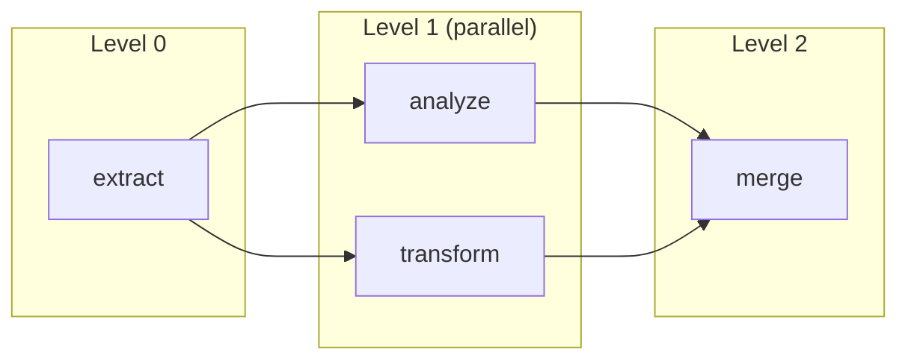

# run Command

The `run` command is the primary way to run a workflow. It resolves dependencies, runs independent actions in parallel and finds tools automatically.

```bash
agac run -a <workflow-name> [options]
```

:::note[Run from Anywhere]
You can run this command from any subdirectory in your project. The CLI will find your project root automatically.
:::

## Basic Usage

These are the basic commands:

```bash
# Run an agentic workflow
agac run -a my_workflow

# Run with custom tools
agac run -a my_workflow -u ./user_code --use-tools

# Force parallel execution
agac run -a my_workflow --execution-mode parallel
```

The last line of the output counts actions, not records. A final action is an action that no other action reads.
A final action can complete, or be skipped, with no record. This occurs when each record was filtered, skipped or
failed before it got to the final action. In that case, the run prints a warning under the last line and names the final action:

```
✓ 0.3s — 1 completed, 1 skipped
⚠ No records reached the final output: write_out
```

The log line before the warning names the `agac dispositions` command that shows the cause.

## Options

| Option | Description |
|--------|-------------|
| `-a, --agent NAME` | The workflow name (required) |
| `-u, --user-code DIRECTORY` | The path to the folder of your code that contains the tools |
| `--use-tools` | Let actions use tools |
| `-e, --execution-mode` | The execution mode: `auto` (default), `parallel` or `sequential` |
| `--concurrency-limit` | The maximum number of concurrent actions (default: 5, range: 1-50) |
| `--record-limit N` | Limit each action to N records **per input file**, whatever the workflow configuration sets. This is the same unit that `record_limit` uses. The flag applies to actions that set no limit of their own. It takes precedence over `AGAC_RECORD_LIMIT`. An action that actually drops records says so, and names this flag and the counts. The reason is that a truncated run otherwise looks complete |
| `--file-limit N` | Stop each action after N input files, whatever the workflow configuration sets. This is the same unit that `file_limit` uses. The flag counts the files that the action processed successfully. Thus a file that fails does not use the budget, and the action attempts each file in a directory of unreadable files. The flag applies to actions that set no limit of their own. It takes precedence over `AGAC_FILE_LIMIT`. An action whose walk through its input files actually stops says so, and names this flag. The reason is that a shortened run otherwise looks complete. This flag never limits `agac retry` |
| `--fresh` | Before execution, clear the stored results, the dispositions, the prompt traces, the status and the event logs (`events.json`, `errors.json` and their rotations from earlier runs). Also discard the data that the provider recorded locally about each batch that this workflow submitted, collected or not. This flag gives a clean start for debugging. |
| `--rerun ACTION` | Answer each record of `ACTION` again, under the configuration as it is now. Do the same for each action that reads the output of `ACTION`. You can give the name of a versioned action as the configuration writes it. The flag then runs each version of the action again. Each other action keeps its answers. Use this flag after a configuration edit. An edit alone runs nothing again (see [When you edit the workflow](#when-you-edit-the-workflow)). If the workflow does not have the name, the run stops before it starts |
| `--verify-keys` | Verify the API keys before execution. The command probes each vendor one time for each endpoint. For an `openai` action with `base_url`, the probe uses `models.list()` at that URL. For an action without `base_url`, the probe uses the OpenAI endpoint. If a server does not answer, the command logs a warning and the run continues. A local server may serve `/v1/models` without a check of the key (llamafile 0.10.6 does this). Thus a passing probe there shows that the server is reachable, not that the key is correct. Each [declared endpoint](../configuration/endpoints.md#verify-an-endpoint) that the workflow uses also gets one structured-output request. For that request, three conditions are errors. They are a refused credential, a server that cannot be reached, and a reply that does not match the schema of the probe |

## Run a Smaller Version of a Project {/* #running-a-project-smaller-than-it-is */}

The limits of a workflow are in the project configuration, for each action. To run the workflow at a low cost without a change to the configuration,
limit the whole run from the command line. Examples are a smoke check, a quick pass over a real dataset, or one action under a debugger:

```bash
agac run -a my_workflow --record-limit 2 --file-limit 1
```

The limit applies to **every** action, which includes the actions that configure no limit of their own.
If the own limit of an action is smaller, the action keeps its own limit.
This is more important than it seems. A workflow can branch into dozens of actions with repair
loops. In such a workflow, a small configured limit becomes a very large number of model calls.

The two flags limit different dimensions, and the size of a run is proportional to the two dimensions. `--record-limit` counts
**per input file**. This is the same unit that [`record_limit`](../configuration/defaults) uses. Thus, if a staging
directory holds five files, `--record-limit 2` processes up to ten records for each action, not
two. `--file-limit` limits the walk through the files. Thus `--file-limit 1` gets to one of those five files,
whatever the record limit is.

Each action that actually drops records logs a line that names the flag and the counts. Each
action whose walk actually stops logs a line that names the flag that stopped it. An action that is smaller than
its limit logs nothing. `AGAC_RECORD_LIMIT` and `AGAC_FILE_LIMIT` do the same job from the
environment. If you use the flag and the environment variable, the flag wins, because you typed it for this run. A value
that cannot limit anything is not ignored. It fails the run, before any
action starts.

For the flags and for the environment variables, the store keeps the limits in force with the action. Thus, if you remove or increase a limit, the run processes again what the limit held
back. It does not serve a short run as a finished run. You can change `--record-limit` to a different value. The action then runs
again when the new limit could have held something back. If you increase the limit above what an
untruncated run already processed, nothing changes. The reason is that a limit that cannot have an effect is not a
different amount of work. A run that cannot say what it processed runs again on any change.
Two examples are a run that completed without recorded counts, and a run that lost an input file to an
error. In the second example, the records that the run never got to were never counted. `--file-limit` has no such count. Thus any change to `--file-limit` runs
the action again. This includes a change to a value that is larger than the number of staged files. A batch action stores the limits that the run that *submitted* it applied. It does not store
the limits that the later run that collects it was asked for.

The two limits have different effects on the output. `--record-limit` writes again each file that it walks. Thus the run drops the
extra records, and the remaining output is the work of that limit. `--file-limit` limits which
files the run opens at all. A file that the run does not get to keeps the output that the previous run wrote
there. That is the purpose of the file limit. Thus a limited run over a project that already ran is
not a fresh, smaller copy of the project. It is the earlier output, with the walked files replaced. That is
usually what you want for a quick pass. When all of the output must come from
one run, use `--fresh`.

A workflow that has completed is skipped on the next run, unless its limits or its staged
input changed. A configuration edit runs nothing again (see
[When you edit the workflow](#when-you-edit-the-workflow)).

A change to the staged input counts. You can add, remove or change a file under the input of the first stage.
Agent Actions then runs that action again, and each action that reads it. The run log names the files
that changed. As with an edit, the records that the change did not touch keep their answers. The action answers an added record.
It also answers a record whose content changed, because that record is then a new record.

If no staged file holds a record any more, the record leaves nothing. Agent Actions removes its rows, its disposition and its checkpoints,
at that action and at each action that reads it. This includes a disposition that is a failure. Thus `agac retry` no longer offers the record.
The prompt traces of the record stay. Agent Actions removes a record only after a walk that
read each staged file. It does not remove a record under a file limit, or when it could not read a file, or under
`agac retry`. A record that a record limit excludes is still staged, and it keeps what it holds.
You do not need `--fresh` to read new input. `--rerun` answers each record again.

The two flags do not limit [`agac retry`](./retry). A repair walks each file that holds a record that the repair
named. If the repair stopped before one of these files, the cleared disposition of that record would stay unwritten.
A limit exists to prevent this type of erasure.

## When you edit the workflow

If you edit an action in the configuration, the edit does not run anything again. This rule covers these items:

- The model of the action (`model_name`, `model_vendor`, in the action or in `defaults`)
- The prompt, the schema, the guard, `context_scope` and `dependencies`
- The generation settings that an LLM action sends
  (`temperature`, `max_tokens`, `top_p`, `stop`, `frequency_penalty`, `presence_penalty`, `vendor_params`,
  in the action, in `defaults` or in `default_agent_config`)
- The code of a tool or a UDF guard: the full file that defines it, but not the modules that the file imports

The records that the action already answered keep their
answers. The actions that read these records also keep their answers. The action answers the records that it did not answer yet
under the edit. Thus you can change the model of a long run before the run is complete. The run does not ask again for anything that it
already paid for.

Each run that finds an edited action reports the edit, and names what changed:

```
classify was edited since it completed (model): its answers stand, and only records it has
not answered use the edit. Run again with --rerun classify to answer every record under the edit
```

An action can stop before it is complete: it was killed, interrupted or stopped by an error. Such an action keeps the
records that it finished. It answers the other records under the edit. After the action completes, each later run
names the edit as for a completed action. The reason is that the action still holds answers from before the edit:

```
classify was edited since its last run started (model): the records it finished stand, a
batch already sent is collected as it was sent, and the rest are answered under the edit. Run
again with --rerun classify to answer every record under the edit
```

A batch that the action sent before the edit, and that is not collected yet, counts as finished records. After
collection, the answers of the batch are from before the edit, and each later run names the edit. An action
that kept nothing, not even a batch, answers each record under the edit. The run tells you so:

```
classify was edited since its last run started (model): it kept no answers, so every
record is answered under the edit
```

An edit can occur together with a change to the staged input. The run names that edit in the same way. The records that the change
added or changed are answered under the edit. Each other record keeps its answer.

To answer each record under the edit, use `--rerun` with the name of the action. The flag runs that
action again, and each action that reads its output. Each other action keeps its answers:

```bash
agac run -a my_agent --rerun classify
```

An action that may hold answers from more than one configuration continues to report this, even after you change the
configuration back. This applies to these cases:

- A resume under an edit
- A retry under an edit
- A reset under a file limit that leaves files from an earlier configuration

```
classify may hold answers given under more than one config. Run again with --rerun classify
to answer every record under the config in force
```

You can edit an action while its batch is submitted and not yet collected. The run that collects the batch then names the edit.
The run collects the batch as it was sent:

```
classify was edited since its batch was sent (model): the batch is collected as it was sent.
Run again with --rerun classify to answer every record under the edit
```

Under a file limit, `--rerun` gets to only the files that the walk opens. The run warns that
the files that it does not get to keep output from an earlier run. The action still shows as
complete. The run gives the same warning when a changed limit resets an edited action. When all of the output must come from one configuration,
use `--fresh`.

`--fresh` starts the whole workflow again. Each [prompt trace](../data-io/prompt-traces) row
records the configuration under which its record was answered. Thus you can read a workflow that holds answers from more
than one configuration, one record at a time.


## Parallel Execution

Agent Actions automatically finds independent actions and runs them concurrently.

```bash
# Auto-detect parallel execution (default)
agac run -a my_workflow

# Force parallel execution
agac run -a my_workflow --execution-mode parallel
# Or using short form:
agac run -a my_workflow -e parallel

# Force sequential execution
agac run -a my_workflow --execution-mode sequential

# Limit concurrent actions to 10
agac run -a my_workflow -e parallel --concurrency-limit 10
```

The diagram below shows how Agent Actions puts actions into levels. Actions at the same level run in parallel, because they do not depend on the outputs of each other:



`analyze` and `transform` both depend on `extract`, but not on each other. Thus they run concurrently. The `merge` action waits until the two actions complete.

When an action fails, the actions that read it are skipped, and the other actions of the workflow continue. This is true in each execution mode.

Two types of error end the run:

- An error that prevents an action from starting its work at all. An example is a store that does not answer.
- A store failure while the run counts the rows that an action wrote, after the action ran.

When one of these errors occurs, the run ends in this sequence:

1. In parallel mode, the actions that already run next to the failed action finish first.
2. The run stops with the error and a non-zero exit code.
3. No downstream action of the failed action runs.

The action that raised the error shows `failed`. Its `error_message` in `agent_io/.agent_status.json` is the error.
[`agac status`](./utilities#status) shows the error, and the run history records the failure.
After you fix the cause, run the workflow again, or use [`agac retry`](./retry#an-action-that-failed-as-a-whole).
`agac retry` runs that action again, and each action after it.

An online action also fails when the store refuses to record that one of its records
failed or exhausted its retries. If the store does not record the failure, `agac retry` could not
find the failure. Thus Agent Actions does not let the action complete without the record of the failure. These results occur:

- The action shows `failed`.
- The store error is its `error_message`, and the run history also contains the store error.
- The actions that read the failed action are skipped.
- The run exits with a non-zero code.

A batch action does not fail in this way. Its records
keep the `deferred` mark that they got at submission. The next run settles them (see
[`retry`](./retry#a-record-left-deferred-after-its-batch-was-collected)).

:::note[Concurrency Limits]
The default concurrency limit is 5 actions. The maximum is 50.
:::

If your workflow has many parallel actions and you get rate limit errors, consider a lower limit. If you have capacity, increase the limit, to a maximum of 50.

## Concurrent Runs {/* #concurrent-runs */}

A run holds a lock on `agent_io/store/<workflow>.db.lock` until the run exits. A second
`agac run` or `agac retry` of the same workflow exits 1 before it loads anything:

```
Problem: RunInProgressError: Another run of workflow 'ql_trace_probe' is in progress (pid 48211). Wait for it to finish or stop it, then run again.
```

Runs of different workflows do not block each other. Read-only commands (`inspect`,
`records`, `status`, `traces`, `preview`, `dispositions`, `retry --dry-run`) never take the
lock. The operating system releases the lock when the run exits or when something kills the run. Thus no lock
stays after the run. A run that submits a batch job exits. Thus the next run can collect the batch job.

`agac clean` and the `reset_workflow.py --full` script of the skills also take the lock.
`agac clean` takes the lock in each mode, when it finds something to remove.
The two commands take the lock before they ask a question or delete anything. While a run holds the lock, they exit 1.
The reason is that they delete what the run reads and writes. They hold the lock until they finish.
Thus Agent Actions refuses a run that starts during that time. They never delete the lock file.
After `clean --all`, the store folder holds only the empty `<workflow>.db.lock`.
On a system without `fcntl` (Windows), with a plain `python3`, `reset_workflow.py --full` cannot take the lock. It gives a warning and continues.

## See Also

- **[Tool Actions](../tools/)**: Create custom tools with `@udf_tool`
- **[batch Commands](./batch)**: Process large datasets asynchronously
- **[schema Command](./schema)**: Analyze the structure of a workflow and its field dependencies
- **[inspect Commands](./inspect)**: Analyze the context and the data flow without a run
