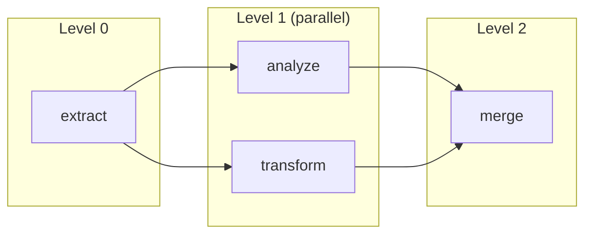

# run Command

The `run` command is your primary way to execute an agentic workflow. It handles dependency resolution, parallel execution, and tool discovery automatically.

```bash
agac run -a <workflow-name> [options]
```

:::tip Run from Anywhere
You can run this command from any subdirectory within your project. The CLI will automatically find your project root.
:::

## Basic Usage

Let's start with the essentials:

```bash
# Run an agentic workflow
agac run -a my_workflow

# Run with custom tools
agac run -a my_workflow -u ./user_code --use-tools

# Force parallel execution
agac run -a my_workflow --execution-mode parallel
```

## Options

| Option | Description |
|--------|-------------|
| `-a, --agent NAME` | Agentic workflow name (required) |
| `-u, --user-code DIRECTORY` | Path to user's code folder containing tools |
| `--use-tools` | Enable tool usage for actions |
| `-e, --execution-mode` | Execution mode: `auto` (default), `parallel`, or `sequential` |
| `--concurrency-limit` | Max concurrent actions (default: 5, range: 1-50) |
| `--record-limit N` | Cap each action at N records **per input file** — the same unit `record_limit` uses — whatever the workflow config sets. Applies to actions that set no limit of their own, and takes precedence over `AGAC_RECORD_LIMIT`. An action that actually drops records says so, naming this flag and the counts, since a truncated run otherwise looks complete |
| `--file-limit N` | Stop each action after N input files — the same unit `file_limit` uses — whatever the workflow config sets. It counts files the action got through, so a file that fails does not spend the budget and a directory of unreadable files is attempted in full. Applies to actions that set no limit of their own, and takes precedence over `AGAC_FILE_LIMIT`. An action whose walk actually stops says so, naming this flag, since a shortened run otherwise looks complete. Never holds back `agac retry` |
| `--fresh` | Clear stored results, dispositions, status, and event logs (`events.json`, `errors.json` and their earlier-run rotations) before execution, and discard what the provider recorded locally about every batch this workflow submitted, collected or not. Gives a clean slate for debugging. |
| `--rerun ACTION` | Answer every record of `ACTION`, and of every action that reads its output, again under the config as it is now. The name of a versioned action as the config writes it re-runs every version of it. Every other action keeps its answers. Use it after a config edit: an edit alone re-runs nothing (see [When you edit the workflow](#when-you-edit-the-workflow)). A name the workflow does not have stops the run before it starts |
| `--verify-keys` | Verify API keys before execution. Each vendor is probed once per endpoint: an `openai` action with `base_url` is probed at that URL with `models.list()`, and an action without one at the OpenAI endpoint. A server that does not answer is logged as a warning and the run continues. A local server may serve `/v1/models` without checking the key (llamafile 0.10.6 does), so a passing probe there shows the server is reachable, not that the key is right. Each [declared endpoint](../configuration/endpoints.md#verify-an-endpoint) the workflow uses gets one structured-output request too; there a refused credential, a server that cannot be reached and a reply that does not match the probe's schema are errors |

## Running a project smaller than it is

A workflow's limits live in the project's config, per action. To run it cheaply from
outside — a smoke check, a quick pass over a real dataset, one action under a debugger —
bound the whole run from the command line:

```bash
agac run -a my_workflow --record-limit 2 --file-limit 1
```

The bound applies to **every** action, including those that configure no limit of their own,
which matters more than it sounds: a workflow that fans out across dozens of actions with repair
loops turns a small configured limit into a very large number of model calls.

The two flags bound different axes, and a run is proportional to both. `--record-limit` counts
**per input file**, the same unit [`record_limit`](../configuration/defaults) uses — so a staging
directory holding five files and `--record-limit 2` processes up to ten records per action, not
two. `--file-limit` bounds the walk itself, so `--file-limit 1` reaches one of those five files
whatever the record limit is.

Each action that actually drops records logs a line naming the flag and the counts, and each
action whose walk actually stops logs one naming the flag that stopped it; an action smaller than
its limit stays quiet. `AGAC_RECORD_LIMIT` and `AGAC_FILE_LIMIT` do the same job from the
environment; when both doors are used the flag wins, because it was typed for this run. A value
that cannot bound anything fails the run rather than being ignored, and fails it before any
action starts.

Either way the limits in force are stored with the action, so lifting one re-runs what it held
back instead of serving a short run as a finished one. Changing `--record-limit` to another value
re-runs the action when the new limit could have held something back; raising it above what an
untruncated run already processed changes nothing, because a limit that cannot bite is not a
different amount of work. A run that cannot say what it processed re-runs on any change, as it
always did: one that completed before these counts existed, or one that lost an input file to an
error, since the records it never reached were never counted. `--file-limit` has no such count behind it, so any change to it re-runs
the action, including a change to a value larger than the number of staged files. A batch action stores what the run that *submitted* it applied, not
what the later run that collects it was asked for.

The two limits leave different traces. `--record-limit` rewrites every file it walks, so the
surplus records are dropped and what remains is that limit's work. `--file-limit` bounds which
files are opened at all, and a file it does not reach keeps the output the previous run wrote
there — the point of not walking it. So a bounded run over a project that has already been run is
not a fresh smaller copy of it: it is the earlier output with the walked files replaced. That is
usually what you want for a quick pass. Pass `--fresh` when the whole output has to come from
one run.

A workflow that has completed is skipped on the next run unless something it ran under
changed. Staged input counts: adding, removing or changing a file under the first stage's
input re-runs that action and every action reading it over all input, and the run log names
the files that changed. `--fresh` is not needed to pick up new input.

Neither flag holds back [`agac retry`](./retry): a repair walks every file holding a record it
named. Stopping short of one would leave that record's cleared disposition unwritten, which is
the erasure a limit exists to avoid.

## When you edit the workflow

An edit to an action's config does not re-run anything. That covers its model
(`model_name`, `model_vendor`, in the action or in `defaults`), prompt, schema, guard,
`context_scope` and `dependencies`. The records the action already answered keep their
answers, and so do the actions that read them. Records it has not answered yet are answered
under the edit. So you can switch the model of a long run partway through, and nothing it
already paid for is asked again.

Each run that meets an edited action says so, and names what changed:

```
classify was edited since it completed (model): its answers stand, and only records it has
not answered use the edit. Run again with --rerun classify to answer every record under the edit
```

An action that stopped partway (killed, interrupted, or stopped by an error) keeps the
records it finished and answers the rest under the edit. Once it completes, each later run
names the edit as for a completed action, since it still holds answers from before it:

```
classify was edited since its last run started (model): the records it finished stand, and
the rest are answered under the edit. Run again with --rerun classify to answer every record
under the edit
```

To answer every record under the edit, pass `--rerun` with the action's name. It re-runs that
action and every action that reads its output, and keeps every other action's answers:

```bash
agac run -a my_agent --rerun classify
```

Under a file limit, `--rerun` reaches only the files the walk opens. The run warns that
the files it does not reach keep output from an earlier run, and the action still reads as
complete. The same warning comes when a changed limit resets an edited action. Pass
`--fresh` when the whole output has to come from one config.

`--fresh` starts the whole workflow again. Each [prompt trace](../data-io/prompt-traces) row
records the config its record was answered under, so a workflow that holds answers from more
than one config can be read record by record.


## Parallel Execution

Agent Actions automatically detects independent actions and runs them concurrently.

```bash
# Auto-detect parallel execution (default)
agac run -a my_workflow

# Force parallel execution
agac run -a my_workflow --execution-mode parallel
# Or using short form:
agac run -a my_workflow -e parallel

# Force sequential execution
agac run -a my_workflow --execution-mode sequential

# Limit concurrent actions to 10
agac run -a my_workflow -e parallel --concurrency-limit 10
```

The diagram below shows how Agent Actions organizes actions into levels. Actions at the same level run in parallel because they don't depend on each other's outputs:



Notice that `analyze` and `transform` both depend on `extract`, but not on each other - so they run concurrently. The `merge` action waits for both to complete.

When an action fails, the actions that read it are skipped and the rest of the workflow carries on, whichever mode runs it. An error that keeps an action from starting its work at all, such as the store not answering, ends the run instead, and so does the store failing as the rows an action wrote are counted once it has run: in parallel mode the actions already running beside it finish first, then the run stops with the error and a non-zero exit, and nothing below it runs. The action that raised reads `failed`, with the error as its `error_message` in `agent_io/.agent_status.json`; [`agac status`](./utilities#status) shows it, and the run history records the failure. Once the cause is fixed, run the workflow again, or [`agac retry`](./retry#an-action-that-failed-as-a-whole), which re-runs that action and every action after it.

An online action also fails when the store refuses to record that one of its records
failed or exhausted its retries. Unrecorded, the failure is one `agac retry` could not
find, so the action is not left to complete without it: it reads `failed`, with the store
error as its `error_message` and in the run history, the actions that read it are
skipped, and the run exits non-zero. A batch action does not fail this way: its records
keep the `deferred` mark they were submitted with, and the next run settles them (see
[`retry`](./retry#a-record-left-deferred-after-its-batch-was-collected)).

:::info Concurrency Limits
The default concurrency limit is 5 actions. If your agentic workflow has many parallel actions and you're hitting rate limits, consider reducing this. If you have capacity, increase it up to 50.
:::

## See Also

- **[Tool Actions](../tools/)** - Creating custom tools with `@udf_tool`
- **[batch Commands](./batch)** - Process large datasets asynchronously
- **[schema Command](./schema)** - Analyze workflow structure and field dependencies
- **[inspect Commands](./inspect)** - Analyze context and data flow without running
