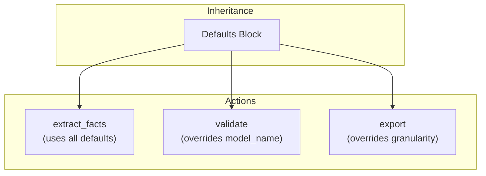

# Defaults

The defaults block sets configuration values that all actions in a workflow inherit. An action can override each default value. Thus you do not write the same value many times. For example, if 20 actions use the same model, you write `model_vendor: openai` one time, not twenty times. This is DRY (do not repeat yourself) configuration.

The defaults work like CSS inheritance. You set base styles on a parent element, and the child elements inherit them unless they explicitly override them.

## Overview

The defaults give these benefits:

- **Reduced repetition** - You set common values one time
- **Consistency** - All actions share the base configuration
- **Flexibility** - You override specific values in each action
- **Maintainability** - You change the shared configuration in one place

## Syntax

```yaml
defaults:
  model_vendor: openai
  model_name: gpt-4o-mini
  json_mode: true
  granularity: record
  run_mode: batch

actions:
  - name: action_using_defaults
    prompt: "..."  # Inherits all defaults

  - name: action_with_override
    model_name: gpt-4  # Override just this value
    prompt: "..."
```

:::note[Examples show the setting, not a complete action]
The examples on this page omit the lines that are not the subject of the example. Each action also needs an `intent` and a `context_scope`. The file also needs a `name` that matches its filename, and a `description`.
:::

## Defaultable Fields

| Field | Type | Description |
|-------|------|-------------|
| `model_vendor` | string | The LLM provider (openai, anthropic and other providers) |
| `model_name` | string | The model identifier |
| `frequency_penalty` | float | A penalty for repeated tokens, from -2.0 to 2.0 (OpenAI and Groq) |
| `presence_penalty` | float | A penalty for tokens that are already present, from -2.0 to 2.0 (OpenAI and Groq) |
| `json_mode` | boolean | Enables JSON output mode (default: `true`). See [Non-JSON Mode](../../guides/non-json-mode.md) |
| `output_field` | string | The field name for plain-text output when `json_mode: false` (default: `raw_response`) |
| `granularity` | string | `record` (default) or `file` processing. Here, `file` applies to tool actions only. LLM actions stay at `record`, and HITL actions are always `file` |
| `run_mode` | string | `online` (default) or `batch` execution |
| `on_empty` | string | The result of an empty answer: `warn` (default), `error` or `skip`. See [Execution Fields](./index.md#execution-fields) |
| `context_scope` | object | The default context visibility: `observe`, `drop`, `passthrough`, `seed` |
| `temperature` | float | The LLM temperature (0.0-2.0) |
| `max_tokens` | integer | The maximum number of response tokens |
| `top_p` | float | Top-p (nucleus) sampling (0.0-1.0) |
| `stop` | string/list | The stop sequence or sequences that end the generation |
| `record_concurrency` | integer | The number of records of an online LLM action that are sent at the same time (1-32). If unset, the value is 1. Tool, hitl and batch actions ignore this field. See [Record concurrency](./index.md#record-concurrency) |
| `request_timeout` | number | The number of seconds that one LLM request may take (greater than 0). If a request takes longer, that attempt fails and `retry` retries it. If unset, each provider SDK keeps its own timeout. See [Request timeout](./index.md#request-timeout) |
| `record_limit` | integer | The maximum number of records in each file (default: unlimited). `AGAC_RECORD_LIMIT` caps this value from the environment |
| `file_limit` | integer | The maximum number of files that each action walks (default: unlimited). `AGAC_FILE_LIMIT` limits this value from the environment. This limit does not restrict [`agac retry`](../cli/retry). That command walks the files that hold the records it named, and does not stop at N |
| `enable_prompt_caching` | boolean | Enables Anthropic prompt caching, to reduce the costs of repeated prompts (default: `false`) |

The table lists the common keys. A `defaults:` block accepts each key that [Unrecognized Default Key](#unrecognized-default-key) lists. These keys include `api_key`, `base_url`, `retry`, `expect`, `data_source`, `chunk_config` and `prompt_debug`.

:::note[Every defaultable key is declared]
`DefaultsConfig` declares each key that a `defaults:` block accepts. The load refuses a key that `DefaultsConfig` does not declare. The load does not drop the key silently. The refusal names the declared key that the stray key resembles. The refusal always lists the keys that the block accepts. Thus each key that the framework reads from `defaults:` is also a key that you can write there. If a key is worth inheriting, it is declared.
:::

## Example

```yaml
defaults:
  json_mode: true
  granularity: record
  run_mode: batch
  model_vendor: openai
  model_name: gpt-4o-mini

actions:
  - name: extract_facts
    prompt: $my_workflow.Fact_extraction
    schema: candidate_facts_list
    # Inherits: model_vendor, model_name, json_mode, granularity, run_mode

  - name: score_question_quality
    model_vendor: anthropic
    model_name: claude-sonnet-4-20250514
    # Overrides model settings, inherits everything else
```

## Inheritance Rules

The diagram shows how the defaults go to the actions. Each action can override specific fields and inherit all other fields:



Thus one action can use Claude while the other actions use GPT-4. All of the actions inherit the same execution settings.

### Resolution Order

Agent Actions resolves a value in this order:

1. The value in the action (if defined)
2. The value in the workflow `defaults:` (if defined)
3. The project `default_agent_config` value in `agent_actions.yml` (if defined)
4. The system default (the built-in fallback)

```yaml
defaults:
  model_name: gpt-4o-mini  # Workflow default

actions:
  - name: standard_action
    # Uses: gpt-4o-mini (from defaults)

  - name: premium_action
    model_name: gpt-4  # Override: uses gpt-4
```

## Context Scope Defaults

The `context_scope` in the defaults block applies to all actions. This is particularly useful for seed data that more than one action needs:

```yaml
defaults:
  context_scope:
    seed:
      syllabus: $file:exam_syllabus.json
      rubric: $file:grading_rubric.yaml

actions:
  - name: extract_facts
    # Has access to seed.syllabus and seed.rubric
    prompt: |
      Using syllabus: {{ seed.syllabus.exam_name }}
      Extract facts from: {{ source.content }}

  - name: score_quality
    dependencies: [extract_facts]
    # Also has access to same seed data
    context_scope:
      observe:
        - extract_facts.facts  # Add action-specific scope
    # seed is merged with defaults
```

### Context Scope Merging

An action can define its own context_scope. Agent Actions then **merges** the context_scope of the action with the defaults. It does not replace the defaults. Most fields do not work this way:

```yaml
defaults:
  context_scope:
    seed:
      config: $file:config.json

actions:
  - name: my_action
    dependencies: [upstream]
    context_scope:
      observe:
        - upstream.field
      passthrough:
        - source.id
    # Result: seed from defaults + observe/passthrough from action
```

## Overriding Patterns

### Override Single Field

```yaml
defaults:
  model_vendor: openai
  model_name: gpt-4o-mini

actions:
  - name: complex_task
    model_name: gpt-4  # Only override model_name
    # Still uses openai vendor from defaults
```

### Override Multiple Fields

```yaml
defaults:
  model_vendor: openai
  model_name: gpt-4o-mini
  run_mode: batch

actions:
  - name: interactive_task
    model_vendor: anthropic
    model_name: claude-sonnet-4-20250514
    run_mode: online
    # Overrides all three
```

### Conditional Override

```yaml
defaults:
  granularity: record

actions:
  - name: per_item_process
    # Uses record from defaults

  - name: aggregate_results
    kind: tool          # file granularity is for tool and HITL actions
    impl: aggregate_results
    granularity: file  # Override for aggregation
    dependencies: [per_item_process]  # Input source
```

## Tool Actions and Defaults

Tool actions inherit the relevant defaults. But some fields, for example `run_mode`, do not apply to tools, because tools do not make LLM calls:

```yaml
defaults:
  granularity: record
  run_mode: batch

actions:
  - name: validate_data
    kind: tool
    impl: validate_function
    # Inherits granularity: record
    # run_mode doesn't apply to tools

  - name: aggregate_data
    dependencies: [validate_data]  # A file action reads the output of an action before it
    kind: tool
    impl: aggregate_function
    granularity: file  # Override for this tool
```

## Best Practices

This section gives patterns to configure the defaults.

### 1. Set Common Model Configuration

```yaml
# Good: Centralize model settings
defaults:
  model_vendor: openai
  model_name: gpt-4o-mini
  api_key: OPENAI_API_KEY

# Avoid: Repeating in every action
actions:
  - name: action1
    model_vendor: openai  # Repetitive
    model_name: gpt-4o-mini
```

### 2. Use Defaults for Consistency

```yaml
# Good: Ensure consistent settings
defaults:
  json_mode: true
  granularity: record
  run_mode: batch

# All actions will use these unless explicitly overridden
```

### 3. Document Overrides

```yaml
actions:
  - name: premium_analysis
    model_name: gpt-4  # Override: complex task needs better model
    intent: "Deep analysis requiring GPT-4 capabilities"
```

### 4. Group Related Defaults

```yaml
defaults:
  # Model configuration
  model_vendor: openai
  model_name: gpt-4o-mini

  # Generation parameters
  temperature: 0.7
  max_tokens: 2000

  # Processing configuration
  json_mode: true
  granularity: record
  run_mode: batch
```

### 5. Set Generation Parameters at Defaults Level

Generation parameters, for example `temperature`, `max_tokens`, `top_p` and `stop`, follow the same inheritance rules. Set sensible defaults. Then override them in each action that needs a different value:

```yaml
defaults:
  temperature: 0.7
  max_tokens: 2000

actions:
  - name: creative_writing
    temperature: 0.9  # Override: more creative
    max_tokens: 4000  # Override: longer output

  - name: classification
    temperature: 0.1  # Override: more deterministic
    stop: ["\n"]      # Stop at newline
```

### 6. Use Limits for Test Runs

Limit the processing to validate a workflow quickly, before you run it on the full data:

```yaml
# testing config
defaults:
  record_limit: 10    # Process only 10 records per file
  file_limit: 3       # Walk only 3 files per action

# production config — remove limits
defaults:
  # record_limit and file_limit omitted = unlimited
```

To make a run smaller without a change to the project, pass [`--record-limit`](../cli/run#running-a-project-smaller-than-it-is) or [`--file-limit`](../cli/run#running-a-project-smaller-than-it-is) to `agac run`. Alternatively, set `AGAC_RECORD_LIMIT` / `AGAC_FILE_LIMIT` where a variable is more suitable. If both are set, the flag wins. Each one limits the same axis as its config key: records for each input file, and input files for each action. Both apply to each action, including the actions that configure no limit. Thus you can use them on a project that you do not own:

```bash
AGAC_RECORD_LIMIT=2 AGAC_FILE_LIMIT=1 agac run -a my_workflow
```

`record_limit` applies at any action: start actions, actions in the middle of the workflow, or leaf actions. Use it to test a single downstream action without a new run of the full workflow. `file_limit` applies at all stages.

Neither limit restricts [`agac retry`](../cli/retry). That command selects records by id and processes only those records. It walks each file that holds one of those records, for any setting of either limit.

If the limit that applies changes between runs, the actions run again. They are not skipped. This occurs if the limit changed in the config, on the command line or in the environment. The reason is that a completed action stores the limit that actually applied, not the limit that the config asked for.

A raised `record_limit` is the exception. If the last run of an action processed everything that was available, a larger limit cannot reduce that result. So the action stays complete. Some runs cannot say what they processed. Examples are a run that completed before these counts existed, and a run that lost an input file to an error. Such a run keeps the simpler rule. `file_limit` also keeps the simpler rule, because nothing counts the files that a walk did not open.

### 7. Environment-Specific Defaults

Create separate config files for different environments:

```yaml
# development.yml
defaults:
  run_mode: online
  model_name: gpt-4o-mini

# production.yml
defaults:
  run_mode: batch
  model_name: gpt-4
```

## Validation

Agent Actions catches configuration errors. It validates these items:

1. The default field names are declared. Agent Actions refuses an undeclared key. It does not ignore it.
2. The default values have valid types and are in the permitted range.
3. The required fields are present at some level (`model_vendor` for an LLM action, set in the project config, the workflow defaults or the action).

### Unrecognized Default Key

```
Error: Configuration Error: Invalid configuration in agent 'my_workflow'
  Problem: 1 validation error for WorkflowConfig
defaults
  Value error, unknown defaults key 'temperture' — did you mean 'temperature'?; valid defaults keys are anthropic_version, api_key, base_url, ...
```

The list of valid keys is always present. A suggestion is the closest-spelling match, so it can point at the wrong field. The list is the fallback.

### Missing Required Field

```
Error: Configuration Error: Missing required configuration fields
  Problem: Action 'my_action' is missing required configuration: 'model_vendor'
These fields were not found at any level (project → workflow → action).
```

### Invalid Default Value

```
Error: Configuration Error: Invalid configuration in agent 'my_workflow'
  Problem: 1 validation error for WorkflowConfig
defaults.granularity
  Input should be 'record' or 'file' [type=enum, input_value='invalid', input_type=str]
```

To validate and run your workflow, run `agac run -a my_workflow`. The command catches configuration errors automatically, before any LLM calls.

## See Also

- [Configuration](./) - Complete configuration reference
- [Templates](./templates) - Template-based configuration
- [Run Modes](../execution/run-modes) - Batch vs online execution
- [Granularity](../execution/granularity) - Record vs file processing
