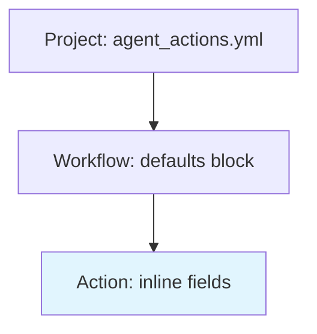

# Configuration

Agent Actions uses a configuration hierarchy with three levels. You set defaults one time and override them where necessary. Thus you do not repeat the same settings in dozens of actions. The more specific level wins. Action settings override workflow defaults, and workflow defaults override project defaults.

The hierarchy works like CSS specificity. Project settings are the base styles. Workflow defaults are class-level overrides. Action settings are inline styles that have priority.

The diagram shows how the configuration goes from the project level to each action:



The most specific level (the inline fields of the action) has the final decision. Thus you can set sensible defaults for the full project, and still customize an individual action when necessary.

## Project Configuration

The `agent_actions.yml` file in the root of your project defines the global settings:

```yaml
# agent_actions.yml
default_agent_config:
  api_key: OPENAI_API_KEY
  model_name: gpt-4o-mini
  model_vendor: openai
  chunk_config:
    chunk_size: 4000
    chunk_overlap: 500

schema_path: schema
tool_path: ["tools"]
seed_data_path: seed_data
seed_data_paths: [shared_seeds]
required_by_default: false

endpoints:                  # OpenAI-compatible servers an action selects with model_vendor
  lab-vllm:
    url: http://gpu-box:8000/v1
    auth: none

logging:
  level: WARNING            # console level; the run log keeps every level
  module_levels:
    httpx: INFO             # re-open a logger the framework clamps to WARNING
  file:
    max_bytes: 52428800     # per run file, DEBUG rows stop past this; 0 = no cap
    backup_count: 5         # earlier runs kept as events.1.json ... events.N.json
```

| Field | Description |
|-------|-------------|
| `default_agent_config` | The default settings that all actions inherit, including `chunk_config`. See [Chunking](../data-io/chunking). Only the keys nested here reach an action. Nothing reads a `chunk_config:` at the top level of the file |
| `schema_path` | The directory that contains the output schemas. Required: if it is not set, the load of a schema fails. `agac init` writes `schema_path: schema` |
| `tool_path` | The directories to scan for custom tools |
| `seed_data_path` | The directory for static reference data (default: `seed_data`) |
| `seed_data_paths` | Shared seed folders, relative to the project root. Agent Actions searches them after the folder of the workflow and the folder of the project. See [Seed Data](../context/seed-data#shared-folders) |
| `endpoints` | OpenAI-compatible servers with structured output. Each server has a `url`, an `auth` source and optional `headers`. An action selects one with `model_vendor: <name>`. See [Endpoints](./endpoints) |
| `required_by_default` | When `true`, flat schema fields (`fields:` list) are required, unless they are marked `optional: true`. When `false` (default), they are optional, unless they are marked `required: true`. This applies to the full project. A schema that declares its own `required_by_default` overrides it. |
| `logging` | Logging for each command that runs in the project. `level` is the console level (`DEBUG`, `INFO`, `WARNING`, `ERROR`, `CRITICAL`, default `INFO`). `module_levels` maps Python logger names to levels. It is the only way to re-open a logger that the framework clamps (`httpx`, `openai`, ...), or to make another logger quiet. `file.max_bytes` and `file.backup_count` set the size and the rotation of the run log. The CLI loads this block when it boots, before any command runs. If an `AGENT_ACTIONS_*` variable is set, it overrides the matching key. `--debug` / `--verbose` / `--quiet` override both. A key under `logging:` that nothing reads (`file.path`, `file.enabled`, `file.level`, `file.format` and any other) configures nothing. The CLI reports such a key on stderr at boot. The run log always writes to `agent_io/logs/events.json` of the workflow. See [Logging](../architecture/logging). |

## Workflow Configuration {/* #agentic-workflow-configuration */}

Each workflow YAML file defines defaults and actions. This example shows how a workflow contains model settings, execution modes and action definitions:

```yaml
# agent_config/my_workflow.yml
name: my_workflow
description: "Extract and validate facts"
# version: "1.0.0"  # Optional — for your own bookkeeping

defaults:
  model_vendor: openai
  model_name: gpt-4o-mini
  json_mode: true
  granularity: Record
  run_mode: batch

actions:
  - name: extract_facts
    intent: "Extract key facts from content"
    prompt: $prompts.extract_facts
    schema: facts_schema
    context_scope:
      observe: [source.*]
```

The top level accepts only these keys, and refuses all other keys. Without this check, a misspelled `defaults:` would be dropped silently, together with each setting in the block:

| Key | Meaning |
|-----|---------|
| `name` | The workflow name (required). It must match the file name without `.yml` |
| `description` | The workflow description (required) |
| `version` | Optional. For your own bookkeeping |
| `defaults` | The settings that each action inherits |
| `actions` | The actions (required) |
| `tool_path` | The location of the tools of this workflow. It has priority over the default config and over `tool_path` in `agent_actions.yml` |
| `storage` | Maintenance settings: `prompt_trace_retention_runs` and `source_data_ttl_days`. The unit of the first setting is **calendar days**, not runs, although its name says runs. `0` means never prune. If you omit a key, the framework default applies. For traces, the framework default is 10 days, and it does prune |

Model settings, for example `model_vendor`, go under `defaults:`, not at the top level.

See [Defaults](./defaults.md) for the complete inheritance system.

## Action Configuration

Each action can override any default. If one action must use a different model or run in a different mode, specify those fields on the action:

```yaml
actions:
  - name: extract_facts
    intent: "Extract key facts from content"
    dependencies: [prior_action]  # Input source

    # Model
    model_vendor: openai
    model_name: gpt-4o-mini

    # Prompt & Schema
    prompt: $prompts.extract_facts
    schema: facts_schema
    json_mode: true
    context_scope:
      observe: [source.*]

    # Execution
    run_mode: batch
    granularity: Record

    # Conditional
    guard:
      condition: "source.content != ''"
      on_false: filter
```

### Core Action Fields

| Field | Type | Description |
|-------|------|-------------|
| `name` | string | A unique action identifier |
| `intent` | string | A human-readable description (required) |
| `kind` | string | `llm` (default), `tool` or `hitl` |
| `dependencies` | list | The upstream actions to wait for |
| `prompt` | string | An inline prompt or a `$store.template` reference |
| `schema` | string | The output validation schema |
| `context_scope` | object | Controls data visibility: `observe`, `drop`, `passthrough`, `seed`. Each action must declare one. See [Context Scope](../context/context-scope.md) |

### Model Fields

| Field | Type | Description |
|-------|------|-------------|
| `model_vendor` | string | Provider: openai, anthropic, google, groq, cohere, ollama_local, ollama_cloud, llamafile, agac-provider |
| `model_name` | string | The model identifier (for example, gpt-4o-mini) |
| `api_key` | string | The name of the environment variable for the API key. Not necessary for `agac-provider`, `ollama_local`, `llamafile` or a declared endpoint. An action on one of them expands and inspects with no `api_key` at any level |
| `base_url` | string | The server URL for `openai`, `llamafile`, `ollama_local` and `ollama_cloud`. For `openai`, it can be any server that speaks the OpenAI chat API, for example `http://localhost:8080/v1`. Preflight refuses it on `anthropic`, `gemini`, `groq` and `cohere` actions |
| `temperature` | float | The LLM temperature (0.0-2.0) |
| `max_tokens` | integer | The maximum number of response tokens |
| `top_p` | float | Top-p (nucleus) sampling (0.0-1.0) |
| `stop` | string/list | The stop sequence or sequences that end the generation |
| `vendor_params` | object | Other request parameters of the vendor SDK, passed through as written. See [Vendor parameters](#vendor-parameters) |

:::note[Vendor-Specific Parameter Mapping]
Agent Actions automatically maps the generation parameters (`temperature`, `max_tokens`, `top_p`, `stop`) to the API keys of each vendor:
- **OpenAI / Groq**: The parameters go to the API unchanged. OpenAI and Groq also support `frequency_penalty` and `presence_penalty`.
- **Anthropic**: `stop` → `stop_sequences` (a string value is wrapped in a list)
- **Gemini**: `max_tokens` → `max_output_tokens`, `stop` → `stop_sequences`
- **Cohere**: `top_p` → `p`, `stop` → `stop_sequences`
- **Ollama**: `max_tokens` → `num_predict`. The parameters go in the `options` dict. `stop` strings are wrapped in a list.
:::

### Vendor parameters

`vendor_params` passes any other request parameter of the vendor SDK to the vendor, under the name that the SDK uses. Use it for parameters such as thinking budgets, reasoning effort, `seed` or `top_k`.

```yaml
defaults:
  model_vendor: anthropic
  model_name: claude-haiku-5-5
  max_tokens: 16000
  vendor_params:
    thinking: {type: disabled}

actions:
  - name: write_quiz
    vendor_params:
      top_k: 40
```

The rules:

- **The keys are the SDK's own.** A key is a keyword argument of the request that the SDK sends. For Gemini, a key is a field of `GenerateContentConfig`. For Ollama, a key is an argument of `chat()`. The value goes to the vendor unchanged.
- **Preflight checks each key.** `agac inspect` and `agac run` refuse a key that the request does not take. The error names the action, the key and the valid keys. An unknown key never passes silently.
- **agac sets some keys itself.** Preflight refuses `model`, `messages`, `tools`, `system`, `stream` and `timeout` on every vendor. It also refuses `stream_options` on OpenAI, `request_options` on Cohere and `http_options` on Gemini. Set the timeout with [`request_timeout`](#request-timeout).
- **A vendor parameter wins.** A key that agac also sets, for example `temperature` or the default `tool_choice`, takes the value from `vendor_params`.
- **Blocks merge key by key.** An action's `vendor_params` merge over the `vendor_params` in `defaults:`. Those merge over the `vendor_params` in the `default_agent_config:` of the project. A key at a lower level replaces the same key above it. The other keys above it stay.
- **Some dicts merge too.** Ollama `options` merge into the options that agac sets, so `num_ctx` keeps the `num_predict` that comes from `max_tokens`. `extra_headers`, `extra_query` and `extra_body` merge the same way.
- **A newer parameter goes in `extra_body`.** If the installed SDK does not know a parameter yet, put it under `extra_body` (Anthropic, OpenAI, Groq). The SDK sends `extra_body` as part of the request body.
- **Batch requests carry the same keys.** In a batch file, `extra_body` joins the request body. `extra_headers` and `extra_query` do not apply. Gemini batch requests put `safety_settings`, `system_instruction`, `tool_config`, `cached_content` and `labels` beside `generation_config`, and every other key in it.
- **An agac-provider action ignores the block.** It accepts any key, so a workflow that you switch to the mock provider keeps its `vendor_params`. Tool and hitl actions send no request, and they ignore an inherited block.
- **An edit counts as a config change.** `vendor_params` is a generation setting, like `temperature`. An edit makes the next run answer the action again.

One example for each vendor:

| Vendor | Example |
|--------|---------|
| `anthropic` | `vendor_params: {thinking: {type: enabled, budget_tokens: 4096}, top_k: 40}` |
| `openai` | `vendor_params: {reasoning_effort: low, seed: 7}` |
| `groq` | `vendor_params: {reasoning_effort: default, reasoning_format: parsed}` |
| `gemini` | `vendor_params: {thinking_config: {thinking_budget: 0}, top_k: 40}` |
| `cohere` | `vendor_params: {k: 40, seed: 7, safety_mode: CONTEXTUAL}` |
| `ollama_local`, `ollama_cloud` | `vendor_params: {think: false, keep_alive: 10m, options: {num_ctx: 8192, repeat_penalty: 1.1}}` |
| `llamafile` and other OpenAI-compatible servers | `vendor_params: {seed: 7}` |

:::note[Anthropic: the schema tool, and long answers]
In JSON mode, an Anthropic request forces the schema tool (`tool_choice: {type: tool, name: <schema>}`), so the model cannot answer in text. When `vendor_params.thinking` is on, the request does not force the tool, because the API refuses a forced tool with thinking. `vendor_params.tool_choice` replaces the default. A request with a `max_tokens` above 21,333 streams, because the SDK refuses a request that it expects to take longer than 10 minutes.
:::

:::note[An answer that the output budget cuts off]
A model that thinks first can spend all of `max_tokens` before it writes an answer. The error then names the stop reason, for example `Empty response content from Anthropic API (stop_reason=max_tokens)`. The error is a `ResponseTruncatedError`, which [`retry`](../execution/retry.md) retries. Every vendor reports it the same way. In JSON mode, the record fails with a parse error that names the stop reason, and `expect: {repair: auto}` can regenerate it. To fix the cause, raise `max_tokens`, or lower the thinking budget in `vendor_params`.
:::

### Execution Fields

| Field | Type | Description |
|-------|------|-------------|
| `run_mode` | string | `online` (default) or `batch`. See [Run Modes](../execution/run-modes.md) |
| `granularity` | string | `record` (default) or `file`. See [Granularity](../execution/granularity.md) |
| `guard` | object | Conditional execution. See [Guards](../execution/guards.md) |
| `is_operational` | boolean | Enables or disables the action (default: true) |
| `on_empty` | string | The result of an empty answer. `warn` (default) fails the record, and the run continues. `error` fails the action. `skip` passes the record through as a tombstone |
| `retry` | object | The retry configuration for transport-layer failures |
| `record_concurrency` | integer | The number of records of an online LLM action that are sent at the same time (1-32, default 1: one at a time). You can also set it in `defaults:` or in the `default_agent_config:` of the project. See [Record concurrency](#record-concurrency) |
| `request_timeout` | number | The number of seconds that one LLM request may take, greater than 0. If a request has no answer after that time, that attempt fails as a network error. [`retry`](../execution/retry.md) retries it like any other network error. When no attempts remain, the record fails and the run names the timeout. If unset (the default), each provider SDK keeps its own timeout. You can also set it in `defaults:` or in the `default_agent_config:` of the project. See [Request timeout](#request-timeout) |

### Request timeout

`request_timeout` limits each online request to the model. Thus a request that stops answering fails, and does not hold the run indefinitely. Agent Actions passes the value to each provider SDK as the per-request timeout of that SDK:

- `timeout` for each call, for OpenAI, llamafile, declared endpoints, Groq and Anthropic
- the `timeout` of the client, for Cohere and Ollama
- `http_options.timeout` (in milliseconds), for Gemini

The value does not change any answer. Thus a change to the value is not a config edit, and the action keeps the answers that it holds.

```yaml
defaults:
  request_timeout: 120     # every action
  retry: { max_attempts: 3 }

actions:
  - name: long_summary
    request_timeout: 600   # this action may take longer
```

- The OpenAI, Groq and Anthropic SDKs retry a timed-out request two times on their own before they report it. Thus, with those vendors, one attempt can last up to three times `request_timeout`, plus their short backoff.
- On a [declared endpoint](./endpoints.md), the `request_timeout` of an action has priority over the `timeout_seconds` of the endpoint. If the action value is unset, `timeout_seconds` applies.
- The value applies to online requests only. In `run_mode: batch`, the provider runs the batch on its side, and `request_timeout` does not apply. This includes the in-process batch for `ollama_local` and `ollama_cloud`.

### Record concurrency

`record_concurrency` lets an online LLM action send up to that number of records at the same time. The action does not wait for each answer before it sends the next record. Each record gets a checkpoint as soon as its answer arrives. The output of the action keeps the input order.

In a sequential run, Ctrl-C stops all new requests. The run waits for the records that it already sent, keeps their answers and then stops. Thus a resumed run sends only the records that have no answer. In a parallel run (`--execution-mode parallel`, or chosen automatically), Ctrl-C does not reach an action that is running, with or without this key. The action continues to send its records, up to `record_concurrency` at a time, until it ends.

```yaml
defaults:
  record_concurrency: 4    # every online LLM action
```

- The maximum number of requests in flight is `--concurrency-limit` (actions at the same time) times `record_concurrency`, times `votes` for an `llm_judge` that sets it. Choose the value to suit the rate limit of your provider. If one record gets a 429, only that record retries, and the other records continue to send.
- The load refuses it on a tool or hitl action, and on an action that runs in `run_mode: batch`. If one of those actions inherits it from `defaults:`, the action ignores it.
- It does not change any answer. Thus a change to it keeps the answers that an action holds.
- Above 1, the token usage that the run records for the action is not the usage of that action. It is empty, or it is the usage of the previous action. Also, a `judge_budget` can be spent two times on one value, when two records judge that value at the same moment.

:::note[Granularity Constraints]
- **File granularity** is supported for tool and HITL actions (`kind: tool`, `kind: hitl`)
- **Guards** are supported with File granularity. The guard is evaluated for each record before the action receives the file. The guard uses the record as stored, not the view that `context_scope` shapes. Thus a field that the action drops can still answer a clause. See [Guards](../execution/guards.md).
:::

### Input Source

A workflow can replace the default `staging/` input with a local folder and an optional file-type filter. `data_source` goes under `defaults:`, where the first actions of the workflow read it. The loader refuses it on an action:

```yaml
defaults:
  data_source:
    type: local
    folder: ./data
    file_type: [json]
```

### Validation Fields

| Field | Type | Description |
|-------|------|-------------|
| `json_mode` | boolean | Enables structured JSON output |
| `expect` | object | The output expectations and their enforcement policy (see [AI Expectations](../validation/expectations.md)) |

### Tool Action Fields

| Field | Type | Description |
|-------|------|-------------|
| `impl` | string | The Python function name (required for `kind: tool`) |

Tool actions support `Record` and `File` granularity. With File granularity, the tool can process all records at the same time. This permits operations such as deduplication, aggregation and batch exports.

## Vendor Support

| Vendor | `model_vendor` | Batch API | Example Models |
|--------|----------------|-----------|----------------|
| OpenAI | `openai` | ✅ | gpt-4o, gpt-4o-mini |
| Anthropic | `anthropic` | ✅ | claude-sonnet-4-20250514 |
| Google | `google` | ✅ | gemini-2.0-flash |
| Groq | `groq` | ✅ | llama-3.3-70b-versatile |
| Cohere | `cohere` | ❌ | command-r-plus |
| Ollama (local) | `ollama_local` | ✅ | llama3, mistral |
| Ollama (cloud) | `ollama_cloud` | ✅ | gpt-oss:120b-cloud |
| llamafile | `llamafile` | ❌ | any GGUF model that the server loads |
| Mock (no network, no key) | `agac-provider` | ✅ | any name. The answers come from the schema |

### Named local runtimes

`model_vendor: llamafile` sends the action to a llamafile server at `http://localhost:8080/v1` with no API key. To use another address, set `base_url` on the action. A `llamafile` action and an `openai` action can run in the same workflow. Each one reaches its own server.

```yaml
actions:
  - name: classify_local
    model_vendor: llamafile
    model_name: local
  - name: summarize_cloud
    model_vendor: openai
    model_name: gpt-4o-mini
```

A `llamafile` action sends no key, even when the project defaults set `api_key`. To reach a server started with `--api-key`, use `model_vendor: openai` with `base_url` (see below).

Preflight checks what the runtime can run. Preflight refuses batch mode:

```
Action 'classify_local': vendor 'llamafile' does not support run_mode: batch.
Set run_mode: online.
```

A JSON action with no schema gets a warning, because llamafile does not enforce `json_object` output. The run continues:

```
Action 'classify_local': vendor 'llamafile' does not enforce json_object output.
Add a schema to this action.
```

The llamafile values were measured on llamafile 0.10.6.

### OpenAI-compatible servers

To send an `openai` action to a server that speaks the OpenAI chat API, set `base_url` on the action. Examples of such servers are llamafile, LM Studio and vLLM. Each action uses its own `base_url`. An action with no `base_url` of its own inherits the value in the workflow `defaults:` block, if there is one, like each other model field. An action with neither continues to use the OpenAI endpoint. Thus one run can mix a local server and OpenAI:

```yaml
actions:
  - name: classify_local
    model_vendor: openai
    model_name: local
    base_url: http://localhost:8080/v1
    api_key: LOCAL_KEY        # the server may ignore it, but the env var must be set
  - name: summarize_cloud
    model_vendor: openai
    model_name: gpt-4o-mini
```

:::warning[CAUTION]
An `openai` action with `base_url` must use `run_mode: online`. Only OpenAI serves the Batch API. The local servers return HTTP 404 for `/v1/batches`. Preflight refuses the combination:

```
Action 'classify_local': vendor 'openai' with base_url does not support run_mode: batch.
Set run_mode: online.
```
:::

:::warning[CAUTION]
The `anthropic`, `gemini`, `groq` and `cohere` clients always call the endpoint of their own vendor. Preflight refuses `base_url` on those actions:

```
Action 'summarize': vendor 'anthropic' does not send requests to base_url.
Remove base_url, or set model_vendor: openai for an OpenAI-compatible server.
```

Tool and `hitl` actions send no request. Thus a `base_url` that they inherit from `defaults:` is permitted.
:::

:::note
Without a schema, the client asks for `response_format: json_object`. Some local servers do not enforce that format, and return prose or values of the wrong type. Schema output uses the `json_schema` format. llamafile 0.10.6 enforced this format in each measured run.
:::

For an action on such a server, give the action a schema.

## Environment Variables

You give an API key as the name of a variable, not as the value. Agent Actions references environment variables by name. This keeps secrets out of your configuration files:

```yaml
api_key: OPENAI_API_KEY  # Uses $OPENAI_API_KEY from environment
```

### API Keys

| Variable | Provider |
|----------|----------|
| `OPENAI_API_KEY` | OpenAI |
| `ANTHROPIC_API_KEY` | Anthropic |
| `GEMINI_API_KEY` | Google Gemini |
| `COHERE_API_KEY` | Cohere |
| `OLLAMA_API_KEY` | Ollama Cloud |
| `GROQ_API_KEY` | Groq |
| `OLLAMA_HOST` | Ollama local server (default: `http://localhost:11434`) |

`agac-provider`, `ollama_local` and `llamafile` take no key. If an action on another vendor has no `api_key`, the error names the variable of that vendor in the table.

### Runtime Variables

| Variable | Default | Description |
|----------|---------|-------------|
| `AGENT_ACTIONS_LOG_LEVEL` | INFO | The console log level (DEBUG, INFO, WARNING, ERROR, CRITICAL). When set, it overrides `logging.level` in `agent_actions.yml`. |
| `AGENT_ACTIONS_DEBUG` | 0 | Set to `1` to run the console at DEBUG level |
| `AGENT_ACTIONS_LOG_MAX_BYTES` | 52428800 | The limit for the DEBUG rows written to each run log file. Past this limit, the DEBUG rows stop. `0` means no cap. Overrides `logging.file.max_bytes`. |
| `AGENT_ACTIONS_LOG_RETAIN_RUNS` | 5 | The number of earlier run logs that are kept. Overrides `logging.file.backup_count`. |
| `AGAC_RECORD_LIMIT` | unset | Limits each action to this number of records for each input file. It overrides a larger `record_limit`, and it applies to actions that set none. If both are set, [`--record-limit`](../cli/run#running-a-project-smaller-than-it-is) has priority, and it can raise this value as well as lower it. It is for a cheap run of a project from outside the project, for example a smoke check or a quick sanity pass. On a workflow that you already ran, it is not read-only. A limit smaller than the number of records that a completed action already processed differs from the limit that the action stored. So the action runs again under this limit, and its output is rewritten to the smaller set. A value at or above the number that an untruncated run processed cannot cut anything, and does not change the action. That needs a run that can say what it processed. A run that completed before these counts existed, or a run that lost an input file to an error, keeps the coarse rule. Such a run runs again on any change. When the stored output matters, unset the variable or use a scratch project. An action that actually drops records logs a warning that names this variable, because a truncated run otherwise looks complete. An action that had nothing to drop logs no warning. A value below 1, or a value that is not an integer, fails. It is not ignored. The check occurs while the workflow is assembled. Thus it stops any command that loads the workflow, including read-only commands such as [`agac inspect`](../cli/inspect). An empty or blank value reads as unset, because that is what a shell means by `AGAC_RECORD_LIMIT=`. It never excludes a record that [`agac retry`](../cli/retry) runs again, because retry selects by id. |
| `AGAC_FILE_LIMIT` | unset | Stops each action after this number of input files. It overrides a larger `file_limit`, and it applies to actions that set none. It counts the files that the action processed. Thus a file that fails does not use the budget. If both are set, [`--file-limit`](../cli/run#running-a-project-smaller-than-it-is) has priority, and it can raise this value as well as lower it. It is the other axis of the same job. `AGAC_RECORD_LIMIT` makes each file smaller, and this variable reduces the number of files that are read. A run is proportional to both. On a workflow that you already ran, it is not read-only, for the same reason. The limit that it applies differs from the limit that the completed actions stored, so they run again under it. The files that the shorter walk does not reach keep the output that the earlier run wrote there. Thus the result is the old output with the walked files replaced, not a smaller fresh copy. An action whose walk actually stops early logs a warning that names this variable. An action that reached each file logs no warning. A value below 1, or a value that is not an integer, fails. It is not ignored, and it fails before any action starts. The walk does not read a file limit until a file is processed. So the check occurs while the workflow is assembled, and it also stops read-only commands such as [`agac inspect`](../cli/inspect). An empty or blank value reads as unset. It never restricts [`agac retry`](../cli/retry), which walks each file that holds a record that it named. |

## Directory Structure

Agent Actions uses a structure with two levels: **project-level** assets that all workflows share, and **workflow-level** assets that are specific to each domain:

```
project/
├── agent_actions.yml           # Project config
│
├── # ════════════════════════════════════════════════════════
├── # PROJECT-LEVEL (shared across all workflows)
├── # ════════════════════════════════════════════════════════
├── schema/                     # Output schemas (folder named by schema_path)
├── tools/                      # Custom tools (shared)
├── prompt_store/               # Shared prompt templates (optional)
│
├── # ════════════════════════════════════════════════════════
├── # WORKFLOW-LEVEL (domain-specific)
├── # ════════════════════════════════════════════════════════
└── agent_workflow/
    └── my_workflow/
        ├── agent_config/
        │   └── my_workflow.yml # Agentic workflow definition
        ├── agent_io/
        │   ├── staging/        # Input data (starting point)
        │   ├── store/          # SQLite database holding every action's output
        │   └── logs/           # events.json, run_results.json
        ├── schema/             # Workflow-level schemas (optional)
        ├── seed_data/          # This workflow's own reference data
        └── prompt_store/       # Domain-specific prompts (optional)
```

### Asset Location Summary

| Asset | Project Level | Workflow Level | Notes |
|-------|--------------|----------------|-------|
| **Schemas** | `schema/` | `workflow/schema/` | Either or both. A schema name must be unique across all of them |
| **Tools** | `tools/` and the other folders in `tool_path` | — | Found through `tool_path`. The `tool_path` of a workflow has priority |
| **Prompts** | `prompt_store/` | `workflow/prompt_store/` | Either or both. Searched recursively |
| **Seed Data** | `seed_data/` and the folders of `seed_data_paths` | `workflow/seed_data/` | Searched in that order, workflow first. A shared file exists one time. See [Seed Data](../context/seed-data#shared-folders) |
| **Input/Output** | — | `workflow/agent_io/` | Always workflow-level |

This structure keeps your workflows organized and permits reuse. Shared schemas make sure that data contracts are consistent. The seed folder of a workflow customizes that workflow. A shared seed folder holds what each workflow reads.

## See Also

- [Defaults](./defaults.md) — Configuration inheritance system
- [Templates](./templates.md) — Template-based configuration
- [Run Modes](../execution/run-modes.md) — Batch vs online execution
- [Granularity](../execution/granularity.md) — Record vs file processing
