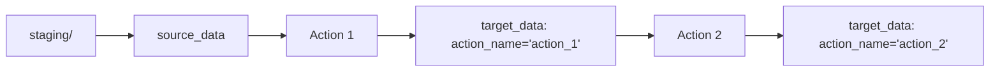

# Data I/O

:::note[Storage backend]
SQLite. All source and target records are in a single SQLite database for each workflow, at `agent_io/store/<workflow>.db`. `agent_io/staging/` holds your input as on-disk files. The framework does not write `agent_io/source/`.
:::

Every workflow needs data to flow in, through and out. Agent Actions uses a standardized layout that makes this flow predictable and traceable.

Input data enters through one location (`staging/`). The framework registers the input in `source_data`. The data then moves through the actions, and each action writes to `target_data`. You query the result from the SQLite database. The layout enforces this separation. Thus it is easy to examine what went in and what came out.

## Directory Structure

```
agent_workflow/
└── my_workflow/
    ├── agent_config/
    │   └── my_workflow.yml         # Workflow definition
    ├── agent_io/
    │   ├── staging/                # Input data (on-disk JSON / CSV / etc.)
    │   └── store/
    │       └── my_workflow.db      # SQLite database — source, target, dispositions, traces
    └── seed_data/                  # Static reference data
```

:::note[Storage Backend]
SQLite is the only supported storage backend. Source records, target records, dispositions, prompt traces and checkpoint outputs are all in `agent_io/store/<workflow>.db`. Only `staging/` stays as on-disk files, because users put these files there by hand.
:::

### staging/

Your workflow starts in this directory. Put the input files here before you run the workflow:

```
agent_io/staging/
├── document_1.json
├── document_2.json
└── batch_input.csv
```

You can also use `data_source`, set under `defaults:`, to make the workflow read from a local folder:

```yaml
defaults:
  data_source:
    type: local
    folder: ./data
    file_type: [json, csv]
```

The output of each input file is stored under its path, with the suffix replaced by `.json`. Thus `page.csv` and `page.json` in the same folder would share one name. The run refuses such a folder before it processes anything, and it names the two files. Rename or remove one of the two files.

### source_data (table)

A metadata layer that tracks what is in staging:

- One row for each `(relative_path, source_guid)` from the staging files
- Populated automatically on `agac run`
- Gives the join key (`source_guid`) that connects target records to their origin

### target_data (table)

The outputs of each action are stored in the `target_data` table:

```sql
CREATE TABLE target_data (
    id            INTEGER PRIMARY KEY AUTOINCREMENT,
    action_name   TEXT NOT NULL,
    relative_path TEXT NOT NULL,
    data          TEXT NOT NULL,         -- JSON array of records
    record_count  INTEGER,
    created_at    TEXT DEFAULT CURRENT_TIMESTAMP,
    UNIQUE(action_name, relative_path)
)
```

Each row stores every record that an action produced for a given input file (`relative_path`). The row stores these records as a single JSON array in `data`, in compressed form. Read the records with [`agac records`](../cli/records). `sqlite3` shows the column as a blob.

## Data Flow

This diagram shows how a document moves through a workflow:



These events occur at each stage:

1. The input data is placed in `staging/`.
2. Agent Actions registers each input record in `source_data` with a stable `source_guid`.
3. Each action writes its output as a `target_data` row with the key `(action_name, relative_path)`.
4. Downstream actions read from the `target_data` rows of their upstream actions.
5. `relative_path` stays the same across actions. Thus you can trace the same input file through every action.

The `source_guid` field gives lineage tracking. You can trace any output record back to its original staging file. This tracing is essential for debugging and auditing.

## Storage Backend

All workflow data is in `agent_io/store/<workflow>.db`. The framework manages this file. The file is created on the first `agac run`. It is migrated in place when columns are added. `--fresh` truncates the file (it does not delete it).

### SQLite Database Schema

The database has six tables that the framework owns:

| Table                | Purpose                                                                            |
|----------------------|------------------------------------------------------------------------------------|
| `source_data`        | Source records, deduplicated by `(relative_path, source_guid)`                     |
| `target_data`        | Output records of each action, one row for each `(action_name, relative_path)` |
| `record_disposition` | Dispositions of each record (`success`, `failed`, `exhausted`, `skipped`, `filtered`, `passthrough`, `deferred`, `unprocessed`) that each action emits |
| `prompt_trace`       | The compiled prompt and the LLM response for each record and each attempt (online and batch) |
| `prompt_trace_dictionary` | Compression dictionaries for the text columns of `prompt_trace`              |
| `checkpoint_output`  | Mid-action checkpoint records (resumable batch retrieval and repair recovery)     |

The database also has a `workflow_metadata` bookkeeping table for key/value state at the run level.

### Querying the Database

You can examine workflow data directly with SQLite:

```bash
sqlite3 agent_io/store/<workflow>.db

-- List all actions with output
SELECT DISTINCT action_name FROM target_data;

-- Count records per action
SELECT action_name, SUM(record_count) FROM target_data GROUP BY action_name;
```

The `data` column is compressed in the store. Thus you read the records themselves with the CLI:

```bash
# The records extract_facts produced
agac records -w <workflow> -a extract_facts
```

### Benefits

- **Performance**: Indexed queries give fast data access
- **Integrity**: ACID transactions prevent partial writes
- **Deduplication**: Automatic deduplication, based on `source_guid`
- **Concurrency**: WAL mode enables concurrent reads

## Learn More

- **[Input Formats](./input-formats.md)** — JSON, CSV, and other supported formats
- **[Output Format](./output-format.md)** — Output structure and lineage tracking
- **[Data Lineage](./data-lineage.md)** — Ancestry chain for parallel merges and Map-Reduce
- **[Chunking](./chunking.md)** — Split large documents for LLM processing
- **[Prompt Traces](./prompt-traces.md)** — Inspect compiled prompts and LLM responses for each record
