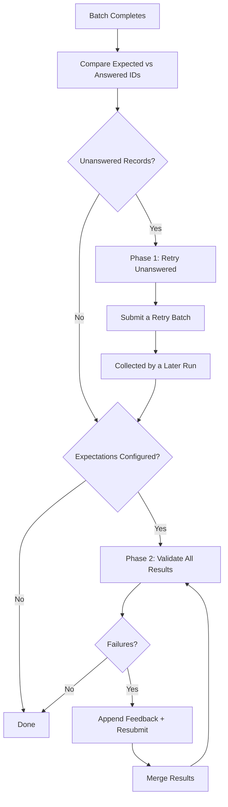

# Batch Recovery

Batch recovery automatically handles two problems of a batch API, in a process with two phases. In the first problem, the provider does not answer some records. For example, you submit 1,000 records to a batch API and only 985 come back. In the second problem, some outputs fail validation. For example, 40 of those 985 records have outputs that fail validation.

## The Two Phases

Batch recovery runs after the initial batch completes. Batch recovery handles two different failure modes, one after the other:



**Phase 1 (Retry)** recovers the records that the provider did not answer. The provider dropped some of these records completely (network errors, timeouts, silent failures). The provider returned the other records with an error for each record and no content. Phase 1 submits the same request again, with no change.

**Phase 2 (Repair)** repairs the records that the LLM answered with output that fails the `expect:` suite of the action (schema violations, failed rules). Before Phase 2 submits a record again, Phase 2 changes the prompt to include the failure feedback.

## Phase 1: Retry Missing Records

After the system gets the batch results, it compares the expected record IDs with the IDs that the provider answered. A record that the provider returned with an error, or with null content, is not an answered record. If retry is enabled for the action, any missing record starts the retry loop. Retry is disabled until a `retry:` block enables it (see [Configuration](#configuration)). If retry is disabled, a record that the provider did not return fails immediately. See [A record nothing sends again](#a-record-nothing-sends-again).

### How It Works

1. Collect all `custom_id` values from the context map. These values are the expected IDs.
2. Collect the `custom_id` values of the results that the provider answered successfully. A result that the provider returned with an error carries the real `custom_id` of the record, but no content. Thus that result is not an answered result.
3. Calculate the difference. The difference is the set of missing records.
4. While attempts remain, do the steps that follow. `max_attempts` counts each attempt, which includes the original batch. Thus `max_attempts: 1` sends no retry batch.
   - Make new records from the context map for the missing IDs.
   - Submit the new records as a new batch, and stop. The run asks to be run again.
   - The next run collects that batch and merges the results. Each result replaces any earlier answer for the same record.
   - Update the set of missing records.
5. If records are still missing after all attempts, mark these records with exhaustion metadata.

If the system cannot build a retry at all, the loop stops immediately for those records. The loop also stops in this way when no attempts remain. The cause is that preparation admits no task for the records: a guard rejects each of the records when the system evaluates the guard again. The records are exhausted under `on_exhausted`, and the system stores the file.

The system prepares a retry again from the stored context of each record, in the same way as
the first request. The preparation uses the dependencies and the version of the action, and the
`workflow.*` values of the run. The prompt of the retry reads the same upstream answers. The
guard of the retry decides in the same way as for the first request. `workflow.run_id` is the ID
of the run that collects the batch, not the ID of the run that sent the first request. The
system prepares a repair round in the same way.

### A record nothing sends again

A record fails with the reason `batch_not_returned` if two conditions are true. The provider did
not include the record in its results, and no retry will send the record again. The record is
one of these two types:

- A record of an action that has retry disabled.
- A record whose retry batch was not sent. The cause is that the system could not render its prompt, or that the provider refused it.

The action completes with failures (`completed_with_failures`). The downstream actions skip the
record, and [`agac retry`](../cli/retry) sends the record again. After the system collects the
answer of the record, the downstream actions answer the record too.

### Configuration

You configure retry at the action level or at the defaults level. Retry is disabled for an
action if neither the action nor `defaults:` gives a `retry:` block:

```yaml
defaults:
  retry:
    enabled: true
    max_attempts: 3        # 3 attempts in all: the original batch and up to 2 retry batches
    on_exhausted: return_last  # or "raise"
```

### Per-Record Tracking

The system counts the failures of each record separately, not for all records together. For example, record `A` succeeds on retry attempt 1, and record `B` needs all 3 attempts. Each record gets its own count:

```json
{
  "_recovery": {
    "retry": {
      "attempts": 2,
      "failures": 1,
      "succeeded": true,
      "reason": "missing",
      "timestamp": "2024-06-15T10:30:45.123456+00:00"
    }
  }
}
```

### Exhaustion

When a record exhausts all retry attempts, the `on_exhausted` value sets the result:

- **`on_exhausted: return_last`**: The system marks the record with exhaustion metadata. The
  workflow continues without the record. The action ends with the status
  `completed_with_failures` (`failed` when no record succeeds), as it does for any `exhausted`
  or `failed` record.
- **`on_exhausted: raise`**: The system writes the output file first. Then the run stops. A
  batch writes one time, at the end. Thus a halt during the conversion would discard each
  record that already converted cleanly. For this reason, the system carries the halt to the
  caller and raises the halt after the write. A run that collects several files first collects
  all of the files. Thus a halt in one file never leaves the finished batch of another file
  uncollected. If more than one file halts, the system raises the first halt and logs the other
  halts. The system carries two other halts in the same way. The first is the halt that
  `on_empty: error` asks for. The second is the halt that the system raises when no record of a
  file succeeds.

The two policies apply to each record that spends its attempts. But the two shapes of an
exhausted record do not get the same disposition. The difference is whether a result row came
back at all.

A record that the provider never returned has nothing to report. Thus the record becomes an
`EXHAUSTED` tombstone with the disposition `exhausted_after_N_attempts`.

A record can come back with an error, or with null content and no message at all. This record
gets the disposition `FAILED`. The record carries the message of the provider, or a generic
failure if the provider gave no message. The record also carries the same exhausted retry
metadata under `_recovery.retry`.

The message of the provider is the more useful signal of the two. Thus the system keeps the
message, and does not replace it with an empty tombstone. To count retry exhaustion, count the
two shapes. Filter on `_recovery.retry.succeeded == false`, not on the disposition only.

## Phase 2: Validate and Repair

After Phase 1 makes sure that all recoverable records are present, Phase 2 checks whether the
outputs are valid. Phase 2 runs when the action has an [`expect:`](../validation/expectations.md)
block with a repair policy.

### How It Works

A repair round is a full provider batch. Thus a repair round defers, and does not block:

1. Run the expectation suite of the action on each returned record. The suite includes the
   structural gate that checks schema conformance.
2. The records that pass **graduate** into a pool. The system never evaluates these records
   again. Thus a later round does not spend the judge budget on them again.
3. The system collects the records that fail into a repair batch. Each record carries its own
   regeneration prompt.
4. The system submits the batch, and the run defers. The next pass continues in the same loop.
5. When no iterations of `max_iterations` remain (the first generation counts as one),
   `on_exhausted` decides the output of the action.

The system does not submit a round that has nothing to send. If a guard rejects each failing record when the guard is evaluated again, no empty batch goes to the provider. The system abandons those records under `on_exhausted`, as it does when no rounds remain. If the guard rejects some of the failing records, the round goes to the provider with the other records. The system abandons the records that it did not send in the same way, in that pass. The system does not count these records as sent. Thus, when the round comes back without these records, the system does not interpret their absence as records that the provider dropped.

The system reconstructs a record that the provider never returns as a failure. The system does
not let the record become a silent passthrough. A record with no content at all failed at the
provider, not at its expectations. Thus that record keeps its own error.

## Recovery Metadata

Each record that recovery processes gets a `_recovery` field in its output. Content extraction automatically excludes this field. Downstream actions never see the field, but the field is available for audits and debugging.

### Structure

```json
{
  "_recovery": {
    "retry": {
      "attempts": 3,
      "failures": 2,
      "succeeded": true,
      "reason": "missing",
      "timestamp": "2024-06-15T10:30:45.123456+00:00"
    },
    "expectations": {
      "attempts": 2,
      "failed": []
    }
  }
}
```

### Fields

**Retry metadata** (present when transport-layer recovery occurred):

| Field | Type | Description |
|-------|------|-------------|
| `attempts` | integer | The total number of attempts, which includes the initial attempt |
| `failures` | integer | The number of failed attempts before success |
| `succeeded` | boolean | Whether the retry succeeded at the end |
| `reason` | string | The reason for the retry. A batch record always carries `missing`. An online record carries the error class of its last failed attempt: `network_error`, `rate_limit`, `timeout` or `api_error` |
| `timestamp` | string | The ISO 8601 timestamp of the recovery |

**Expectations metadata** (`_recovery.expectations`, present when the repair loop exhausted):

| Field | Type | Description |
|-------|------|-------------|
| `attempts` | integer | The number of iterations spent, which includes the first generation |
| `failed` | list | The IDs of the expectations that still failed when no iterations remained |

**Evaluation metadata** (`_recovery.evaluation`, present when a batch record graduated through the loop):

| Field | Type | Description |
|-------|------|-------------|
| `passed` | boolean | Whether the record graduated |
| `strategy_name` | string | The evaluation strategy that judged the record |

### Serialization

Serialization keeps the recovery metadata. The system can save batch results to disk and load them again (for example, for `agac batch retrieve`). The retry metadata and the expectations metadata stay the same through this round-trip.

## Example: Full Recovery Flow

You submit 100 records. 95 records come back. Phase 1 recovers the 5 missing records. Then 10 of the 100 records fail validation.

```
Submit 100 records
├── Phase 1: Retry
│   ├── 5 missing → resubmit
│   ├── Attempt 1: 4 recovered, 1 still missing
│   ├── Attempt 2: 1 recovered
│   └── Result: 100 records (all recovered)
│
└── Phase 2: Repair
    ├── Validate 100 results → 10 fail
    ├── Attempt 1: resubmit 10 with feedback → 8 pass
    ├── Attempt 2: resubmit 2 with feedback → 1 passes
    └── Result: 99 passed, 1 exhausted (on_exhausted: return_last)

Final output:
   5 records — _recovery.retry present (recovered in Phase 1)
   1 record  — _recovery.expectations present (exhausted in Phase 2)
```

## See Also

- [Retry & Error Handling](./retry.md) — Transport-layer retry for online mode
- [Expectations](../validation/expectations.md) — Output rules and the repair loop
- [Run Modes](./run-modes.md) — Online execution and batch execution
- [Output Format](../data-io/output-format.md) — The output structure and the `_recovery` field
