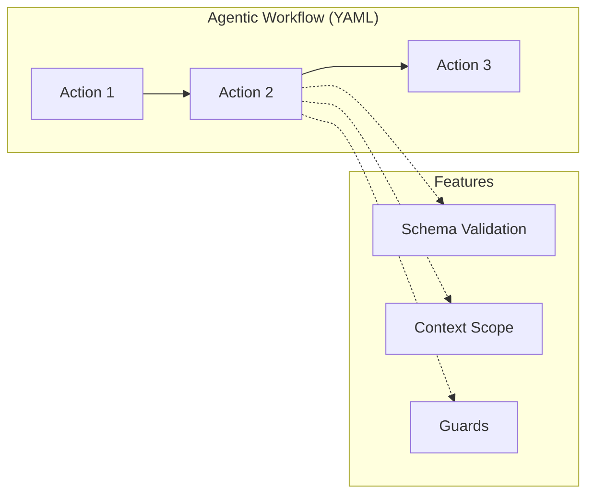

# Reference

The reference section documents the features of Agent Actions in detail. Use it when you build your first workflow, and when you debug a complex workflow with many actions.

## Quick Links

**Building Workflows**

- [Configuration](./configuration/): Project, workflow and action settings
- [Context](./context/): Data flow between actions
- [Prompts](./prompts/): Prompt templates with Jinja2
- [Schemas](./schemas/): JSON Schema validation

**Running Workflows**

- [Execution](./execution/): Run modes, guards and granularity
- [Validation](./validation/): Pre-flight checks and output expectations
- [Tools](./tools/): Custom tools with `@udf_tool`

**Understanding the System**

- [Architecture](./architecture/): The DAG execution model
- [Data I/O](./data-io/): File formats and directories

## Core Concepts

Each action in a workflow receives input, does its work and sends its output to the next action. A workflow is similar to an assembly line, in which each action is a station. The diagram shows how actions connect. It also shows how features such as validation and guards attach to each action:



Each action can have its own schema validation, context scope and guards. Because of this modularity, you can build complex workflows and still test each action.

**Workflow**: A DAG (directed acyclic graph) of actions that you define in YAML. Actions declare dependencies, and the engine sets the execution order automatically.

**Action**: One unit of work in a workflow. An action is an LLM call or a Python tool. Each action has inputs, a prompt or a function, and validated outputs.

**Field Reference**: A field reference gets an upstream output into a prompt, with syntax such as `{{ extract_facts.facts }}`. The field gets its value when the referenced action completes. Thus a field reference is similar to a formula in a spreadsheet that points to a cell.

**Context Scope**: Controls what data flows between actions, with `observe`, `drop` and `passthrough`.

**Guard**: Conditional execution. A guard skips or filters actions based on data conditions. A guard is a quality checkpoint. If the input does not meet the standards, the guard skips the action entirely.

**Schema**: JSON Schema validation for outputs. An `expect:` repair policy regenerates responses that are not valid. Schema validation finds structural errors, but it cannot verify semantic correctness. A response might match your schema but still contain incorrect information.

## Example: Fact Extraction Workflow {/* #example-fact-extraction-agentic-workflow */}

This simple workflow extracts facts from documents and validates the facts:

```yaml
name: fact_extraction
description: "Extract facts from documents and validate them"
defaults:
  model_vendor: openai
  model_name: gpt-4o-mini
  json_mode: true

actions:
  - name: extract_facts
    intent: "Extract facts from the document"
    prompt: $prompts.extract_facts
    schema: facts_schema
    context_scope:
      observe: [source.*]

  - name: validate_facts
    intent: "Validate the extracted facts"
    dependencies: [extract_facts]
    prompt: |
      Validate these facts: {{ extract_facts.facts }}
    schema: validation_result
    context_scope:
      observe: [extract_facts.facts]
    guard:
      condition: "extract_facts.facts != []"
      on_false: skip
```

If `extract_facts` returns an empty list, the guard on `validate_facts` checks the condition and skips the action entirely. Agent Actions makes no API call. Thus the guard prevents unnecessary work and saves tokens.

## Supported Providers

Agent Actions supports OpenAI, Anthropic, Google, Groq, Cohere and Ollama. You can mix providers in the same workflow. Use different models for different actions, based on cost or capability. For setup details, see [Configuration](./configuration/).
