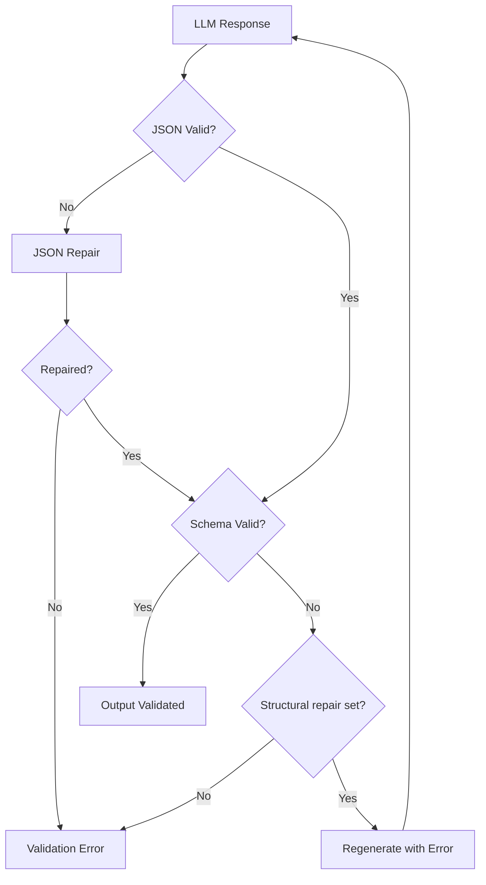

# Schema System

What happens when an LLM returns malformed JSON or misses a required field? The Schema System provides output validation for LLM actions. Schemas define the expected structure of action outputs, enabling automatic validation, regeneration on failure, and type-safe data flow between actions.

Think of schemas like contracts: they define exactly what each action promises to deliver. When the LLM output does not match the contract, Agent Actions catches the error before it propagates downstream.

## Overview

Let's explore what schemas provide in your agentic workflow:

- **Output Validation** - Ensure LLM responses match expected structure
- **Repair** - Automatic regeneration when the output fails the action's `expect:` suite
- **Documentation** - Define contracts between actions
- **Type Safety** - Catch structural issues before downstream processing

Keep in mind that schema validation catches structural errors but cannot verify semantic correctness. A response might match your schema perfectly but still contain incorrect information.

## Schema Formats

Agent Actions supports multiple schema definition approaches:

| Format | Location | Use Case |
|--------|----------|----------|
| External YAML/JSON | `schema/` directory | Reusable, complex schemas |
| Inline Object | Workflow YAML | Simple, one-off schemas |
| Shorthand | Workflow YAML | Very simple type definitions |

## External Schemas (YAML and JSON Files)

Store reusable schemas in the folder that `schema_path` names in `agent_actions.yml` (`schema/` in a new project). A workflow can also keep its own `schema/` folder inside `agent_workflow/<workflow>/`. Schema files can use `.yml`, `.yaml`, or `.json` extensions. A schema name must be unique across all of these folders: a workflow that names a schema found in two places fails to load.

### Directory Structure

```
project/
├── agent_actions.yml
├── schema/                          # Project-level (shared)
│   ├── candidate_facts_list.yml     # YAML format
│   ├── question_quality_score.yml
│   ├── product_data.json            # JSON format works too
│   └── cluster_validation.yml
└── agent_workflow/
    ├── quiz_generation/             # Workflow uses project schemas
    └── document_analysis/
        └── schema/                  # Optional: schemas only this workflow keeps
```

Schemas define data contracts that often span multiple workflows. A `candidate_facts_list` schema might be used by both extraction and validation workflows. Keeping those in the project folder prevents drift and ensures consistent validation across your project.

If you need a workflow-specific output structure, use an inline schema (see below) or put a uniquely named schema file in that workflow's own `schema/` folder.

A schema an action names must exist. `agac inspect` and `agac run` both refuse a name that matches no file, before any action runs, with `Action '<action>' names schema '<name>', which cannot be loaded: ...`. This holds for tool actions too.

### JSON Schema Format

Full JSON Schema syntax for complex validation:

```yaml
# schema/candidate_facts_list.yml
name: candidate_facts_list
type: array
items:
  type: object
  properties:
    fact:
      type: string
      description: "Short, testable statement with technical detail"
      maxLength: 250
    quote:
      type: string
      description: "Short verbatim evidence from source"
    technical_level:
      type: string
      description: "Type of technical content"
      enum:
        - configuration
        - implementation
        - constraint
        - procedure
        - integration
  required:
    - fact
    - quote
    - technical_level
```

`items` must say what each element is: `type: string` (or another type) for a list of
values, or `type: object` with `properties` for a list of records. An `items` with
`properties` and no `type` is read as an object; one with neither is refused with
`Array schema '<name>' has 'items' with no 'type'`, rather than taken for a list of
objects that would reject every string the model returns.

A record may hold only the fields its schema lists, unless the schema sets
`additionalProperties: true`. That lets a tool carry fields through without listing them:
set it at the root of an object schema, or at the root of an array schema or under its
`items` (where `items` says otherwise, `items` wins). An action that reads such a field is
not refused, but preflight warns that the field cannot be checked; list it in the schema
to have it checked.

A schema file may also be a JSON Schema object. Its properties are the record's
fields, the same as `fields:` entries. A property is required only when it is
listed under `required:`; the project's `required_by_default` does not apply.

```yaml
# schema/page_summary.yml
name: page_summary
type: object
properties:
  summary: {type: string}
  tone: {type: string}
required: [summary]
```

An array schema's top-level `required:` is a boolean for the array itself; list
required item properties under `items.required`, as above.

### Fields Format

Simplified syntax for straightforward schemas:

```yaml
# schema/question_quality_score.yml
name: question_quality_score
fields:
  - id: syllabus_alignment_score
    type: number
    description: "How well the question tests objectives (0-100)"

  - id: objective_tested
    type: string
    description: "Which objective(s) this question tests"

  - id: aligned_skill_area
    type: string
    description: "Primary exam skill area tested"

  - id: reasoning
    type: string
    description: "Explanation of alignment"
```

A field may also carry an `expectations:` block — quality rules about that field,
checked at run time by any action that opts in with `expect:`. Rules ride in the
schema file for the author's benefit and never reach the provider:

```yaml
fields:
  - id: syllabus_alignment_score
    type: number
    description: "How well the question tests objectives (0-100)"
    expectations:
      - id: score_is_a_known_band
        type: accepted_values
        params:
          values: [0, 25, 50, 75, 100]
```

See [AI Expectations](../validation/expectations.md) for the rule vocabulary and
for the file's own top-level `expectations:` block, which holds rules that are
about no single field.

### Reference in Workflow

Every action also needs an `intent` and a `context_scope`. The workflow snippets on this page leave them out.

```yaml
actions:
  - name: extract_facts
    prompt: $prompts.extract_facts
    schema: candidate_facts_list  # References schema/candidate_facts_list.yml (or .yaml/.json)

  - name: score_quality
    prompt: $prompts.score_quality
    schema: question_quality_score
```

:::tip Schema Compilation
During the render step, schema references are **inlined** into the workflow. This means `schema: candidate_facts_list` gets replaced with the actual schema content from the matching file (`candidate_facts_list.yml`, `.yaml`, or `.json`).
:::

## Inline Schemas

Define schemas directly in workflow YAML for simple cases:

### Object Shorthand

```yaml
- name: generate_summary
  prompt: $prompts.summary_generator
  schema:
    summary: string
    code_snippets: array
```

Equivalent to:

```yaml
schema:
  type: object
  properties:
    summary:
      type: string
    code_snippets:
      type: array
```

### Complex Inline Schema

```yaml
- name: generate_distractor
  schema:
    distractor_1: string
    explanation_why_it_is_incorrect_1: string
    thinking_process_1: string
```

## One Schema per Action

An action has one schema. `schema: dispatch_task('...')` is not supported: `agac inspect` accepts it, but the run looks for a schema file with that name and fails with `Schema file 'dispatch_task('...')' not found`. When records need different output shapes, split them with [guards](../execution/guards.md) into separate actions, each with its own schema.

## Schema Types

### Primitive Types

| Type | Description | Example |
|------|-------------|---------|
| `string` | Text value | `"hello"` |
| `number` | Numeric value | `42`, `3.14` |
| `integer` | Whole number | `42` |
| `boolean` | True/false | `true` |
| `array` | List of items | `[1, 2, 3]` |
| `object` | Key-value pairs | `{"key": "value"}` |

### Array Schema

```yaml
name: items_list
type: array
items:
  type: object
  properties:
    name:
      type: string
    value:
      type: number
```

### Nested Objects

```yaml
name: nested_structure
type: object
properties:
  metadata:
    type: object
    properties:
      created_at:
        type: string
      version:
        type: integer
  data:
    type: array
    items:
      type: string
```

### Enums

```yaml
properties:
  status:
    type: string
    enum:
      - pending
      - approved
      - rejected
  priority:
    type: string
    enum:
      - low
      - medium
      - high
```

## Validation Constraints

A constraint written on a field or property is not always sent to the provider, and not always checked on the response. This table shows what each one does on a top-level field:

| Constraint | Sent to the provider | Checked on the response |
|------------|----------------------|-------------------------|
| `enum` | Yes | Yes |
| `minimum`, `maximum` | No | Yes |
| `pattern` | Yes | No |
| `minLength`, `maxLength`, `exclusiveMinimum` | No | No |

Inside the `items` of an array field, every constraint is sent with the schema, and the response is checked element by element against the whole `items` schema, so `maxLength` there is enforced.

### String Constraints

```yaml
properties:
  title:
    type: string
    minLength: 1
    maxLength: 100
  email:
    type: string
    pattern: "^[a-zA-Z0-9+_.-]+@[a-zA-Z0-9.-]+$"
```

### Number Constraints

```yaml
properties:
  score:
    type: number
    minimum: 0
    maximum: 100
  count:
    type: integer
    exclusiveMinimum: 0
```

### Required Fields

```yaml
type: object
properties:
  name:
    type: string
  description:
    type: string
required:
  - name  # description is optional
```

## Examples

### Fact Extraction Schema

```yaml
# schema/candidate_facts_list.yml
name: candidate_facts_list
type: array
items:
  type: object
  properties:
    fact:
      type: string
      description: "Short, testable statement"
      maxLength: 250
    quote:
      type: string
      description: "Verbatim evidence from source"
    technical_level:
      type: string
      enum:
        - configuration
        - implementation
        - constraint
        - procedure
        - integration
    supports_objective:
      type: string
      description: "Learning objective supported"
  required:
    - fact
    - quote
    - technical_level
    - supports_objective
```

### Cluster Validation Schema

```yaml
# schema/cluster_validation.yml
name: cluster_validation
fields:
  - id: should_keep_cluster
    type: boolean
  - id: reasoning
    type: string
  - id: new_clusters
    type: array
    items:
      type: object
      properties:
        cluster_name:
          type: string
        semantic_unique_ids:
          type: array
          items:
            type: string
```

### Inline Schema in Workflow

```yaml
- name: review_code_snippets
  schema:
    code_snippets: array
    removed_snippets: array
    removal_reasoning: string
```

## Schema Validation Flow

Consider what happens when an action receives a response. Agent Actions validates the output through multiple stages:



Notice that invalid JSON triggers a repair attempt before giving up. This handles common LLM issues like trailing commas or unquoted keys.

## JSON Mode

Enable structured output with `json_mode`:

```yaml
defaults:
  json_mode: true

actions:
  - name: extract_facts
    schema: candidate_facts_list
    # json_mode: true inherited from defaults
```

When enabled:
- LLM is instructed to return JSON
- Provider-specific JSON modes are used when available
- Invalid JSON triggers repair

## Best Practices

### 1. Use External Schemas for Reuse

```yaml
# Good: Reusable schema file
schema: candidate_facts_list

# Avoid: Duplicating complex schemas inline
```

### 2. Document with Descriptions

```yaml
properties:
  score:
    type: number
    description: "Quality score from 0-100. >= 85 means keep."
```

### 3. Use Enums for Constrained Values

```yaml
# Good: Explicit allowed values
technical_level:
  type: string
  enum: [configuration, implementation, constraint]

# Avoid: Free-form strings for categorical data
```

### 4. Define Required Fields

```yaml
required:
  - fact
  - quote
  # Optional: supports_objective
```

### 5. Use Appropriate Types

```yaml
# Good: Specific types
score:
  type: integer
  minimum: 0
  maximum: 100

# Avoid: Overly permissive
score:
  type: string  # Loses numeric validation
```

## Error Handling

### Validation Failure

What happens when schema validation fails? Agent Actions provides two paths:

1. If a repair policy is set: regenerate with the failure list
2. Otherwise: the mismatch is logged as a warning and the record is stored as the model returned it

This means a single validation failure does not crash your agentic workflow.

A `kind: tool` action at record granularity checks each record's output against its schema. An output that fails it fails that record, as a tool that raises does: the record is marked `failed` with the validation message, the other records of its file are stored, the action ends `completed_with_failures` (`failed` when no record succeeds, as for a tool that raises), and `agac retry` runs the tool on that record again.

At file granularity each output of the tool is checked the same way after it returns. A refused output that names one input by `source_index` fails that record, with every other output of it; one that names several inputs or none fails every record of the file. See [When a FILE Tool Fails](../execution/granularity#when-a-file-tool-fails).

### Common Errors

The warning reads `Schema validation warning for '<action>': <errors>`. The errors are:

```
Missing required fields: fact, quote
Type mismatch for 'score': expected number, got string
Field 'technical_level': 'invalid' is not one of ['configuration', 'implementation', 'constraint']
Field 'score': 150 is greater than the maximum of 100
Field 'facts' element 0: 'xxxxxxxx...' is too long
```

### Debugging

Print what is sent to the model:

```yaml
- name: my_action
  schema: my_schema
  prompt_debug: true  # Online runs print the prompt, context preview and schema sent to the model
```

## Schema Discovery

List available schemas, using your `schema_path` folder and the workflow-level `schema/` folders:

```bash
ls schema/*.yml schema/*.yaml schema/*.json agent_workflow/*/schema/*
```

A schema file is checked when the workflow that names it is loaded. Check one without running the workflow:

```bash
agac inspect -a my_workflow
```

Reaching the action list means pre-flight passed, malformed schemas included. To see what each action's schema declares and how the fields flow between actions, run `agac schema -a my_workflow`.
