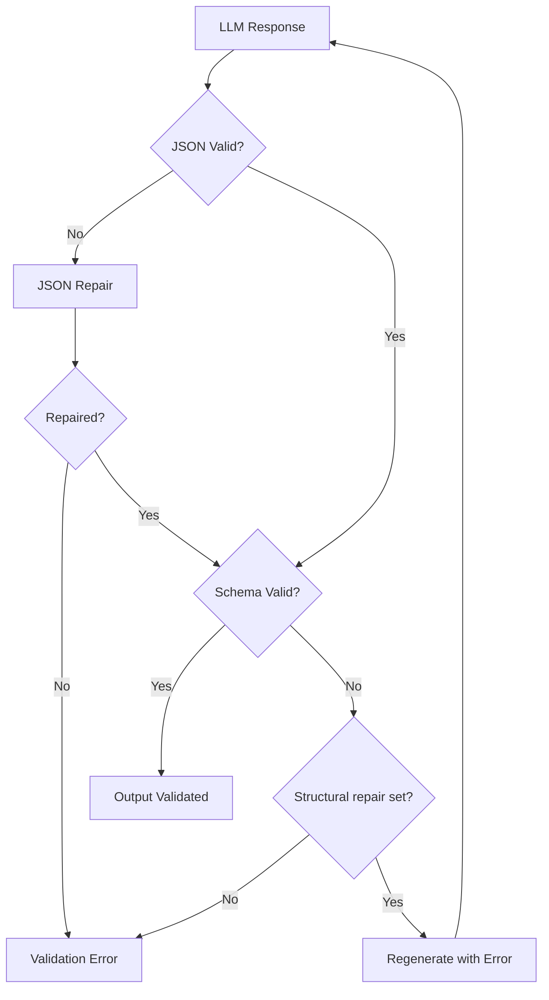

# Schema System

The Schema System validates the output of LLM actions. An LLM can return malformed JSON or omit a required field. A schema defines the expected structure of the output of an action. Thus Agent Actions can validate the output automatically, generate the output again when it fails, and send type-safe data between actions.

A schema is a contract. It defines exactly what each action promises to deliver. When the LLM output does not match the contract, Agent Actions finds the error before the error goes downstream.

## Overview

Schemas give these functions in your workflow:

- **Output Validation** - Make sure that LLM responses match the expected structure
- **Repair** - Generate the output again automatically when the output fails the `expect:` suite of the action
- **Documentation** - Define the contracts between actions
- **Type Safety** - Find structural problems before downstream actions process the data

Schema validation finds structural errors. It cannot verify that the content is semantically correct. A response might match your schema perfectly and still contain incorrect information.

## Schema Formats

Agent Actions supports multiple ways to define a schema:

| Format | Location | Use Case |
|--------|----------|----------|
| External YAML or JSON | `schema/` directory | Complex schemas that you use again |
| Inline Object | Workflow YAML | Simple schemas that you use one time |
| Shorthand | Workflow YAML | Very simple type definitions |

## External Schemas (YAML and JSON Files)

Put the schemas that you use again in the folder that `schema_path` names in `agent_actions.yml` (`schema/` in a new project). A workflow can also keep its own `schema/` folder inside `agent_workflow/<workflow>/`. A schema file can have the `.yml`, `.yaml` or `.json` extension. A schema name must be unique across all of these folders. If a workflow names a schema that is in two places, the workflow fails to load.

### Directory Structure

```
project/
├── agent_actions.yml
├── schema/                          # Project-level (shared)
│   ├── candidate_facts_list.yml     # YAML format
│   ├── question_quality_score.yml
│   ├── product_data.json            # JSON format works too
│   └── cluster_validation.yml
└── agent_workflow/
    ├── quiz_generation/             # Workflow uses project schemas
    └── document_analysis/
        └── schema/                  # Optional: schemas only this workflow keeps
```

Schemas define data contracts that are often used by multiple workflows. For example, both an extraction workflow and a validation workflow might use a `candidate_facts_list` schema. Keep these schemas in the project folder. This prevents drift and makes the validation the same across your project.

If you need an output structure for one workflow only, use an inline schema (see below). Or put a schema file with a unique name in the `schema/` folder of that workflow.

A schema that an action names must exist. If a name matches no file, `agac inspect` and `agac run` refuse it before any action runs. The message is `Action '<action>' names schema '<name>', which cannot be loaded: ...`. This rule applies to tool actions too.

### JSON Schema Format

Use the full JSON Schema syntax for complex validation:

```yaml
# schema/candidate_facts_list.yml
name: candidate_facts_list
type: array
items:
  type: object
  properties:
    fact:
      type: string
      description: "Short, testable statement with technical detail"
      maxLength: 250
    quote:
      type: string
      description: "Short verbatim evidence from source"
    technical_level:
      type: string
      description: "Type of technical content"
      enum:
        - configuration
        - implementation
        - constraint
        - procedure
        - integration
  required:
    - fact
    - quote
    - technical_level
```

`items` must say what each element is. For a list of
values, use `type: string` (or another type). For a list of records, use `type: object` with `properties`. If an `items` has
`properties` and no `type`, Agent Actions reads it as an object. If an `items` has no `properties` and no `type`, Agent Actions refuses it with
`Array schema '<name>' has 'items' with no 'type'`. Agent Actions does not read this `items` as a list of
objects, because that list would reject every string that the model returns.

A record may hold only the fields that its schema lists, unless the schema sets
`additionalProperties: true`. This setting lets a tool send fields through and not list them.
You can set it in these places:

- The root of an object schema
- The root of an array schema
- Under the `items` of an array schema

If `items` gives a different value, the value in `items` wins. Preflight does not refuse an action that reads such a field.
But preflight warns that it cannot check the field. To make preflight check the field, list it in the schema.

A schema file may also be a JSON Schema object. Its properties are the fields of the
record, the same as `fields:` entries. A property is required only when it is
listed under `required:`. The `required_by_default` setting of the project does not apply.

```yaml
# schema/page_summary.yml
name: page_summary
type: object
properties:
  summary: {type: string}
  tone: {type: string}
required: [summary]
```

In an array schema, the top-level `required:` is a boolean for the array itself. List
the required properties of the items under `items.required`, as the example above shows.

### Fields Format

Use the simplified syntax for simple schemas:

```yaml
# schema/question_quality_score.yml
name: question_quality_score
fields:
  - id: syllabus_alignment_score
    type: number
    description: "How well the question tests objectives (0-100)"

  - id: objective_tested
    type: string
    description: "Which objective(s) this question tests"

  - id: aligned_skill_area
    type: string
    description: "Primary exam skill area tested"

  - id: reasoning
    type: string
    description: "Explanation of alignment"
```

A field may also have an `expectations:` block. The block holds quality rules about that field.
Any action that enables the rules with `expect:` checks them at run time. The rules are in the
schema file to help the author. The rules never go to the provider:

```yaml
fields:
  - id: syllabus_alignment_score
    type: number
    description: "How well the question tests objectives (0-100)"
    expectations:
      - id: score_is_a_known_band
        type: accepted_values
        params:
          values: [0, 25, 50, 75, 100]
```

For the rule vocabulary, see [AI Expectations](../validation/expectations.md). That page also describes
the top-level `expectations:` block of the file. That block holds rules that are
about no single field.

### Reference in Workflow

Each action also needs an `intent` and a `context_scope`. The workflow examples on this page do not show them.

```yaml
actions:
  - name: extract_facts
    prompt: $prompts.extract_facts
    schema: candidate_facts_list  # References schema/candidate_facts_list.yml (or .yaml/.json)

  - name: score_quality
    prompt: $prompts.score_quality
    schema: question_quality_score
```

:::note[Schema Compilation]
During the render step, Agent Actions puts the content of each referenced schema **inline** in the workflow. Thus Agent Actions replaces `schema: candidate_facts_list` with the schema content from the matching file (`candidate_facts_list.yml`, `.yaml`, or `.json`).
:::

## Inline Schemas

For simple cases, define the schema directly in the workflow YAML:

### Object Shorthand

```yaml
- name: generate_summary
  prompt: $prompts.summary_generator
  schema:
    summary: string
    code_snippets: array
```

This schema is the same as:

```yaml
schema:
  type: object
  properties:
    summary:
      type: string
    code_snippets:
      type: array
```

### Complex Inline Schema

```yaml
- name: generate_distractor
  schema:
    distractor_1: string
    explanation_why_it_is_incorrect_1: string
    thinking_process_1: string
```

## Dynamic Schema Selection

Different records can need different output structures. For example, a quiz generator can need one schema for multiple-choice questions and another schema for open-ended questions. Set `schema:` to a `dispatch_task()` call. List the schemas that the call can choose under `schema_options:`. A tool then selects one of them for each record. Another method also works: use [guards](../execution/guards.md) to divide the records into separate actions, each with its own schema.

### Basic Usage

```yaml
- name: generate_question
  prompt: $quiz_gen.question_prompt
  schema: dispatch_task('select_question_schema')
  schema_options: [mc_question_schema, tf_question_schema, open_question_schema]
```

`schema_options` is the contract of the action. It is the full list of shapes that the action can write. For each record, Agent Actions does these steps:
1. Calls `select_question_schema` with the context of the record.
2. Loads the schema file that has the returned name. The name must be in `schema_options`.
3. Asks the model for output in that schema, and checks the answer against the schema.

Before any action runs, `agac inspect` and `agac run` do these checks:
1. Refuse a `dispatch_task()` schema with no `schema_options`. Refuse `schema_options` with no `dispatch_task()` schema.
2. Load each schema in `schema_options`. Refuse a name that has no file.
3. Find the function in the same way as the run. The function is in `select_question_schema.py` under the tool path of the project. The file defines a function of the same name.
4. Refuse a `dispatch_task()` call inside the fields of a fixed schema. If the schema is chosen for each record, the full schema must be chosen.

The value must be exactly one `dispatch_task()` call. The call works under `run_mode: online` and `run_mode: batch`. In batch mode, Agent Actions sends each record with its own schema. A batch run keeps no `add_dispatch` results. Thus, under `run_mode: batch`, `agac inspect` refuses `add_dispatch: true` on such an action.

### The Function

Return one name from `schema_options`:

```python
import json


def select_question_schema(context_json: str) -> str:
    question_type = json.loads(context_json)["source"]["question_type"].upper()

    if question_type == "MULTIPLE_CHOICE":
        return "mc_question_schema"  # schema/mc_question_schema.yml (or .yaml/.json)
    if question_type == "TRUE_FALSE":
        return "tf_question_schema"
    return "open_question_schema"
```

The chosen schema follows the `required_by_default` setting of the project, as all schema files do. Any other return value fails only that record. For example, a schema definition, `None` or a name that is not in the list fails the record. The message is `dispatch_task('<function>') in schema returned None, which is not in schema_options [<names>].` An error in the function also fails only that record.

The function runs one time for each record. Each retry and each repair round of that record uses the schema that the function chose first. This applies to online runs and batch runs. Each stored record names that schema in `metadata.output_schema`.

### Context Available

The tool receives the context of the record as one JSON string. The keys of the string are the namespaces (`source` and the names of the upstream actions). Decode the string with `json.loads()`:

```python
import json


def select_schema(context_json: str) -> str:
    context = json.loads(context_json)
    content_type = context["source"]["content_type"]
    classification = context["classify_content"]["category"]

    if classification == "code" or content_type == "code":
        return "code_analysis_schema"
    return "default_schema"
```

### Reading a Dispatched Action

A downstream action reads one of several shapes. `agac inspect` checks each field that the action reads against all the options:

| Field | Result |
|-------|--------|
| In each schema in `schema_options` | Checked as any other field is checked |
| In some schemas only | Warning: the field can be absent |
| In no schema | Error |

### Use Cases

| Scenario | Approach |
|----------|----------|
| **Multi-domain content** | Select `technical_schema`, `business_schema`, or `legal_schema` from the content type |
| **Adaptive complexity** | Use a detailed schema for long content and a simple schema for short content |
| **Question types** | Use different schemas for multiple-choice, true/false and open-ended questions |

For more information about `dispatch_task()`, see [Dynamic Dispatch](../prompts/dispatch).

## Schema Types

### Primitive Types

| Type | Description | Example |
|------|-------------|---------|
| `string` | Text value | `"hello"` |
| `number` | Numeric value | `42`, `3.14` |
| `integer` | Whole number | `42` |
| `boolean` | True/false | `true` |
| `array` | List of values | `[1, 2, 3]` |
| `object` | Key-value pairs | `{"key": "value"}` |

### Array Schema

```yaml
name: items_list
type: array
items:
  type: object
  properties:
    name:
      type: string
    value:
      type: number
```

### Nested Objects

```yaml
name: nested_structure
type: object
properties:
  metadata:
    type: object
    properties:
      created_at:
        type: string
      version:
        type: integer
  data:
    type: array
    items:
      type: string
```

### Enums

```yaml
properties:
  status:
    type: string
    enum:
      - pending
      - approved
      - rejected
  priority:
    type: string
    enum:
      - low
      - medium
      - high
```

## Validation Constraints

Agent Actions does not always send a constraint on a field or property to the provider. It also does not always check the constraint on the response. This table shows what Agent Actions does with each constraint on a top-level field of an LLM action:

| Constraint | Sent to the provider | Checked on the response |
|------------|----------------------|-------------------------|
| `enum` | Yes | Yes |
| `minimum`, `maximum` | Yes | Yes |
| `pattern` | Yes | No |
| `minLength`, `maxLength` | Yes | No |
| `exclusiveMinimum`, `exclusiveMaximum`, `multipleOf` | No | No |

Inside the `items` of an array field, Agent Actions sends each constraint with the schema. It checks each element of the response against the full `items` schema. Thus Agent Actions enforces `maxLength` inside `items`.

Agent Actions checks the output of a tool action against the schema in the form that it sends to a provider. Thus Agent Actions enforces each constraint that it sends, `minLength` and `maxLength` included. It refuses an output that breaks one of these constraints.

### String Constraints

```yaml
properties:
  title:
    type: string
    minLength: 1
    maxLength: 100
  email:
    type: string
    pattern: "^[a-zA-Z0-9+_.-]+@[a-zA-Z0-9.-]+$"
```

### Number Constraints

```yaml
properties:
  score:
    type: number
    minimum: 0
    maximum: 100
  count:
    type: integer
    exclusiveMinimum: 0
```

### What the provider is sent

Agent Actions sends `minimum`, `maximum`, `minLength` and `maxLength` to the provider with the field. It also sends `pattern`, `enum`, `minItems` and `maxItems`. It does not send `exclusiveMinimum`, `exclusiveMaximum` and `multipleOf`. The vendor decides if the model must obey a bound:

| Vendor | How the schema is sent | Bounds |
|--------|------------------------|--------|
| `openai`, declared endpoints | `response_format` `json_schema`, not strict | Sent as guidance. Not enforced |
| `groq` | `response_format` `json_schema`, not strict | Sent as guidance |
| `anthropic` | Tool `input_schema` | Sent as guidance |
| `ollama_local`, `llamafile` | JSON schema turned into a grammar by llama.cpp | `minLength`/`maxLength` and integer `minimum`/`maximum` are enforced. `minimum`/`maximum` on a `number` are ignored |
| `gemini` | Written into the prompt text in an online run. `response_schema` in a batch | Sent as guidance |
| `cohere` | `response_format` `json_object` with the schema. Only the field names are in the prompt | [Cohere's structured-output docs](https://docs.cohere.com/docs/structured-outputs) list these keys as unsupported |
| `ollama_cloud` | Written into the prompt text | Sent as guidance |
| `agac-provider` (mock) | Read by the mock | Generated values stay inside `minimum`/`maximum` and `minLength`/`maxLength`. These bounds win over the field-name rules of the mock. For example, a field named `email` with `minLength: 40` gets text, not an address. Inside the `items` of an array or the `properties` of an object, the mock keeps `format`. There, a known `format` wins over a length bound |

For all vendors, Agent Actions checks the answer of an LLM action after the answer arrives. It checks the answer against the `minimum`, `maximum` and `enum` in the schema file. It does not check the string length. A value that is out of the range logs a schema validation warning. A [declared endpoint](../configuration/endpoints.md) also checks its reply against the schema that it sent. Thus a value outside `minimum` or `maximum` fails the record.

### Required Fields

```yaml
type: object
properties:
  name:
    type: string
  description:
    type: string
required:
  - name  # description is optional
```

## Examples

### Fact Extraction Schema

```yaml
# schema/candidate_facts_list.yml
name: candidate_facts_list
type: array
items:
  type: object
  properties:
    fact:
      type: string
      description: "Short, testable statement"
      maxLength: 250
    quote:
      type: string
      description: "Verbatim evidence from source"
    technical_level:
      type: string
      enum:
        - configuration
        - implementation
        - constraint
        - procedure
        - integration
    supports_objective:
      type: string
      description: "Learning objective supported"
  required:
    - fact
    - quote
    - technical_level
    - supports_objective
```

### Cluster Validation Schema

```yaml
# schema/cluster_validation.yml
name: cluster_validation
fields:
  - id: should_keep_cluster
    type: boolean
  - id: reasoning
    type: string
  - id: new_clusters
    type: array
    items:
      type: object
      properties:
        cluster_name:
          type: string
        semantic_unique_ids:
          type: array
          items:
            type: string
```

### Inline Schema in Workflow

```yaml
- name: review_code_snippets
  schema:
    code_snippets: array
    removed_snippets: array
    removal_reasoning: string
```

## Schema Validation Flow

When an action receives a response, Agent Actions validates the output in multiple stages:



Invalid JSON starts a repair attempt before validation stops with an error. The repair fixes common LLM problems, for example trailing commas or keys with no quotes.

## JSON Mode

To enable structured output, use `json_mode`:

```yaml
defaults:
  json_mode: true

actions:
  - name: extract_facts
    schema: candidate_facts_list
    # json_mode: true inherited from defaults
```

When `json_mode` is enabled:
- Agent Actions tells the LLM to return JSON.
- Agent Actions uses the JSON mode of the provider when the provider has one.
- Invalid JSON starts a repair.

## Best Practices

### 1. Use External Schemas for Reuse

```yaml
# Good: Reusable schema file
schema: candidate_facts_list

# Avoid: Duplicating complex schemas inline
```

### 2. Document with Descriptions

```yaml
properties:
  score:
    type: number
    description: "Quality score from 0-100. >= 85 means keep."
```

### 3. Use Enums for Constrained Values

```yaml
# Good: Explicit allowed values
technical_level:
  type: string
  enum: [configuration, implementation, constraint]

# Avoid: Free-form strings for categorical data
```

### 4. Define Required Fields

```yaml
required:
  - fact
  - quote
  # Optional: supports_objective
```

### 5. Use Appropriate Types

```yaml
# Good: Specific types
score:
  type: integer
  minimum: 0
  maximum: 100

# Avoid: Overly permissive
score:
  type: string  # Loses numeric validation
```

## Error Handling

### Validation Failure

When schema validation fails, Agent Actions uses one of two paths:

1. If a repair policy is set, the model generates the output again with the list of failures.
2. If no repair policy is set, Agent Actions logs the mismatch as a warning. It stores the record as the model returned it.

Thus one validation failure does not stop your workflow with a crash.

A `kind: tool` action at record granularity checks the output of each record against its schema. An output that fails the check fails that record, the same as a tool that raises an error. The result is:

- The record is marked `failed` with the validation message.
- The other records of its file are stored.
- The action ends `completed_with_failures`. It ends `failed` when no record succeeds, the same as for a tool that raises an error.
- `agac retry` runs the tool on that record again.

At file granularity, Agent Actions checks each output of the tool in the same way after the tool returns. A refused output can name one input by `source_index`. Then it fails that record and all other outputs of that record. A refused output that names several inputs or no input fails each record of the file. See [When a FILE Tool Fails](../execution/granularity#when-a-file-tool-fails).

### Common Errors

The warning is `Schema validation warning for '<action>': <errors>`. The errors are:

```
Missing required fields: fact, quote
Type mismatch for 'score': expected number, got string
Field 'technical_level': 'invalid' is not one of ['configuration', 'implementation', 'constraint']
Field 'score': 150 is greater than the maximum of 100
Field 'facts' element 0: 'xxxxxxxx...' is too long
```

### Debugging

To print the data that Agent Actions sends to the model, use `prompt_debug`:

```yaml
- name: my_action
  schema: my_schema
  prompt_debug: true  # Online runs print the prompt, context preview and schema sent to the model
```

## Schema Discovery

To list the available schemas, use your `schema_path` folder and the `schema/` folders of the workflows:

```bash
ls schema/*.yml schema/*.yaml schema/*.json agent_workflow/*/schema/*
```

Agent Actions checks a schema file when it loads the workflow that names the file. To check a schema file and not run the workflow, use this command:

```bash
agac inspect -a my_workflow
```

If the command shows the action list, pre-flight passed. This includes the check for malformed schemas. To see what the schema of each action declares and how the fields go between actions, run `agac schema -a my_workflow`.
