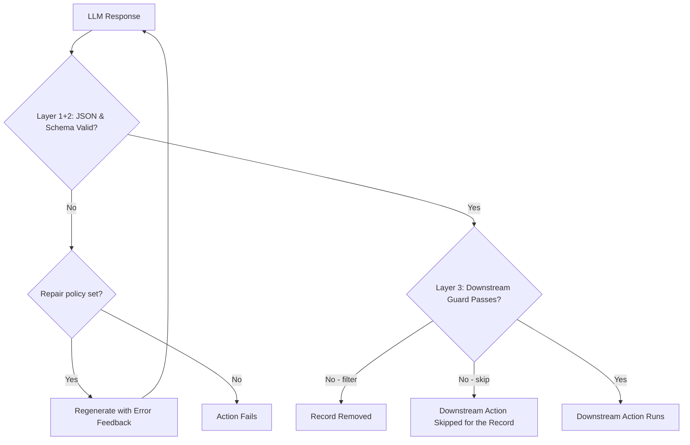

# Output Validation Pipeline

The output validation pipeline makes sure that the output of an LLM is usable. The model might return malformed JSON. It might omit required fields. It might return a response that is technically valid but does not meet your quality level.

Agent Actions validates the output in multiple layers. Each layer finds different problems. An output must pass all the checks before it continues. This is similar to airport security, where each checkpoint finds a different problem.

## Validation Layers

An LLM output goes through three validation layers. The diagram shows the problems that each layer finds and the result of each check:



Guards run last. A guard is on a downstream action. The guard reads the output of an action that already passed layers 1 and 2. The framework evaluates the guard before the downstream action runs.

| Layer | Purpose | Mechanism |
|-------|---------|-----------|
| **1. JSON** | Make sure that the structure is valid | Generate the output again with error feedback |
| **2. Schema** | Validate the types and the fields | Schema constraints and `expect:` repair |
| **3. Guard** | Validate the meaning | Condition expressions |

## Layer 1: JSON Validation

Layer 1 makes sure that the LLM returns valid JSON. If parsing fails and an `expect:` block has a repair policy, the LLM generates the response again:

```yaml
- name: extract_data
  schema: my_schema
  expect:
    repair: auto
    max_iterations: 3
    on_exhausted: return_last
```

## Layer 2: Schema Validation

Layer 2 validates the structure, the types and the constraints of the output.

### Structural Validation

**Required Fields** - Reject the output if a required field is missing:

```yaml
# schema/my_schema.yml
type: object
properties:
  title:
    type: string
  content:
    type: string
required:
  - title
  - content  # Both must be present
```

**Type Checking** - Reject a value that has the wrong type:

```yaml
properties:
  score:
    type: integer  # Rejects "85" (string) or 85.5 (float)
  tags:
    type: array    # Rejects "tag1, tag2" (string)
```

### Value Constraints

**Enums** - Reject a value that is not in the list:

```yaml
properties:
  status:
    type: string
    enum:
      - approved
      - rejected
      - pending
    # Rejects: "maybe", "APPROVED", "Approved"
```

**Numeric Ranges** - Reject a value that is out of the range:

```yaml
properties:
  score:
    type: number
    minimum: 0
    maximum: 100
    # Rejects: -5, 101, 150
```

**Constraints the response check does not enforce** - Schema validation of a model response checks `type`, `required`, `enum`, `minimum` and `maximum`. It also checks the full sub-schema of the `items` of an array. It does not check `exclusiveMinimum`, `exclusiveMaximum`, `minLength`, `maxLength`, `pattern`, `minItems` or `maxItems` on a field. Thus the check accepts a response that breaks one of these constraints. Write these rules as [expectations](./expectations.md) instead:

```yaml
expect:
  repair: auto
  expectations:
    - id: summary_length
      type: word_count_between
      field: summary
      params: { min: 10, max: 500 }   # words, not characters
    - id: email_format
      type: matches_regex
      field: email
      params: { pattern: "^[a-zA-Z0-9+_.-]+@[a-zA-Z0-9.-]+$" }
    - id: has_items
      type: item_count
      field: items
      params: { min: 1, max: 10 }
```

### Schema-Echo and Empty-Object Detection

Schema validation also finds two common LLM failures. Each failure gives valid JSON but data that you cannot use:

**Schema-echo** — The model returns the JSON Schema definition, not data that conforms to the schema. For example, the schema expects `{ optimal_code: string }`, and the LLM returns:

```json
{"title": "InlineSchema", "type": "object", "properties": {"optimal_code": {"type": "string"}}, "required": [], "additionalProperties": false}
```

This output is valid JSON, and its structure matches a JSON object. But it contains zero declared fields. To find this failure, the validator checks the top-level keys of the output. It examines whether they are JSON Schema meta-keys (such as `title`, `type`, `properties`, `required` and `additionalProperties`) and not the expected output fields.

**Empty object** — The model returns `{}`. If no fields are `required`, an empty object passes structural validation. But it has no meaning that you can use. If the schema declares any output fields, the validator rejects an empty object. This occurs also when no field is marked as required.

When an `expect:` block has a repair policy, the two failures become a structural failure. Thus the model gets another chance to produce valid output.

:::note[Meta-key nuance]
Your schema can correctly declare a field named `type` (or another JSON Schema keyword). The validator does **not** reject an output that contains that field. The check occurs only when the output has *zero* declared schema fields.
:::

### Regenerating on Schema Failure

An [`expect:`](./expectations.md) block makes the output conform to the schema. Its structural gate
changes a response that the schema rejects into a failed outcome. The repair loop then acts on that outcome:

```yaml
- name: generate_analysis
  schema: analysis_schema
  expect:
    repair: auto
    max_iterations: 4
    on_exhausted: return_last
```

The block does not need rules of its own. A block with a repair policy and nothing else is the structural
contract. The output must conform to your schema. If it does not conform, the model generates it again. To apply the block to all of a workflow, set it one time under
`defaults:`.

By default, a schema failure sends the original prompt again with no change. The reason is that a response that the schema
rejected has no partial result to keep. `structural: auto` sends the schema feedback
instead. Use this setting for a model that formats the output incorrectly in a systematic way, not occasionally.

If there is no `expect:` block, Agent Actions logs a schema mismatch as a warning. The record continues with no change. Agent Actions rejects a schema-echo record in the two cases.

## Layer 3: Guard Validation

Schema validation finds structural problems. It does not find semantic problems. For example, a score of 25 is a valid integer. But you possibly want to process only high-quality content with scores above 85.

A guard on a downstream action validates the semantic and business logic. The guard examines the output that passed schema validation:

### Filter Unwanted Values

```yaml
- name: score_quality
  schema: quality_score
  # Schema ensures score is number 0-100

- name: generate_final
  dependencies: [score_quality]  # Input source
  guard:
    condition: 'score_quality.score >= 85'  # Semantic: only high quality
    on_false: filter
```

### Reject Specific Content

```yaml
# Filter out responses with unwanted status
- name: next_action
  dependencies: [upstream_action]
  guard:
    condition: 'upstream_action.status != "invalid"'
    on_false: filter

# Filter based on category
- name: process_technical
  dependencies: [classify]
  guard:
    condition: 'classify.category IN ["technical", "implementation"]'
    on_false: filter
```

### Skip vs Filter

When a guard fails, you have two choices. The two choices have very different results:

| Action | Use Case |
|--------|----------|
| `filter` | Remove the record fully from the workflow |
| `skip` | Skip this action, but continue to process the record |

```yaml
# Filter: Record stops here
guard:
  condition: 'score_quality.quality >= 50'
  on_false: filter

# Skip: Record continues without this action
guard:
  condition: 'analyze_content.needs_enhancement == true'
  on_false: skip
```

## Combining All Layers

These patterns show how the layers work together in real workflows.

### Pattern: Quality Gate Workflow {/* #pattern-quality-gate-pipeline */}

```yaml
actions:
  # Step 1: Extract with schema validation + repair
  - name: extract_facts
    prompt: $prompts.extract_facts
    schema: candidate_facts_list  # Layer 2: type/structure
    expect:
      repair: auto
      max_iterations: 4
      on_exhausted: return_last

  # Step 2: Filter empty results (Layer 3)
  - name: validate_facts
    dependencies: [extract_facts]  # Input source
    guard:
      condition: 'extract_facts.candidate_facts_list != []'
      on_false: filter

  # Step 3: Score quality with schema
  - name: score_quality
    dependencies: [validate_facts]  # Input source
    schema: quality_score  # Ensures score is 0-100
    expect:
      repair: auto
      max_iterations: 3
      on_exhausted: return_last

  # Step 4: Filter low quality (Layer 3)
  - name: generate_output
    dependencies: [score_quality]  # Input source
    guard:
      condition: 'score_quality.score >= 85'
      on_false: filter
```

### Pattern: Two-Stage LLM Validation

Use an LLM action to validate the output of another LLM:

```yaml
actions:
  # Generate content
  - name: generate_content
    prompt: $prompts.generate
    schema: content_schema
    expect:
      repair: auto
      max_iterations: 4
      on_exhausted: return_last

  # LLM validates the content
  - name: validate_content
    dependencies: [generate_content]  # Input source
    prompt: |
      Review this content and determine if it meets quality standards:
      {{ generate_content.content }}

      Return: {"is_valid": true/false, "reason": "..."}
    schema:
      is_valid: boolean
      reason: string

  # Guard on validation result
  - name: publish_content
    dependencies: [validate_content]  # Input source
    guard:
      condition: 'validate_content.is_valid == true'
      on_false: filter
```

### Pattern: Enum + Guard for Categories

```yaml
# Schema enforces valid categories
# schema/classification.yml
properties:
  category:
    type: string
    enum:
      - technical
      - conceptual
      - procedural
      - invalid

---
# Workflow guards against unwanted category
- name: classify_content
  schema: classification
  expect:
    repair: auto
    max_iterations: 3
    on_exhausted: return_last

- name: process_valid
  dependencies: [classify_content]  # Input source
  guard:
    condition: 'classify_content.category != "invalid"'  # Filter "invalid" category
    on_false: filter
```

### Pattern: Numeric Threshold with Repair

Make the LLM return acceptable scores:

```yaml
# Schema with constraints
# schema/score_schema.yml
properties:
  confidence_score:
    type: number
    minimum: 0
    maximum: 100
    description: "Confidence from 0-100. Must be >= 70 for high confidence."

---
# Action with a repair policy
- name: assess_confidence
  prompt: |
    Assess confidence in this analysis.
    Return a score from 0-100.
    Scores below 70 indicate low confidence.
  schema: score_schema
  expect:
    repair: auto
    max_iterations: 5
    on_exhausted: return_last

# Guard for business threshold
- name: proceed_if_confident
  dependencies: [assess_confidence]  # Input source
  guard:
    condition: 'assess_confidence.confidence_score >= 70'
    on_false: filter
```

## Custom Validation with Tool Actions

Some validation logic is too complex for schema constraints or guard expressions. For example, the logic checks values against a blocklist or calls an external API.

For complex validation logic, use a tool action:

```yaml
actions:
  - name: generate_content
    schema: content_schema
    expect:
      repair: auto
      max_iterations: 3
      on_exhausted: return_last

  - name: custom_validate
    kind: tool
    impl: validate_content
    dependencies: [generate_content]  # Input source

  - name: next_step
    dependencies: [custom_validate]  # Input source
    guard:
      condition: 'custom_validate.validation_passed == true'
      on_false: filter
```

```python
# tools/validate_content.py
@udf_tool()
def validate_content(data: dict) -> dict:
    """Custom validation logic."""
    issues = []
    content = data["generate_content"]

    # Check for prohibited words
    prohibited = ["todo", "placeholder", "tbd"]
    text = content["text"].lower()
    for word in prohibited:
        if word in text:
            issues.append(f"Contains prohibited word: {word}")

    # Check minimum quality
    if len(content["summary"]) < 50:
        issues.append("Summary too short")

    return {
        "validation_passed": len(issues) == 0,
        "issues": issues
    }
```

## Validation Decision Matrix

| Want to Reject | Use | Example |
|----------------|-----|---------|
| Invalid JSON | `expect: { repair: auto }` | Malformed response |
| Wrong type | Schema `type` | String instead of number |
| Missing field | Schema `required` | No "title" field |
| Wrong value | Schema `enum` | "maybe" not in ["yes", "no"] |
| Out of range | Schema `minimum`/`maximum` | Score of 150 (max 100) |
| Too short or too long | Expectation `word_count_between` | Summary < 10 words |
| Empty array | Guard `!= []` | No facts extracted |
| Low score | Guard `>= threshold` | Quality < 85 |
| Wrong category | Guard `!= value` | Category == "invalid" |
| Complex logic | Tool action | Custom business rules |

## Repair vs Guard

Use repair when the LLM can fix the problem. Use a guard when the LLM cannot fix the problem. Repair generates the output again. A guard filters the output.

| Aspect | Repair | Guard |
|--------|--------|-------|
| **When** | Before Agent Actions accepts the output | After Agent Actions accepts the output |
| **Purpose** | Fix LLM mistakes | Filter output that is valid but not wanted |
| **Action** | Generate the output again | Skip or remove the record |
| **Cost** | More LLM calls | No more cost |
| **Use for** | Structural problems | Semantic filters |

**Use repair when:**
- The output is malformed (JSON errors).
- Schema validation fails.
- A rule names a defect that the model can correct.

**Use a guard when:**
- The output is valid but does not meet the criteria.
- You filter on values (scores, categories).
- You make business logic decisions.

The limit is that repair costs API tokens. Guards are free. If you filter on a value that the LLM produced correctly, use a guard. Do not generate the output again in the hope of a different answer.

## Best Practices

### 1. Layer Your Validation

```yaml
# Layer 1 & 2: Schema + repair
- name: extract
  schema: extraction_schema
  expect:
    repair: auto
    max_iterations: 4
    on_exhausted: return_last

# Layer 3: Guard for quality
- name: process
  dependencies: [extract]
  guard:
    condition: 'extract.quality >= 80'
    on_false: filter
```

### 2. Use Enums for Constrained Values

```yaml
# Good: LLM must choose from list
status:
  type: string
  enum: ["approved", "rejected", "pending"]

# Avoid: Free-form string with guard
# (LLM might return "Approved", "APPROVED", etc.)
```

### 3. Provide Schema Descriptions

```yaml
properties:
  score:
    type: integer
    minimum: 0
    maximum: 100
    description: "Quality score. 85+ is high quality, below 50 is rejected."
```

### 4. Set Reasonable Repair Limits

```yaml
# Simple schema: fewer iterations
expect:
  repair: auto
  max_iterations: 3
  on_exhausted: return_last

# Complex schema: more iterations, halt on exhaustion
expect:
  repair: auto
  max_iterations: 5
  on_exhausted: raise
```

### 5. Guard Early to Save Cost

Guards prevent downstream work. Put guards as early as possible in your workflow. Thus you do not use API calls on records that a guard will filter later.

```yaml
# Filter early before expensive actions
- name: extract  # Cheap
- name: validate  # Cheap
  dependencies: [extract]  # Input source
  guard:
    condition: 'extract.facts != []'
    on_false: filter
- name: expensive_llm_call  # Only runs on valid data
  dependencies: [validate]  # Input source
```

## Debugging Validation Failures

### Check Schema Validation Errors

```bash
AGENT_ACTIONS_LOG_LEVEL=DEBUG agac run -a workflow
```

Find these lines in the log:
```
Schema validation warning for 'extract_data': Missing required fields: title
Schema validation warning for 'extract_data': Field 'status': 'invalid' is not one of ['approved', 'rejected', 'pending']
```

### Check Guard Evaluation

```bash
AGENT_ACTIONS_LOG_LEVEL=DEBUG agac run -a workflow
```

Find these lines in the log:
```
Guard pre-filter for 'generate_output': 0 passed, 0 skipped, 1 filtered, 0 failed, 0 left unjudged for the cascade filter, of 1 total
[generate_output] All 1 records filtered by guard (score_quality.score >= 85). None of them reaches downstream actions.
```

### Validate Schema Syntax

`agac inspect` loads the workflow through preflight. Preflight validates
the schemas that the workflow refers to. If a schema is malformed, the command shows an error that gives the path. The command exits with a non-zero code before the workflow makes any LLM call:

```bash
agac inspect -a workflow_name
```

### Analyze Schema Structure

```bash
agac schema -a workflow
```
