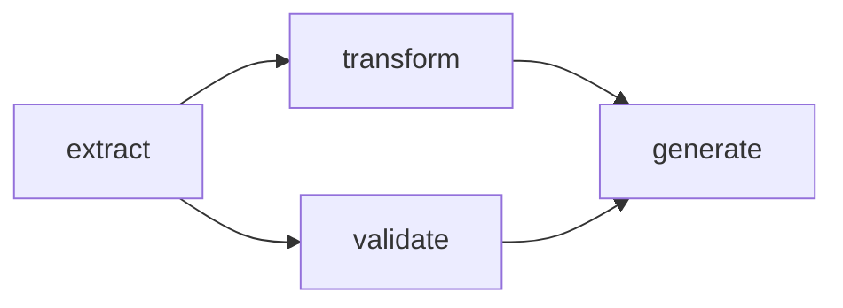
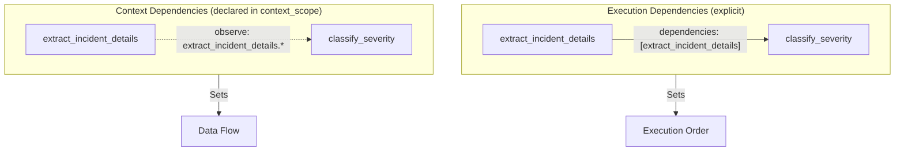
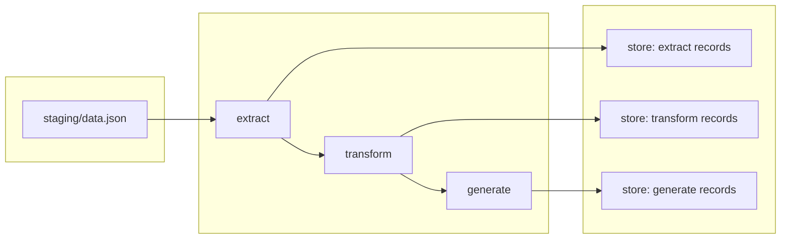

# Key Concepts

This page gives the core concepts of Agent Actions. These concepts help you design effective workflows.

## Workflows {/* #what-is-an-agentic-workflow */}

A workflow is a system in which AI agents do tasks autonomously. The agents make decisions and take actions to achieve a goal. A workflow is different from a simple prompt-response interaction. A workflow has more than one action, uses tools and coordinates its components.

### How Agent Actions Models a Workflow {/* #how-agent-actions-models-this */}

Agent Actions represents a workflow as a directed acyclic graph (DAG) of actions. Each action declares:
- Its **dependencies** (what must run first)
- Its **inputs** (the data that it needs, through the context scope)
- Its **output schema** (what it will produce)
- Its **prompt** (instructions for the LLM)
- Its **model** (which provider and model to use)

Agent Actions uses these declarations to find the execution order, to validate the outputs and to run actions in parallel where possible.



In this example, `transform` and `validate` both depend on `extract`, but they do not depend on each other. Agent Actions runs `transform` and `validate` in parallel.

The DAG structure guarantees these conditions:
- Actions run only after their dependencies complete
- Data flows in one direction (no cycles)
- Independent actions run in parallel automatically

## Actions

An action is one unit of work in your workflow. An action is an LLM call, a tool call (for example, a Python function) or a human review gate (HITL, human-in-the-loop).

**Reasons to define actions in YAML, and not to chain API calls directly:**

- **Structure**: Actions declare dependencies and schemas. Thus the workflow documents itself
- **Validation**: Agent Actions enforces the output schemas automatically
- **Reusability**: Workflows share prompts and schemas through the prompt store and the schema directory. Jinja2 templates reuse action patterns
- **Version control**: You can diff and review YAML configurations
- **Separation of concerns**: Prompts, schemas and logic are in separate files
- **Progressive context disclosure**: The context scope controls exactly what data each action sees

```yaml
actions:
  - name: classify_genre
    intent: "Classify book into BISAC categories"
    dependencies: [extract_metadata]
    schema: classify_genre
    prompt: $book_catalog.Classify_Book_Genre  # Reference to prompt_store
    context_scope:
      observe:
        - extract_metadata.*
    expect:
      max_iterations: 3
      expectations:
        - { type: matches_regex, field: primary_bisac_code,
            params: { pattern: '^[A-Z]{3}\d{6}$' } }
```

**Action fields:**

| Field | Description |
|-------|-------------|
| **name** | Unique identifier for this action |
| **intent** | A description, for people, of what this action does (required) |
| **dependencies** | Actions that must complete first |
| **schema** | The name of the JSON Schema for output validation (a tool action must name one) |
| **prompt** | The instructions for the LLM (inline or a `$workflow.PromptName` reference) |
| **kind** | `llm` (default), `tool` for Python functions, or `hitl` for human review gates |
| **impl** | For tool actions, the name of the function to call |
| **hitl** | For hitl actions, the configuration block (for example port, instructions and timeout) |
| **context_scope** | Progressive context disclosure. It controls exactly what data flows into this action (`observe`, `drop`, `passthrough`). Each action must declare one |
| **expect** | Output rules, and the repair policy that regenerates the output on failure |
| **model_vendor** | Which provider to use (inherited from defaults if not specified) |
| **model_name** | Which model to use (inherited from defaults if not specified) |
| **run_mode** | `online` or `batch` processing (inherited from defaults if not specified) |
| **granularity** | `record` (one record at a time) or `file` (all records at once) processing (inherited from defaults if not specified). `file` is for tool and HITL actions. Thus an LLM action stays at `record` |

**Configuration inheritance:** Agent Actions uses a hierarchical configuration system. Settings cascade from `agent_actions.yml` → workflow `defaults` → individual actions. Set a field at the action level only if you want to override the inherited value.

Actions are stateless. An action receives input, processes the input and produces validated output. Thus actions are easy to test, to retry and to understand.

### Action Kinds

Agent Actions supports three kinds of actions:

| Kind | When to Use | Example |
|------|-------------|---------|
| **`llm`** | Call an LLM to generate, classify, or transform data | Summarize text, extract entities, classify categories |
| **`tool`** | Execute Python functions for deterministic operations | Data validation, API calls, file I/O |
| **`hitl`** | Pause the workflow for human review and approval | Quality gates, manual data verification, compliance checks |

**Example: All three kinds in one workflow**

```yaml
actions:
  - name: generate_report
    kind: llm  # LLM generates initial report
    intent: "Generate the compliance report"
    prompt: "Generate a compliance report from the data..."
    schema: report
    context_scope:
      observe:
        - source.*

  - name: validate_report
    kind: tool  # Python validates report structure
    intent: "Validate the report structure"
    impl: validate_compliance_report
    schema: report
    dependencies: [generate_report]
    context_scope:
      observe:
        - generate_report.*

  - name: review_report
    kind: hitl  # Human reviews before publishing
    intent: "Review the report before publishing"
    dependencies: [validate_report]
    hitl:
      instructions: "Review the compliance report for accuracy"
    context_scope:
      observe:
        - validate_report.*

  - name: publish_report
    kind: tool  # Publish if approved
    intent: "Publish the approved report"
    impl: publish_to_portal
    schema: report
    dependencies: [review_report]
    context_scope:
      observe:
        - review_report.*
    guard:
      condition: "review_report.hitl_status == 'approved'"
      on_false: skip
```

For more details on HITL actions, see the [Human-in-the-Loop guide](../guides/human-in-the-loop.md).

### Dependency Types

Agent Actions has two types of dependencies:

- **Execution dependencies**: You declare them with `dependencies: [action_name]`. They control the execution order. Upstream actions complete before downstream actions start.
- **Context dependencies**: You declare them with `context_scope` entries such as `action_name.field`. The output schema of that action must define the referenced field. From the schema, Agent Actions knows that the field exists and that it can pass the field to downstream actions.

**Example: Execution dependency**

```yaml
# From the incident_triage example
- name: classify_severity
  dependencies: [extract_incident_details]  # Must wait for extraction to complete
  intent: "Classify incident severity"
  prompt: $incident_triage.Classify_Severity
```

**Example: Context dependency (through context_scope)**

```yaml
# From the incident_triage example
- name: classify_severity
  dependencies: [extract_incident_details]
  context_scope:
    observe:
      - extract_incident_details.*  # Pull all fields from upstream action's output
      - source.incident_report
```



You declare both types. A prompt may refer only to a namespace that `context_scope` lists in `observe` or `passthrough`. Each action that a prompt or `context_scope` names must be upstream through `dependencies`. The reason is that only the actions that a record passed through are sure to be on the record. Preflight refuses any other name.

## Field References

**How actions share data:** A field reference points to a field in the output of an upstream action. When you write `{{ extract_data.product_name }}`, you point to the `product_name` field of `extract_data`. The field gets its value when that action completes. Thus a field reference is similar to a formula in a spreadsheet that points to a cell.

```yaml
prompt: |
  Product: {{ extract_data.product_name }}
  Features: {{ extract_data.key_features }}
```

The `{{ action_name.field }}` syntax gets data from completed upstream actions. Agent Actions validates these references at configuration time. Thus you find typos before Agent Actions makes any API calls.

**Declared context**: A prompt can use `{{ extract_data.product_name }}` only if the `context_scope` of the action lists `extract_data.product_name` or `extract_data.*` under `observe` (or `passthrough`). Preflight refuses a prompt that refers to a namespace that the `context_scope` does not list.

## Schema Validation

**Malformed JSON from an LLM:** Agent Actions validates the output of each action against its JSON Schema. You can configure `expect:` with a repair policy. Then Agent Actions regenerates the output until it conforms, up to `max_iterations` times (default 3).

```json
{
  "type": "object",
  "properties": {
    "sentiment": {
      "type": "string",
      "enum": ["positive", "negative", "neutral"]
    },
    "confidence": {
      "type": "number",
      "minimum": 0,
      "maximum": 1
    }
  },
  "required": ["sentiment", "confidence"]
}
```

You can also define schemas in YAML with the `fields` shorthand, which is more concise:

```yaml
# schema/my_workflow/sentiment_result.yml
name: sentiment_result
fields:
  - id: sentiment
    type: string
    description: "Detected sentiment"
  - id: confidence
    type: number
    description: "Confidence score 0-1"
required:
  - sentiment
  - confidence
```

Thus downstream actions always receive data with a correct structure. But schema validation finds structural errors and cannot verify semantic correctness. A response might match your schema but still contain incorrect information.

## Context Scope

Context scope controls what data flows between actions. It keeps prompts focused and token costs low. For example, with a large document, you can keep the full raw HTML away from the downstream actions.

| Directive | Effect |
|-----------|--------|
| `observe` | Fields sent to the LLM prompt/context |
| `drop` | Fields excluded from context entirely |
| `passthrough` | Fields attached to the output. The LLM does not receive these fields |

```yaml
context_scope:
  observe:
    - extract_data.product_name
  drop:
    - source.raw_html
  passthrough:
    - source.id
```

This configuration sends `product_name` to the LLM and excludes raw HTML from context entirely. It also keeps the source ID on the output record of the action, and the LLM does not see the source ID. The ID stays under its origin namespace, `source.id`, not under the name of the action. Thus a downstream action reads the ID as `source.id`.

## Execution Flow

The diagram shows how data moves through a workflow from start to finish:



The flow:

1. You put the input data in `agent_io/staging/`
2. Agent Actions stages each record into the store under `agent_io/store/`
3. Actions execute in dependency order (in parallel where possible)
4. Agent Actions validates the output of each action and writes it to the `target_data` table of the store, keyed by action name

## Further Reading

- **[Field References](../reference/context/field-references)**: Details of the reference syntax
- **[Context Scope](../reference/context/context-scope)**: Control of the data flow
- **[Schemas](../reference/schemas/)**: Schema design patterns
- **[Guards](../reference/execution/guards)**: Conditional execution
