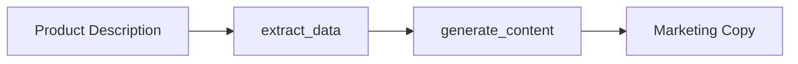

# Tutorials

These tutorials teach Agent Actions through practical exercises.

## Your First Workflow

In this tutorial, you build your first workflow. The workflow has two actions. The first action extracts product data. The second action generates marketing content. This pattern is common when you automate content creation.

## The Workflow That You Build {/* #what-youll-build */}

Each action in a workflow receives input, does its work and sends its output to the next action. A workflow is similar to an assembly line, in which each action is a station. The diagram shows the workflow that you create:



The first action extracts structured data from raw text. The second action uses the structured data to generate marketing copy.

## 1. Create Your Project {/* #1-set-up-your-project */}

Initialize a new project:

```bash
agac init my_workflow
cd my_workflow
```

To start from a full working example, run `agac init example contract_reviewer my_workflow`. The command scaffolds a complete project that you can run immediately. To see all examples, run `agac init list`.

The `agac init my_workflow` command creates the standard project structure:

```
my_workflow/
├── agent_actions.yml      # Project configuration (API key variable names, defaults)
├── agent_workflow/        # Workflow definitions
├── prompt_store/          # Prompt templates (optional)
├── schema/                # Output schemas for validation
├── seed_data/             # Reference data
├── templates/             # Config templates
└── tools/                 # Custom Python functions
```

**`agent_actions.yml`** is the project marker file. The file tells Agent Actions that the directory is a project. The file also stores the default configuration, for example the name of the environment variable for your API key and the model settings. If the file does not exist, the commands that read the project fail with `Project not found`.

For this tutorial, you create a workflow in `agent_workflow/`:

```
agent_workflow/
└── product_pipeline/
    ├── agent_config/
    │   └── product_pipeline.yml       # Workflow definition
    └── agent_io/
        ├── staging/
        │   └── products.json          # Input data (the only on-disk data you write)
        └── store/
            └── product_pipeline.db    # SQLite database — created on first run
```

## 2. Define Your Schemas

**Why schemas matter:** A schema defines the exact structure that you expect from the LLM. Agent Actions validates each response against the schema. Thus a schema is a contract for the output. If the LLM returns malformed data, an `expect:` repair policy regenerates the output, up to `max_iterations` times (default 3).

Create these schema files:

**`schema/product_data.json`**:
```json
{
  "type": "object",
  "properties": {
    "product_name": { "type": "string" },
    "category": { "type": "string" },
    "key_features": {
      "type": "array",
      "items": { "type": "string" },
      "minItems": 3
    },
    "price_range": { "type": "string" },
    "target_audience": { "type": "string" }
  },
  "required": ["product_name", "category", "key_features", "target_audience"]
}
```

**`schema/marketing_content.json`**:
```json
{
  "type": "object",
  "properties": {
    "headline": { "type": "string", "maxLength": 60 },
    "description": { "type": "string", "maxLength": 200 },
    "key_benefits": {
      "type": "array",
      "items": { "type": "string" },
      "minItems": 3,
      "maxItems": 5
    }
  },
  "required": ["headline", "description", "key_benefits"]
}
```

## 3. Create Your Workflow {/* #3-create-your-agentic-workflow */}

The workflow configuration defines your actions and how data flows between the actions. The `generate_content` action refers to fields of `extract_data` with the `{{ extract_data.field }}` syntax. Actions share data through these field references. Each action declares a `context_scope`. Each field that a prompt refers to must be in the `context_scope` of the action.

**`agent_workflow/product_pipeline/agent_config/product_pipeline.yml`**:

```yaml
name: product_pipeline
description: "Extract product data and generate marketing content"

defaults:
  model_vendor: openai
  model_name: gpt-4o-mini
  json_mode: true

actions:
  - name: extract_data
    intent: "Extract structured product data from raw text"
    prompt: |
      Extract structured product information from this text:
      {{ source.content }}

      Return: product name, category, key features, price range, target audience.
    schema: product_data
    context_scope:
      observe:
        - source.content

  - name: generate_content
    intent: "Write marketing copy from the extracted data"
    dependencies: [extract_data]
    prompt: |
      Create marketing content for this product:

      Name: {{ extract_data.product_name }}
      Category: {{ extract_data.category }}
      Features: {{ extract_data.key_features }}
      Audience: {{ extract_data.target_audience }}

      Generate a catchy headline, engaging description, and 3-5 key benefits.
    schema: marketing_content
    context_scope:
      observe:
        - extract_data.*
      passthrough:
        - source.content
```

## 4. Add Input Data

**`agent_workflow/product_pipeline/agent_io/staging/products.json`**:

```json
[
  {
    "content": "Smart Fitness Tracker Pro - Advanced health monitoring device with heart rate tracking, sleep analysis, and GPS functionality. Price: $199-249. Perfect for fitness enthusiasts and health-conscious users."
  }
]
```

## 5. Configure the Project

**`agent_actions.yml`**:

```yaml
default_agent_config:
  api_key: OPENAI_API_KEY        # Environment variable name for your API key
  model_vendor: openai           # openai, anthropic, google, groq, cohere, ollama_local, ollama_cloud, llamafile
  model_name: gpt-4o-mini        # Any model supported by your provider

schema_path: schema
tool_path: ["tools"]
seed_data_path: seed_data
```

Agent Actions automatically stores all workflow outputs in `agent_io/store/<workflow>.db`. You do not need a storage configuration.

Use a provider for which you have an API key. This example uses Anthropic:

```yaml
default_agent_config:
  api_key: ANTHROPIC_API_KEY
  model_vendor: anthropic
  model_name: claude-sonnet-4-20250514
```

## 6. Run Your Workflow {/* #6-run-your-agentic-workflow */}

```bash
agac run -a product_pipeline
```

The output is similar to this:

```
Starting agent run for: product_pipeline
...
product_pipeline — 2 actions
Step 1/2 extract_data
  ✓ extract_data  1 record in 2.1s (openai/gpt-4o-mini)
Step 2/2 generate_content
  ✓ generate_content  1 record in 1.8s (openai/gpt-4o-mini)

✓ 3.9s — 2 completed
```

Print the content that `generate_content` stored for each record. The content holds one entry for each namespace that the record carries. The store keeps the records compressed. Thus, read the records with the CLI, not with sqlite3:

```bash
agac records -w product_pipeline -a generate_content --field content
```

```json
[
  {
    "source": {
      "content": "Smart Fitness Tracker Pro - Advanced health monitoring device..."
    },
    "extract_data": {
      "product_name": "Smart Fitness Tracker Pro",
      "category": "Wearable Technology",
      "key_features": ["Heart Rate Tracking", "Sleep Analysis", "GPS"],
      "price_range": "$199-249",
      "target_audience": "Fitness enthusiasts"
    },
    "generate_content": {
      "headline": "Track Your Fitness Like a Pro",
      "description": "Advanced health monitoring with precision tracking...",
      "key_benefits": ["24/7 Health Monitoring", "GPS Accuracy", "Sleep Insights"]
    }
  }
]
```

## What Agent Actions Did {/* #what-just-happened */}

Agent Actions did these operations:

1. **extract_data** read from `staging/`, called the LLM and validated the output against the `product_data` schema
2. **generate_content** received the output of extract_data through `{{ extract_data.field }}` references. It generated marketing content and validated the content against the `marketing_content` schema
3. Both actions wrote their records as rows in the `target_data` table of `agent_io/store/product_pipeline.db`

**Invalid JSON from the LLM:** You can configure `expect:` with a repair policy. Then Agent Actions regenerates the output until it conforms to your schema, up to `max_iterations` times. To enable the repair policy, see [Expectations](../reference/validation/expectations.md).

## Next Steps

- **[Key Concepts](./concepts)**: Actions, dependencies and context
- **[Custom Tools](../guides/custom-tools)**: Add Python tools to your workflow
- **[Design Patterns](../guides/design-patterns)**: Workflow patterns that you can use again
