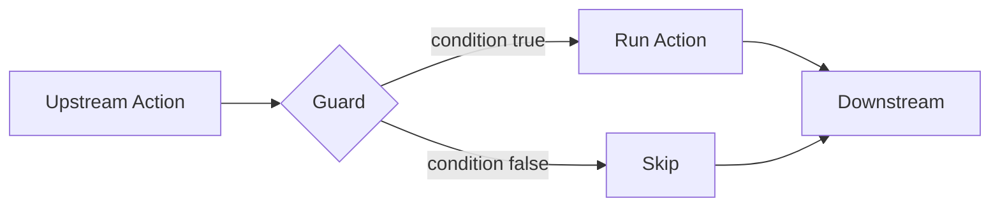

# Documentation Style Guide

This guide gives the rules for the text, the structure and the format of the Agent Actions documentation. The pages are written to the rules of Simplified Technical English (ASD-STE100). We call this style "STE" in this guide.

STE has one purpose: each sentence must have one meaning only. Readers of this documentation include non-native speakers, translation tools and AI agents. None of these readers can ask the author what a sentence means.

The one principle is: **remove ambiguity, but never remove information.** A shorter page is not a better page. A page is better when each sentence has one meaning and the page keeps each fact, condition, number, limit and reason.

:::note
Do not say that a page "complies with" ASD-STE100. ASD does not certify documentation of this type. Say that the page is "written to STE rules".
:::

---

## 1. Writing Modes

Use one of two modes. The page type sets the mode.

| Mode | Page types | Rules |
|------|------------|-------|
| Strict | CLI reference, configuration reference, procedures, troubleshooting, error text, setup steps | All rules in section 2. One word for one meaning. Hard limits on sentence length. |
| Light | Overviews, tutorials, concept pages, guides, design patterns | All structural rules in section 2. The word rules in section 2.3 are advice, not hard limits. |

A page can contain the two modes. For example, a guide can have a concept section in light mode and a procedure in strict mode.

---

## 2. Writing Rules

### 2.1 Sentences

1. Write a maximum of 20 words in a procedural sentence (an instruction).
2. Write a maximum of 25 words in a descriptive sentence.
3. Write one instruction in each sentence. Exception: two actions that occur at the same time.
4. In a procedure, put the condition first: "If the batch fails, run `agac batch retry`."
5. Use the active voice: "The guard skips the action." Use the passive voice only when the actor is not known.
6. Use the simple tenses: "The run stopped." Keep a compound tense only when it carries a meaning that the simple tense cannot. For example, "the batch has completed" means that the output is available now.
7. Do not use semicolons. Write two sentences.
8. Do not use contractions. Write "do not", not "don't".
9. Do not omit articles ("the", "a"), subjects or verbs.
10. Do not put more than three nouns in a row. Write "the retry count of the action", not "the action retry count limit setting".

### 2.2 Paragraphs and lists

1. Put the result or the definition first, in the first sentence.
2. Write one topic in each paragraph, with a maximum of six sentences.
3. Use a numbered list for three or more steps, or for items that the text refers to by number.
4. Use a bulleted list for three or more items that have no order.
5. Do not hide a sequence of steps in one sentence.

### 2.3 Words

1. Use one word for one meaning. Use the same term for the same thing on all pages. See section 6.
2. Use a verb for an action, not a noun. Write "validate the schema", not "perform validation of the schema".
3. Do not use phrasal verbs. Write "start", not "kick off". Write "remove", not "take out".
4. Do not use Latin abbreviations. Write "for example" and "that is".
5. Keep the software verbs that name a computer process, for example "install", "debug", "log in" and "roll back".
6. Define a technical term the first time that it occurs on a page, if it is not common English.

### 2.4 Keep the confidence of the original

A hedge or a modal verb is content. Do not make a claim stronger or weaker than the facts.

1. "The request may fail" does not become "The request fails".
2. "Approximately 40%" keeps "approximately".
3. "Can" (it is possible) and "must" (it is an obligation) are different. Do not change one to the other.

### 2.5 Do not use

| Do not use | Why | Use |
|------------|-----|-----|
| "Let's explore...", "You might wonder..." | It adds words but no information. | Start with the fact. |
| A rhetorical question as a heading or a sentence | The reader must find the answer. | State the answer. |
| "Seamless", "powerful", "robust", "best-in-class" | It does not say what the feature does. | Give the behavior or a measurement. |
| "As needed", "appropriate", "properly" | The reader cannot decide the scope. | Give the rule or the list. |
| "It", "this" or "that" with no clear noun | The reader cannot find the noun. | Write the noun again. |
| An analogy in place of the mechanism | The analogy has more than one reading. | State the mechanism. An analogy can follow it, if it adds help. |
| "It should be noted that...", "In order to..." | It adds words but no information. | State the fact. Write "to". |

**Do:**
> A guard checks a condition before an action runs. If the condition is false, the guard skips the action. The guard does not send a request to the LLM.

**Do not:**
> Let's walk through how guards work. Think of a guard as a quality checkpoint on an assembly line—if the input doesn't meet standards, the station is skipped.

### 2.6 Keep these items verbatim

Do not change these items. Each item counts as one word for sentence length.

- Code blocks, inline code, commands, flags and options
- File paths, URLs and link targets
- Identifiers, YAML keys, field names and parameter names
- Quoted error text, log lines and CLI output
- Numbers and their units, versions and dates
- Product names, for example Agent Actions, Docusaurus and OpenAI

---

## 3. Page Structure

### 3.1 Page layout

Use this structure for each page:

```markdown
---
title: Feature Name
description: One sentence that says what the feature does
sidebar_position: N
---

# Feature Name

One paragraph that says what the feature does and when to use it.

## How It Works

The mechanism. Add a diagram if the mechanism has more than two paths.

## Example: [Specific Scenario]

A real use of the feature, with the configuration and the result.

## [Feature-Specific Sections]

The details, one topic in each section.

## See Also

Links to related pages.
```

### 3.2 Headings

- **H1 (`#`)**: The page title. Use it one time on each page.
- **H2 (`##`)**: The main sections, for example "How It Works" and "Configuration".
- **H3 (`###`)**: The subsections in a main section.
- **H4 (`####`)**: Use it only when an H3 section has subsections.

A heading is a statement or a noun phrase. A heading is not a question.

:::warning[CAUTION]
Other pages and external sites link to headings by their anchor. The anchor comes from the heading text. If you change the text of a heading, add the old anchor as an explicit ID: `## Retry a Failed Batch {/* #retrying-failed-batches */}`. If you do not do this, the links to the old anchor stop working. Do not use the `{#id}` form. The site builds with `future.v4`, so MDX reads `{#id}` as a JavaScript expression and the build fails. A broken anchor gives only a warning in the build, so make sure that each old anchor stays.
:::

### 3.3 Tables

Use a table to compare options, to list parameters or to show the operations of a protocol:

```markdown
| Option | Description | Default |
|--------|-------------|---------|
| `--quiet` | Show only the errors and the result | `false` |
| `--execution-mode` | The execution mode: `auto`, `parallel` or `sequential` | `auto` |
```

### 3.4 Code blocks

Give the language of each code block, for syntax highlighting:

````markdown
```yaml
actions:
  - name: extract_facts
    prompt: $prompts.extract_facts
    schema: facts_schema
```
````

Add a comment in the code when the code alone does not show its purpose:

````markdown
```yaml
# Skip validation if no facts were extracted
guard:
  condition: "extract_facts.facts != []"
  on_false: skip
```
````

### 3.5 Diagrams

A diagram shows one mechanism. Each diagram must have a purpose, and the text must say what the diagram shows.

Use Mermaid for these diagram types:

- **Flowcharts**: Decision trees and how a workflow runs
- **Sequence diagrams**: Request and response flows
- **Architecture diagrams**: System components

Rules:

1. Use a maximum of 10 nodes in a diagram. Divide a larger diagram into two or more diagrams.
2. Put text before or after the diagram that says what the diagram shows.
3. Use the same styles in all diagrams.

````markdown
The guard examines the condition before the action runs. If the condition is false, the guard skips the action:



The two paths join. The downstream actions run, but they do not receive output from a skipped action.
````

Put text with each diagram. Say what the reader must see in the diagram.

---

## 4. Format

### 4.1 Voice and person

| Aspect | Rule |
|--------|------|
| Voice | Active |
| Tense | Simple present for features. Simple past for the result of an example run. |
| Person | "You" in instructions. Do not use "we" or "I" on documentation pages. |
| Tone | Neutral and direct |

**Active voice:**
> Agent Actions validates your schema before it runs the workflow.

**Not passive:**
> The schema is validated by Agent Actions before execution is performed.

### 4.2 Bold, italics and code

- **Bold**: A key term the first time it occurs, UI elements, and the lead word of a list item.
- *Italics*: Do not use italics for emphasis. Use them only when the page defines a new term.
- `Code`: Commands, file names, field names and values.

---

## 5. Admonitions

Use the Docusaurus admonitions for three types of callout only. Each type has one meaning.

| Callout | Syntax | Use it for |
|---------|--------|------------|
| WARNING | `:::danger[WARNING]` | A risk of wrong data, data loss, a security exposure or cost that you cannot recover |
| CAUTION | `:::warning[CAUTION]` | A risk that a change breaks existing behavior or a run |
| NOTE | `:::note` | Extra information only |

Rules:

1. Put the WARNING or the CAUTION before the step that it applies to.
2. A NOTE gives information only. Put an instruction in a step or in the body text, not in a NOTE.
3. Do not use `:::tip`, `:::info` or `:::caution` on new pages.
4. Use a callout only for lost data, a broken run, or a fact that is not in the body text.

```markdown
:::danger[WARNING]
`agac clean --all` deletes all `agent_io` folders of the workflow, which include staging, target and the store. You cannot recover the deleted files.
:::

:::warning[CAUTION]
A guard skips the action fully. The action sends no request to the LLM and writes no output.
:::

:::note
Batch mode requires outputs that can be serialized to JSON.
:::
```

---

## 6. Terminology

### 6.1 Use one term for one thing

| Use | Do not use |
|-----|------------|
| workflow | pipeline, agentic workflow (except in the product description on the home page) |
| action | step, task, node (for an action in a workflow) |
| `agac` | agent-actions (for the CLI) |
| field reference | variable, placeholder |
| upstream / downstream | before / after (for data flow) |
| record | row, item (for one unit of data that an action processes) |
| tool | UDF, function (for user code that an action calls) |

"Step" is correct for a step in a procedure. "Row" is correct for a row in a table. "Node" is correct for a node in a diagram.

"UDF guard" is correct for a guard with a `udf:` condition. The error messages of Agent Actions use this term. A UDF guard is not an action, so do not call it a "tool guard".

### 6.2 Define technical terms

If you use a technical term, define it the first time that it occurs:

**Do:**
> Agent Actions runs a workflow as a DAG (directed acyclic graph). Each action runs after the actions that it depends on. Each action runs one time.

**Do not:**
> Agent Actions implements DAG-based execution semantics.

### 6.3 Acronyms

Write the full term the first time, then the acronym:

> A user-defined function (UDF) adds your own Python code to a workflow. Agent Actions finds UDFs in your code directory.

---

## 7. Examples

### 7.1 The running example

Use the same scenario on related pages. The primary example for Agent Actions is **fact extraction and validation**. This workflow processes documents:

- `extract_facts`: Gets the facts from the source documents
- `validate_facts`: Checks the extracted facts
- `format_output`: Formats the validated facts

### 7.2 Example format

Give each example in three parts: the context, the code and the result:

````markdown
### Example: Conditional Execution

A validation action must run only if there are facts to validate:

```yaml
actions:
  - name: validate_facts
    dependencies: [extract_facts]
    guard:
      condition: "extract_facts.facts != []"
      on_false: skip
    prompt: Validate these facts...
```

The guard checks `extract_facts.facts`. If the list is empty, the guard skips the action. The action sends no request and writes no output.
````

### 7.3 Before and after

To show a change, give the old configuration, then the new configuration:

````markdown
**Before (the same keys in each action):**
```yaml
- name: action_1
  model_vendor: openai
  model_name: gpt-4o-mini
- name: action_2
  model_vendor: openai
  model_name: gpt-4o-mini
```

**After (the keys in `defaults`):**
```yaml
defaults:
  model_vendor: openai
  model_name: gpt-4o-mini

actions:
  - name: action_1
  - name: action_2
```
````

---

## 8. Common Page Patterns

### 8.1 "How It Works" sections

Give the mechanism in three to five short paragraphs:

```markdown
## How Guards Work

A guard examines a condition before an action runs. The condition refers to upstream outputs with the field syntax `action_name.field`.

If the condition is false, the `on_false` value of the guard sets the result:
- `skip`: The action does not run.
- `filter`: The action runs only on the records where the condition is true.

The guard examines the condition at runtime, after the dependencies complete. Thus a guard can use computed values, not only static configuration.
```

### 8.2 CLI command pages

Use this structure for each command:

````markdown
## command-name

One sentence that says what the command does.

```bash
agac command-name [options]
```

**Options:**

| Option | Description |
|--------|-------------|
| `-a, --agent TEXT` | The workflow name (required) |
| `--json` | Show the output as JSON |

**Examples:**

```bash
# Basic usage
agac command-name -a my_workflow

# With options
agac command-name -a my_workflow --json
```
````

### 8.3 Feature pages

Give a new feature in this order:

1. **Problem**: The problem that the feature solves.
2. **Solution**: How the feature solves the problem.
3. **Example**: The feature in a workflow.
4. **Details**: The configuration and the options.

A long feature page uses this order of sections:

1. **Opening**: The problem that the feature solves.
2. **How It Works**: The mechanism, with diagrams.
3. **Example**: A real scenario.
4. **Configuration**: The options.
5. **When to Use It**: When to use the feature, and when not to use it.
6. **See Also**: Related features.

---

## 9. Checklist

Before you publish a page, do these checks:

- [ ] Each concept has a specific example.
- [ ] Each technical term has a definition where it first occurs.
- [ ] You can copy and run each code example.
- [ ] `npm run build` completes with no broken links.
- [ ] Each changed heading keeps its old anchor as an explicit ID.
- [ ] The headings follow the hierarchy (H2, then H3, then H4).
- [ ] A table shows each comparison and each list of options.
- [ ] No sentence is longer than 20 words (procedural) or 25 words (descriptive).
- [ ] The text has no contractions, no semicolons and no phrasal verbs.
- [ ] The page uses the terms in section 6.
- [ ] Each callout is a WARNING, a CAUTION or a NOTE, as section 5 defines them.
- [ ] The rewrite keeps each fact, condition, number, limit and hedge of the original text.
